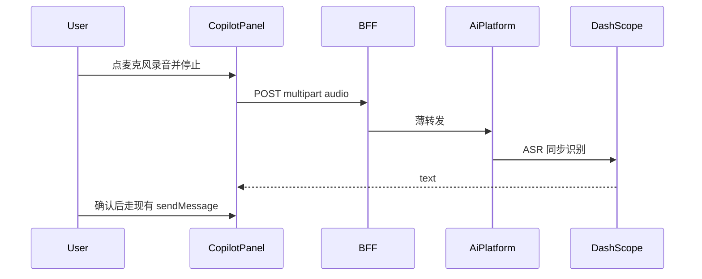

# Copilot 语音输入（云端转写）

> 状态：规划已定，实现跟本文。最后更新：2026-11-10  
> 入口：管理台 [`CopilotPanel`](../../../frontend/mis-admin-web/src/components/chat/CopilotPanel.tsx) 输入区麦克风  
> **不是** `agent/ai-platform-prd.md` P2-06（企业微信语音消息 + TTS 回复）。

## 1. 做什么

用户在 Copilot 点麦克风录音，停止后音频经 BFF 转到 ai-platform，用现有通义 Key 调 **qwen3-asr-flash**，文字写入输入框。用户可改再点发送。**不自动发送。**

不做：`AiChatPanel`、企微语音通道、TTS、把音频当对话附件、流式中间结果。

现有 `POST /agent-ops/files/upload` 白名单无音频，且会进会话 metadata。转写走独立短生命周期接口，音频用完即丢。

## 2. 交互

- 回形针左侧麦克风；录音中高亮 + 秒数；再点结束并转写；可取消。
- 生成中禁用麦克风。**http / https 都可点**，不以 `isSecureContext` 预判关掉。
- 失败（拒麦、空识别、超时、浏览器拦非安全源）在输入区短文案，不弹阻塞窗。
- 成功：拼到当前输入末尾（已有字则空格分隔）。

内网协议：

| 入口 | 麦克风 |
|------|--------|
| `http://IP` | Chrome 常禁麦；代码仍尝试；运维可把源加入 `unsafely-treat-insecure-origin-as-secure` |
| `https://IP`（证书已信任或用户点继续） | 安全上下文，一般可取麦；自签/IP 证书先出证书警告，与禁麦不是一事 |
| `https://域名` + 内网 CA | 最稳 |

产品不强制跳 https。

## 3. 链路

| 层 | 路径 |
|----|------|
| 前端 | `POST /api/v1/agent-ops/speech/transcribe`（字段 `file`） |
| BFF | 薄转发，权限 `agent:chat:use` |
| ai-platform | `POST /api/v1/speech/transcribe` |
| 厂家 | 现有 `QWEN_API_KEY` + 出口代理，模型默认 `qwen3-asr-flash` |

上限约 60 秒 / 2MB；MIME：`audio/webm`、`audio/ogg`、`audio/mp4`、`audio/wav`。空文本业务错误，非 500。日志记 userId、时长、模型、成败，不打音频内容。首期不扣 LLM token 配额。

配置：`SPEECH_ASR_MODEL`、`SPEECH_MAX_SECONDS`、`SPEECH_MAX_BYTES`。密钥仍用 `QWEN_API_KEY`。

Flyway 追加登记 BFF 路径（`sys_api` 绑 92032）。`deny-unmapped=true`，未登记即 403。

## 4. 验收

- 有对话权限可录音，文字进输入框，发送走原对话协议。
- 未映射 API / 无权限 → 403；超时长明确错误。
- 转写失败不发出空消息；历史里无音频附件。
- http 与 https 按钮均可点；取麦失败只提示。
