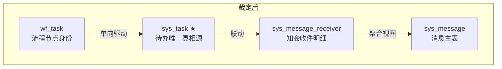

# 09 · 统一收件箱（消息 / 待办 / 已办）统一规划

> 版本：**v1.0-draft**（待评审）
> 日期：2026-10-09
> 基线：`06-workflow-architecture-final-design-v4.md`（唯一有效基线，v3 视为已废弃）
> 性质：**纯规划**。本文不含代码改动、不含提交。所有实现必须另开 ADR 与工单。
> 证据口径：本文所有「现状」结论均已在本机实测复核，标注 `文件:行号` 或 `Vx__*.sql:行号`。凡未标注证据者，一律视为**待核实假设**，不得作为动工依据。

---

## 0. 决策摘要（TL;DR）

| # | 结论 | 性质 |
|---|---|---|
| D1 | 用户说的"消息 / 通知 / 待办 / 已办"**不是四个功能，而是一个收件箱的四个筛选视图** | 认知层根因 |
| D2 | 当前**没有消息详情页**（`/messages/{id}` 无调用方），点击任意消息一律跳 `/task/pending` | 事实·`inbox-page.tsx:83-84` |
| D3 | 铃铛角标是**前端假算**（前 4 条待办 + 前 4 条消息，`slice(0,8)`），与真实未读数必然矛盾 | 事实·`header-toolkit.tsx:59,77,92` |
| D4 | 同一行的「同意」和「驳回」**走两套后端** | 事实·`task-list-page.tsx:90-93` |
| D5 | 待办处理后，关联消息状态**永不联动**（空方法） | 事实·`TaskService.java:206-208` |
| D6 | `sys_task` 与 `wf_task` 双表镜像，一个待办在库里有两条独立流转的记录 | 事实·`V120:61-83` / `V121:87-102` |
| D7 | 文档反复承诺的 **WebSocket 实时推送**，代码零落地 | 事实·`README.md:37` 承诺，grep 无 `WebSocket/SseEmitter/stomp` |
| D8 | 库里有**两套已读模型**（`sys_task.read_flag` 恒 false / `sys_message_receiver.read_flag` 有完整链路） | 事实·grep `setRead` 仅 2 处 `FALSE`，0 处 `TRUE` |

**统一规划的靶心一句话**：
> 把「四个各自为政的列表页」压成**一个收件箱页 + 一个摘要接口 + 一个动作出口 + 一个真相源**，让角标、详情、动作、已读在全局只有一种语义。

---

## 1. 现状诊断

### 1.1 能力盘点（实测）

**已具备的资产（不是废的，要继承）**

| 资产 | 位置 | 评价 |
|---|---|---|
| 消息中心 CRUD + 收件箱查询 + 批量已读 | `mis-taskflow` `MessageService.java` | ✅ 后端基本盘扎实 |
| 待办查询 / 处理 / 转办 / 批量处理 | `TaskService.java` | ✅ 能力齐全，前端未用满 |
| 已办查询（`GET /tasks/handled`） | `TaskController.java:55` + `V126`(95048) | ✅ **已落地**，但 `08-taskflow-tryout-guide.md:85-92` 的入口表里没有它 |
| 流程编排 + 图式流转 | `ProcessService.java` + `V124__wf_edge.sql` | ✅ 通用 |
| 未读统计 | `/messages/stats` | ✅ 唯一可信的未读源 |

**明确为空 / 预留未通电的坑位**

| 坑位 | 证据 | 影响 |
|---|---|---|
| `syncLinkedMessagesToHandled()` 空实现 | `TaskService.java:206-208` 仅注释 `// P3 简化` | 处理完待办，收件箱仍是未处理态 |
| `sys_task.read_flag` 死字段 | 全模块 0 处 `setRead(TRUE)` | 任务级"已读"从未存在过 |
| `TaskflowStatus.Task.EXPIRED/CANCELLED` 不可达 | 全仓零引用 | 状态机有 6 值，实际只出 3 值 |
| `SysMessageReceiver.status` 的 `HANDLED/IGNORED/ARCHIVED` | 仅常量声明，零写入 | 「已办 / 已忽略」数据层有坑位没通电 |
| `/messages/{id}` 详情接口 | `messages.ts:60` 无调用方 | **消息没有详情** ← 体验差的头号原因 |
| `/tasks/{id}/transfer`、`/tasks/batch-handle` | `tasks.ts:84,99` 无调用方 | 能力已备，UI 未开 |

### 1.2 乱点清单（按"用户感知强度"排序）

排序依据：**用户能不能一眼看出来**排前面，**数据一致性风险**排前面。

#### 🔴 P0-1 消息没有详情，点任何消息都被扔到待办页

- 证据：`inbox-page.tsx:83-84`（注释自认临时）、`message-board.tsx:70`
- 现状：菜单叫「消息与待办」，页面只显示消息，点任意条目 `navigate('/task/pending')`。
- 用户感知：**"点不动"**。这是"不顺滑"最直接的来源。

#### 🔴 P0-2 角标与真实未读数必然矛盾

- 证据：`header-toolkit.tsx:59`（`read: false` 硬编码给所有待办）、`:77`（`slice(0, 8)`）、`:92`（前端 filter 计数）
- 对照：`/messages/stats` 的真实 unread 只出现在 `inbox-page.tsx:59` 与 `workbench-overview.tsx:39`
- 后果：消息超 4 条时，铃铛显示「3」而收件箱显示「57」。用户**无法信任任何一处数字**，久而久之就不看角标了。
- 附加：标已读后铃铛不重算（`header-toolkit.tsx:87-90` 只在 `open` 时 reload）。

#### 🔴 P0-3 一行数据的两个按钮走两套后端

- 证据：`task-list-page.tsx:90-93` —— 有 `wfInstanceId` 且 action=`APPROVE` → 跳 `ProcessShell`（`POST /workflow/tasks/{id}/complete`）；action=`REJECT` → 走 `POST /tasks/{id}/handle`（`tasks.ts:68`）
- 后果：驳回后流程态可能未同步到任务记录，用户会看到"处理完了但待办还在"。
- 这不是 UI 问题，是**动作出口不唯一**的必然结果。

#### 🔴 P0-4 处理完成后消息不联动

- 证据：`TaskService.java:144` 调用 → `:206-208` 空实现
- 后果：角标不消、"消息和待办对不上"。数据层已存在的真实不一致。

#### 🟠 P1-1 "已办"有三个入口、两套数据源

| 入口 | 数据源 | 后端 |
|---|---|---|
| `/task/my-processed`（我审批的） | `fetchHandledTasks` → `/tasks/handled` | `sys_task` where status in (APPROVED, REJECTED) |
| `/task/my-sent`（我发起的） | `/workflow/instances/my` | `wf_instance` |
| `/agent/approvals`（Agent HITL 审批） | `listApprovals`（`agent-ops-api.ts:951`） | **Python ApprovalStore** |
| `/ai/approvals`（审批中心） | `listApprovals`（`services/approval.ts:102`） | 同上，**函数重复实现两份** |

- 用户感知：三者视觉几乎相同（单色徽标列表），边界说不清。
- 尤其后两者：同一个"审批"概念，两个运行时、两套状态、**无交叉查询入口**（`agent/ai-platform/backend/src/hitl/approval.py` 自建 store，与 `sys_task` 无同步）。

#### 🟠 P1-2 双表镜像，一个待办两条记录

- 证据：`sys_task`（`V120:61-83`）与 `wf_task`（`V121:87-102`）字段高度一一对应（assignee / task_type / status / due_date）；`ProcessService.java:347-375` 每节点插两行；`:184-191` 靠 try/catch 吞异常同步
- 风险：任一侧写失败 → 永久幽灵待办，**无对账任务**。

#### 🟠 P1-3 角标要发两次请求

- `/messages/stats` → `MessageStatsVO(unread,total)`（`MessageService.java:218-222`）
- `/tasks/stats` → `TaskStatsVO(pending,urgent,overdue)`（`TaskService.java:190-194`）
- 无聚合接口，BFF 也未聚合（`mis-admin-bff` 的 `MessageController/TaskController` 纯透传）

#### 🟡 P2-1 交互七页七写法

| 项 | 证据 | 分歧 |
|---|---|---|
| 重试按钮 | `my-processed-page.tsx:61` 有；`task-list-page.tsx:150`、`inbox-page.tsx:150`、`my-sent-page.tsx:59` 无 | 有无不一 |
| 空态 | `my-processed-page.tsx:66` 带图标；另三页纯文字 | 视觉不齐 |
| 列表行点击 | `inbox-page.tsx:156`、`my-sent-page.tsx:67` 整行可点；`task-list-page.tsx:160` 不可点 | 交互语义混乱 |
| 搜索防抖 | `inbox-page.tsx:65` 把 `keyword` 放进 `useCallback` 依赖 = 即输即查 | 违反 `admin-web-design.md:420-433` |
| 数据层 | taskflow/portal 全域 `useQuery` 出现 **0 次** | 违反 `admin-web-design.md:369` |
| toast | taskflow/portal grep 为空；`agent-approval-page.tsx:27` 用 sonner | 操作无反馈 |
| 未读点颜色 | `inbox-page.tsx:167` `bg-destructive`；`message-board.tsx:76` / `header-toolkit.tsx:180` `bg-primary` | 同语义不同色 |
| 加载态高度 | `h-40` 与 `h-28` 两种随机跳动 | 视觉抖动 |

#### 🟡 P2-2 分页 footer 逐字重复 4 处

`task-list-page.tsx:209-226`、`inbox-page.tsx:211-228`、`my-sent-page.tsx:99-111`、`my-processed-page.tsx:123-135`
根因：全站无 `Pagination` / `EmptyState` / `ListCard` 抽象。

#### 🟡 P2-3 同一段 JSON.parse 重复 3 处

`task-list-page.tsx:44-52`、`task-board.tsx:20-28`、`my-processed-page.tsx:82-86` —— 解析 `wfInstanceId`，逐字相同。

#### ⚪ P2-4 `tenantId='1'` 硬编码 7 处

`task-list-page.tsx:39`、`inbox-page.tsx:35`、`my-sent-page.tsx:19`、`my-processed-page.tsx:20`、`process-shell.tsx:24`、`header-toolkit.tsx:27`、`portal-page.tsx:34`
注释统一为「P3 网关身份透传后改为从登录态取」；`TaskflowIdentity.java:18,25` 兜底**默认租户 1**。多租户一开即串户。

### 1.3 根因归约

以上 15 条乱点，收敛到 **4 个根因**。不解决根因，逐条修只会再长出来：

| 根因 | 表现 | 治理手段 |
|---|---|---|
| **R1 没有唯一的收件箱实体** | 消息、待办、已办各自是独立列表，交互各写一套 | §3 统一模型 + §6 前端共享层 |
| **R2 计数没有唯一权威源** | 两个 stats 接口 + 一处前端假算 | §4.1 单一摘要接口 |
| **R3 动作与状态没有唯一出口** | 同意/驳回两条路；消息联动是空方法 | §4.3 统一动作出口 + §5 真相源裁定 |
| **R4 规范文档滞后于实现** | `admin-web-design.md` 仍是 `v1.1-draft`（`:3`），§3.2 路由表（`:95-105`）与 §5 页面规格（`:220-310`）**完全没有 taskflow/portal** | §6.2 本规划落为规范章节，先补规范再改码 |

> **R4 是元问题**。没有"标准交互定义"可对照，重构者会把既有的不一致当成规范继承下来。这一点必须在本规划阶段就解决。

### 1.4 诊断评分卡

| 维度 | 现状（1-5，5 为好） | 目标 |
|---|---|---|
| 概念清晰度（消息/通知/待办/已办边界） | 1 | 4 |
| 信息架构收敛度 | 2 | 5 |
| 计数可信度 | 1 | 5 |
| 动作一致性 | 2 | 5 |
| 反馈及时性（实时性） | 1 | 3 |
| 数据一致性 | 2 | 5 |
| 交互一致性 | 2 | 4 |
| 规范完备性 | 1 | 4 |
| **加权综合** | **1.5** | **4.4** |

---

## 2. 目标态

### 2.1 五条不可协商原则

1. **单一真相源（Single Source of Truth）**
   每一个数字、每一条记录、每一次动作，只有一个权威定义处。禁止任何"前端自己算一份"。

2. **单一动作出口**
   一个待办无论从列表、铃铛、门户卡片、Agent 会话哪个入口处理，走的都是同一个 `POST /tasks/{id}/handle`。前端不得判断"有没有 workflowId"来决定调用路径。

3. **统一模型优先于统一界面**
   先把「收件箱条目」定成一个后端可返回的统一结构，界面收敛是自然结果而非目标。反过来做会得到"整齐但不一致"的界面。

4. **已读（seen）与已处理（resolved）是两条正交轴**
   用户"看过"不等于"处理了"。当前把两者混为一谈，是消息联动空实现的根因。两条轴必须分字段、分语义、分徽标。

5. **零新增概念优先**
   本规划不引入"通知中心""提醒中心"等新名词。若某能力无法归入「收件箱 + 流程实例 + 摘要」三类，宁可不做。

### 2.2 术语表（消除"消息/通知"混用）

当前代码里 `msg_type` 出现 `SYSTEM/REMIND/TASK`，`category`、`reference_task_id`、`priority`、`read_count` 等字段语义重叠，术语没统一是"乱"的深层原因。

| 术语 | 定义 | 覆盖旧称 |
|---|---|---|
| **收件箱条目 Inbox Item** | 一条待用户处理或知会的内容，统一结构 | 「消息」「通知」「待办」在列表层的合并呈现 |
| **待办 Task** | 需要用户**做动作**的条目（`kind=TASK`） | 待办、代办、任务 |
| **知会 Notice** | 只需用户**知晓**的条目（`kind=NOTICE`） | 通知、提醒、消息、告警 |
| **已读 Seen** | 用户看过。字段 `seen`。 | `read_flag`（消息侧）、`read`（前端） |
| **已处理 Resolved** | 用户做了动作或显式忽略。字段 `resolved` + `resolve_action`。 | `sys_message_receiver.status`、`sys_task.status` |
| **摘要 Summary** | 顶部条 / 铃铛所需的全部计数，一次返回 | `unread`、`pending`、`stats` |

> **`read_flag` 一律改称 `seen`**：中文"已读"容易被理解成"已处理"，这是 P0-4 的语义病根。

### 2.3 统一收件箱模型（后端可返回）

```mermaid
classDiagram
    class InboxItem {
      +String itemId          幂等键 (msg:{id} / task:{id})
      +InboxKind kind         TASK | NOTICE
      +InboxStatus status     状态机收敛后的单一集合
      +Boolean seen           看过
      +Boolean resolved       处理了
      +String resolveAction   APPROVE|REJECT|COMPLETE|IGNORE|ACK
      +String title
      +String summary
      +Priority priority      HIGH|NORMAL|LOW
      +LocalDateTime dueAt    截止
      +LocalDateTime createdAt
      +RefType refType        TASK|WORKFLOW_INSTANCE|ORDER|NONE
      +String refId
      +String linkTarget      详情路由（由后端给，前端不猜）
    }
    InboxItem --> Task "kind=TASK"
    InboxItem --> Notice "kind=NOTICE"
```

**关键设计点**：`linkTarget` 由**后端**下发。前端不再有 `navigate('/task/pending')` 这种硬编码猜测（消灭 P0-1）。

---

## 3. 信息架构重构

### 3.1 三入口收敛

```mermaid
flowchart LR
    subgraph 现在 "现在：4 个平行入口"
        A1[铃铛<br/>前端假算] --> B1
        A2[侧栏 工作台<br/>4 个菜单项] --> B1[我的待办<br/>/task/pending]
        A2 --> B2[消息与待办<br/>/task/inbox]
        A2 --> B3[我发起的<br/>/task/my-sent]
        A2 --> B4[我审批的<br/>/task/my-processed]
    end

    subgraph 之后 "之后：1 主 + 1 辅 + 1 铃铛"
        C1[铃铛<br/>唯一摘要接口] --> D[统一收件箱<br/>/inbox]
        C2[侧栏 工作台<br/>2 个菜单项] --> D
        C2 --> E[流程实例<br/>/instances]
        D --> F[Tab: 待办/知会/已办/全部]
        E --> G[我发起的 · 流程视图]
    end
```

| 原入口 | 处置 | 去向 |
|---|---|---|
| `/task/pending`（我的待办） | 降级为 Tab | `/inbox?kind=TASK&view=open` |
| `/task/inbox`（消息与待办） | **升级为主页面** | `/inbox` |
| `/task/my-processed`（我审批的） | 降级为 Tab | `/inbox?view=resolved` |
| `/task/my-sent`（我发起的） | **保留独立** | `/instances`（流程实例视图，语义确实不同：发起者视角而非处理者视角） |
| `/agent/approvals`、`/ai/approvals` | 决策见 §7-P3 | 短期在收件箱内以 `kind=TASK` 呈现，加「来源」标识；长期是否合流另开 ADR |

> **为什么不把「我发起的」也砍进收件箱？** 因为收件箱是"要我做事"，我发起的流程是"我造的事"（等人/看进度），两者信息结构不同（前者按待办状态切 Tab，后者按流程生命周期）。硬合会让两个场景都变难用。这是本规划**唯一保留**的第二个页面。

### 3.2 收件箱页面结构

```
┌─────────────────────────────────────────────────────────────┐
│ 收件箱          [🔍 搜索：标题/摘要/正文 ]     [⚙ 全部已读]   │
├─────────────────────────────────────────────────────────────┤
│ ●待办 12   ○知会 5   ○已办 38   ○全部 55                     │  ← 4 Tab，计数来自 Summary
├─────────────────────────────────────────────────────────────┤
│ ┌───────────────────────────────────────────────────────┐  │
│ │ ● [采购审批]  请审批采购单 PO-2026-0913      ⏰ 剩2天 │  │  ← 整行可点，左侧未读点
│ │   采购部 · 张三 提出 · 09-05                          │  │
│ │                        [同意] [驳回] [转办]             │  │  ← 统一动作出口（就地）
│ └───────────────────────────────────────────────────────┘  │
│ ┌───────────────────────────────────────────────────────┐  │
│ │ ○ [系统] 您的账号将于 7 天后到期              09-04    │  │  ← 整行可点 → 右侧抽屉详情
│ └───────────────────────────────────────────────────────┘  │
└─────────────────────────────────────────────────────────────┘
        [← 上一页]        第 1/6 页 · 共 55 条        [下一页 →]
```

**统一规则（写进规范）**

| 规则 | 内容 |
|---|---|
| R-1 行点击 | **整行可点**，打开右侧详情抽屉。行内按钮仅放**高频动作**（≤3 个）。禁止"整行不可点只能点按钮"。 |
| R-2 动作就地 | 待办 Tab 内提供「同意/驳回/转办」就地操作，不必进详情。驳回需理由弹窗。 |
| R-3 详情抽屉 | 统一右侧抽屉，宽 480px，展示完整正文 + 上下文 + 全部动作。**这是当前完全缺失的能力（P0-1）**。 |
| R-4 已读/已处理 | 两个独立徽标：`●` = 未读；`✓` = 已处理。tooltip 明说"已读/已处理"。 |
| R-5 空态 | 4 个 Tab 全部使用统一 `EmptyState`，必须带图标 + 一句原因 + 一个动作按钮。 |
| R-6 加载态 | 统一骨架屏，行高固定，**禁止高度跳动**。 |
| R-7 分页 | 统一 `Pagination` 组件，位置固定在底部。 |
| R-8 搜索 | 300ms 防抖 + 关键词高亮 + 可清空。 |
| R-9 操作反馈 | 所有写操作走 sonner toast（success/error），不设内联错误块。 |
| R-10 未读点色 | 全局统一 `bg-primary`，**禁止**用 `destructive` 表示未读（红色=错误）。 |

### 3.3 角标语义

| 位置 | 显示 | 数据源 |
|---|---|---|
| 顶栏铃铛 | **一个数字** = 待我处理（Task 未 resolve）+ 未读知会，加权去重 | `GET /inbox/summary` |
| 悬停/点击铃铛 | 分组下拉：待办 N / 未读知会 N / 逾期 N | 同上 |
| 侧栏「收件箱」 | 徽标 = 待我处理总数 | 同上 |
| Tab | 各 Tab 计数 | 同上 |

**规则：全局只允许一个接口、一个数字体系。** 任何页面不得自行发起 stats 计算。

---

## 4. 契约规范（规划目标，非实现）

> 本章是**契约草案**。动工前须落 ADR-022 固化。

### 4.1 统一摘要接口（消灭 R2）

```
GET /api/v1/inbox/summary
→ { pending, overdue, urgent, unreadNotice, resolvedToday, lastSeenAt }
```

- 后端聚合，一次返回，前端**零计算**。
- 铃铛数字 = `pending + unreadNotice`
- 废止前端 `items.filter(!read).length`（`header-toolkit.tsx:92`）
- `/messages/stats` 与 `/tasks/stats` 保留但降级为内部实现，**不再对外暴露**

### 4.2 统一列表接口（消灭 R1）

```
GET /api/v1/inbox?view=open|resolved&kind=TASK|NOTICE|ALL
    &keyword=&cursor=&limit=&sort=
→ { items: InboxItem[], nextCursor, total, summary }
```

- `view` 与 `kind` 两个维度即可表达现有 4 个页面的全部组合
- **响应内嵌 `summary`**，消除"翻页后角标变了"的割裂
- `sort` 白名单：`created_at` / `due_at` / `priority`
- `cursor` 而非 offset（待办表会持续增长，offset 在深翻页时漂移）

### 4.3 统一动作出口（消灭 R3 + P0-3）

```
POST /api/v1/tasks/{id}/handle
{ action: APPROVE | REJECT | COMPLETE | IGNORE | TRANSFER, comment, targetUserId? }
```

- **删掉前端 `wfInstanceId` 判断分支**（`task-list-page.tsx:90-93`）
- 后端在同一事务内完成：`sys_task` 状态流转 → `wf_task` 同步 → **关联消息/知会置 resolved**
- 这条同时消灭 P0-4（空方法）
- `POST /workflow/tasks/{id}/complete` 降级为内部方法或废弃（需 §5 裁定）

### 4.4 实时性

| 阶段 | 方案 | 理由 |
|---|---|---|
| P1 | 30s 轮询 `summary`（仅登录态 + `document.visibilityState==='visible'` 时） + 页面聚焦即刷 | 低成本，立刻消除"角标不更新"的抱怨 |
| P2 | SSE（`/api/v1/inbox/stream`）单向推送 | 单向场景不需要 WebSocket 复杂度 |
| — | **WebSocket 不做** | 文档曾反复承诺（`README.md:37`、`01-...md:52,405-414,550`）但零落地；双向需求（Agent 会话）已有独立 SSE 通道（`src/lib/chat/sse-client.ts`）。**建议在 ADR 中显式判死 WebSocket 方案，防止下一轮又翻出来。** |

---

## 5. 数据模型收敛

### 5.1 真相源裁定（关键决策）



| 裁定 | 内容 |
|---|---|
| **真值源** | `sys_task` 是待办的**唯一真相源**。前端、统计、工作流判断全部只读它。 |
| **降级** | `wf_task` 降为流程引擎的**节点身份表**，只保留 `instance_id / node_code / sys_task_id`。**禁止独立流转 status**，状态一律由 `sys_task` 单向驱动。 |
| **收益** | 消灭"幽灵待办"（P1-2 双表镜像）。当前 `ProcessService.java:184-191` 靠 try/catch 吞异常同步的写法可以删除。 |
| **知会** | `sys_message_receiver` 是知会收件状态的唯一真相源。`sys_message.read_count` / `total_count` **删除**（当前三处口径不一致：`MessageService.java:85` publish 初值 0、`:203-209` 全量重算、`:218-222` 统计又无视它）。 |
| **通知权限** | `V127` 已明确「个人事务 permission 置 NULL，登录即可」，这是**正确的设计修正**。但 `sys_api` 里 95020-95029 仍全量登记 → 排障看权限码会得到误导结论。建议在文档中加一句显式说明，避免后人误判。 |

### 5.2 已读 / 已处理正交化（消灭 P0-4 根因）

| | 字段 | 语义 | 置位时机 |
|---|---|---|---|
| 消息侧 | `seen` (rename `read_flag`) | 看过 | 打开详情抽屉 |
| 消息侧 | `resolved` + `resolve_action` | 认可/忽略/已由待办处理 | 显式 ACK，或被 §4.3 联动 |
| 任务侧 | `seen` (rename `read_flag`) | 看过 | **需要真实写入**（当前 0 处 `setRead(TRUE)`） |
| 任务侧 | `status` | 处理态 | 已有 |

> 迁移必须走 **Flyway 只追加**：新增迁移文件，**禁止改动 V120/V121**（checksum 变更会阻塞整条迁移链）。改名用 `ALTER TABLE ... RENAME COLUMN` 写在**新文件**里，并对存量数据回填。

### 5.3 状态机收敛

| 当前 | 问题 | 目标 |
|---|---|---|
| `TaskflowStatus.Task` 6 值，`APPROVING` 仅在 `:244` 判断、`EXPIRED/CANCELLED` 零引用 | 枚举定义了但不可达，前端按 6 种展示 | 收敛为 4 态：`PENDING` / `APPROVED` / `REJECTED` / `CLOSED`(吸收 EXPIRED/CANCELLED)。**废弃值必须显式映射，不留悬空数据。** |
| `SysMessageReceiver.status` 4 值，3 值零写入 | 同上 | 收敛为 `ACTIVE` / `RESOLVED` / `IGNORED` |

### 5.4 迁移策略

| 迁移 | 内容 | 幂等要求 |
|---|---|---|
| `V128` | 新增 `inbox_item_view` 或统一查询服务底座 | `IF NOT EXISTS` |
| `V129` | `read_flag` → `seen`；新增 `resolved` / `resolve_action`；存量回填 | `ADD COLUMN IF NOT EXISTS` + `UPDATE ... WHERE` |
| `V130` | 删冗余 `sys_message.read_count/total_count` 前先建视图替代 | 需先验证视图可用 |
| `V131` | `wf_task.status` 降级（停止独立写入），加约束注释 | 只加不删，保留回滚余地 |

> 参照项目既有做法（`V120`–`V127` 均为固定 ID + `IF NOT EXISTS` + `NOT EXISTS` + `ON CONFLICT DO NOTHING`），新迁移必须保持**可重复执行**。

---

## 6. 前端收敛

### 6.1 共享层（先建抽象，再迁移页面）

| 组件/Hook | 消除的重复 |
|---|---|
| `EmptyState` | 7 处手写 loading/error/empty 块 |
| `Pagination` | 4 处逐字重复的 footer |
| `UnreadDot` | 3 处 + 2 种颜色 |
| `PriorityBadge` / `StatusBadge` | 2 处逐字重复的优先级映射（`task-list-page.tsx:24-29` / `task-board.tsx:12-17`） |
| `parseWfInstanceId()` | 3 处重复的 `JSON.parse`（`task-list-page.tsx:44-52` 等） |
| `useInboxQuery()` / `useInboxSummary()` | 6 处独立拉取逻辑（`/tasks/my` ×3、`/messages/inbox` ×3），参数各不相同 |
| `useDebouncedValue()` | `inbox-page.tsx:65` 的即输即查 |

**数据层切换**：taskflow/portal 全域 `useQuery/useMutation` 出现 0 次，违反 `admin-web-design.md:369`。切换后自动获得缓存、失效重取、乐观更新，消除 P2-1 中的多条。

### 6.2 规范先行（R4）

在动任何代码前，先把 §3.2 的 R-1~R-10 写入 `docs/frontend/admin-web-design.md`，升级版本号（当前 `v1.1-draft`，`:3`），并补齐 §3.2 路由表与 §5 页面规格中缺失的收件箱章节。

**理由**：本次重构涉及 7 个页面，如果没有先写死的规范，两个执行者会做出两套不一致的东西。

### 6.3 文档债清理

| 项 | 处置 | 理由 |
|---|---|---|
| `06-workflow-architecture-final-design.md`（v3） | 标记 **DEPRECATED** 或删除 | 与 v4 同名并存；README 只索引 v4（`README.md:17`）；v3 主张的 `sys_biz_reference` 已被 `V120:8` 注释明确去掉 |
| `001-message-task-design.md` | 删除或合并进 `01-` | README 未索引，内容为早期精简版 |
| `README.md:127-129` 的 `mis-notification` 模块名 | 更正为 `mis-taskflow` | 该模块不存在 |
| `README.md:129` 的 `sys_biz_reference` | 删除 | `V120:8` 注释已声明废弃 |
| `README.md:37`、`01-...md:52,405-414,550` 的 WebSocket 承诺 | 按 §4.4 更正为轮询→SSE | 避免下轮又翻出来 |
| `08-taskflow-tryout-guide.md:40` "最新版本为 123" | 更新为 V127 | 漏登记 V124-V127 |
| `08-...md:85-92` 入口表 | 补 `/task/my-processed` | 已落地但未登记 |

---

## 7. 分期路线

每期**独立可交付、可回滚**，且每期结束须跑通门禁（前端 `npm run test` / `npm run typecheck`；Java `mvn.ps1 -pl mis-taskflow test`）。

### P0 · 止血（不依赖新接口，1 个迭代内可完成）

| # | 动作 | 消灭 | 验收 |
|---|---|---|---|
| P0-1 | 接通 `syncLinkedMessagesToHandled()` | P0-4 | 处理待办后，关联知会 `status` 变为已处理，`/messages/stats.unread` 相应下降 |
| P0-2 | 铃铛改用 `/messages/stats` + `/tasks/stats` 真实值，去掉前端聚合 | P0-2 | 消息 57 条时铃铛与收件箱 Tab 计数**完全一致** |
| P0-3 | 前端删掉 `wfInstanceId` 判断分支，同意/驳回统一走 `/tasks/{id}/handle` | P0-3 | 同一行两个按钮产生**同一种**后端语义 |
| P0-4 | 消息行点击改为打开**右侧详情抽屉**（即使内容仅摘要） | P0-1 | 点任意消息不再跳到待办页 |

> P0 全程**不新增表、不改迁移、不动契约**，纯逻辑修复。风险最低，收益最直接。

### P1 · 收敛（新增契约，2–3 个迭代）

| # | 动作 | 消灭 |
|---|---|---|
| P1-1 | 建 `GET /inbox/summary` 聚合接口 + `GET /inbox` 列表接口 | P1-3、R2 |
| P1-2 | 前端建共享层 7 个组件/hook，切 TanStack Query | P2-1、P2-2 |
| P1-3 | 30s 可见性感知轮询 summary | P-实时 |
| P1-4 | 规范写入 `admin-web-design.md`（R-1~R-10） | R4 |
| P1-5 | 清理 6.3 文档债 | 认知污染 |
| P1-6 | `tenantId` 从登录态取，删除 7 处硬编码 | P2-4 |

### P2 · 统一（结构收敛，2–3 个迭代）

| # | 动作 | 消灭 |
|---|---|---|
| P2-1 | `/inbox` 上线，4 Tab；旧 4 页 301 到新路由并保留重定向 | R1 |
| P2-2 | 统一动作出口落库事务内联动 | P0-3、P0-4 根治 |
| P2-3 | `wf_task` 降级为节点身份表 | P1-2 |
| P2-4 | 状态机收敛至 4 态 + 知会 3 态 | 不可达状态 |
| P2-5 | 迁移 `V128`–`V131` | 数据模型收敛 |

### P3 · 扩展（需 ADR，逐项独立决策）

| # | 动作 | 说明 |
|---|---|---|
| P3-1 | SSE 推送 | 替代 WebSocket 承诺 |
| P3-2 | 外部渠道（企微 / 邮件 / 短信） | 当前**零规划零代码**：`mis-taskflow` 无任何 Channel/SMS/Email 抽象。需先出 ADR 再动工 |
| P3-3 | Agent HITL 审批是否并入收件箱 | 需裁决 `hitl/approval.py` 自建 store 与 `sys_task` 的关系 |

---

## 8. 验收与度量

### 8.1 每期必跑门禁

| 类型 | 命令 |
|---|---|
| 前端测试 | `npm run test` |
| 前端类型 | `npm run typecheck` |
| Java 测试 | `mvn.ps1 -pl mis-taskflow test`（本机需 `-Dsurefire.forkCount=0`） |
| 迁移幂等 | 对测试库**重复执行** `flyway:migrate` 两次，均应成功 |

### 8.2 规划本身的验收标准

统一规划**做完了**的判定条件（不是代码做完了）：

1. §5 的 5 项裁定全部落成 ADR，无悬空决策
2. §3.2 的 R-1~R-10 已写入前端规范
3. 6.3 的 7 项文档债全部清理，`README.md` 不再出现不存在的模块名/表名
4. WebSocket 方案被显式判死（ADR 记录），不再出现在任何"规划中"文档
5. 三个里程碑的**范围**和**验收标准**被排期方认可

### 8.3 效果度量（代码完成后的观测指标）

| 指标 | 现状基线 | 目标 |
|---|---|---|
| 铃铛数字与真实未读数一致性 | 必然不一致（P0-2） | 100% 一致 |
| 消息可点击率（点开看到正文） | 0%（P0-1） | 100% |
| 角标延迟 | 需手动刷新 | ≤30s |
| 待办处理后角标残留 | 100%（P0-4） | 0 |
| 收件箱页面数 | 4 平行页 | 1 主 + 1 辅 |

---

## 9. 风险登记

| # | 风险 | 等级 | 缓解 |
|---|---|---|---|
| R-1 | 契约改动波及 BFF + 网关 + 门户三处 | 高 | P1 契约先行，ADR 评审后再动工；`linkTarget` 由后端下发可降低前端改动面 |
| R-2 | `wf_task` 降级影响流程引擎 | 高 | 先补对账任务（读 `wf_task` 无对应 `sys_task` 的记录并告警），**观察一个迭代无告警再降级** |
| R-3 | `read_flag` 改名触碰存量数据 | 中 | Flyway 只追加，新文件里 `RENAME COLUMN` + 存量回填；本地测试库重复执行验证幂等 |
| R-4 | 多租户身份收紧（`tenantId`）涉及 BFF 鉴权链 | 中 | 参照 `TaskflowIdentity.java:18,25` 现有兜底逻辑改造，需与网关 `LoginUser` 透传一并做 |
| R-5 | 两套审批（Java / Python）强行合流引入语义混乱 | 中 | P3 单独决策，不在本次范围 |
| R-6 | 规范先行导致工期拉长，团队绕过规范直接改码 | 中 | 把 R-1~R-10 做进 lint / 组件默认行为，让遵守比违反更省事 |

---

## 10. 明确不做（Out of Scope）

| 项 | 理由 |
|---|---|
| 新增"通知中心 / 提醒中心"等新概念 | 违反原则 5。乱的原因不是概念少，是概念多 |
| WebSocket 双向通道 | §4.4 判死，SSE 足够 |
| 外部渠道（企微/邮件/短信）实现 | 需先出 ADR。`01-...md:473` 仅一句占位；`mis-taskflow` 无任何 Channel 抽象 |
| Agent HITL 审批合流 | 跨运行时状态机合并，需独立 ADR |
| 删除 `wf_task` | 只降级不删，保留流程引擎身份与回滚余地 |
| 改写 Flyway 历史迁移 | 违反项目铁律（checksum 变更阻塞整条链） |
| "我发起的" 合并进收件箱 | §3.1 已说明：发起者视角 vs 处理者视角信息结构不同 |

---

## 附录 A · 证据索引

本规划所有现状结论的实测出处，便于复核：

| 结论 | 出处 |
|---|---|
| 消息无详情、点击跳待办 | `frontend/mis-admin-web/src/features/taskflow/inbox-page.tsx:83-84` |
| 铃铛前端假算 | `frontend/mis-admin-web/src/components/layout/header-toolkit.tsx:59,77,92` |
| 同意/驳回分叉 | `frontend/mis-admin-web/src/features/taskflow/task-list-page.tsx:90-93` |
| 未读点双色 | `inbox-page.tsx:167` / `message-board.tsx:76` / `header-toolkit.tsx:180` |
| 无防抖 | `inbox-page.tsx:65` |
| 分页重复 4 处 | `task-list-page.tsx:209-226` / `inbox-page.tsx:211-228` / `my-sent-page.tsx:99-111` / `my-processed-page.tsx:123-135` |
| tenantId 硬编码 7 处 | `task-list-page.tsx:39` 等（见 §1.2 P2-4） |
| `syncLinkedMessagesToHandled` 空实现 | `backend/mis-taskflow/.../service/TaskService.java:206-208`（`:144` 调用） |
| `sys_task.read_flag` 死字段 | 全模块 `setRead` 仅 `TaskService.java:70,159` 两处 `FALSE`，0 处 `TRUE` |
| 双 stats 接口无聚合 | `MessageService.java:218-222` / `TaskService.java:190-194` |
| 状态机不可达值 | `TaskflowStatus.Task` vs `TaskService.java:244` |
| 双表镜像 | `V120__*.sql:61-83` / `V121__*.sql:87-102`；`ProcessService.java:347-375,184-191` |
| 权限码被抹平 | `V127__*.sql:16-18`（permission 置 NULL）+ `:26-36`（全角色授权） |
| 身份兜底默认租户 1 | `mis-admin-bff/.../support/TaskflowIdentity.java:18,25` |
| WebSocket 承诺 | `docs/architecture/msg-log-workflow/README.md:37`、`01-message-task-design.md:52,405-414,550` |
| 模块/表名文档失真 | `README.md:127-129`（`mis-notification`、`sys_biz_reference`）vs `V120__*.sql:8` |
| v3/v4 同名并存 | `06-workflow-architecture-final-design.md`（v3.0）vs `...-v4.md`（v4.0）；`README.md:17` 只索引 v4 |
| 迁移登记滞后 | `08-taskflow-tryout-guide.md:40`（写 123，实际 V127） |
| 规范滞后 | `docs/frontend/admin-web-design.md:3`（v1.1-draft）、`:95-105`、`:220-310` |
| Python 侧独立审批 | `agent/ai-platform/backend/src/hitl/approval.py`、`src/push/wecom_pusher.py` |

## 附录 B · 术语对照速查

| 旧说法 | 新术语 | 位置 |
|---|---|---|
| 消息中心 | 知会 Notice / 收件箱 | 列表层统一为「收件箱」 |
| 通知 | 知会 Notice | `kind=NOTICE` |
| 提醒 REMIND | 知会 Notice | `msg_type=REMIND` 归入 |
| 待办 / 代办 | 待办 Task | `kind=TASK` |
| 已读 / read_flag | 已读 Seen | `seen` |
| 未读数 | 未读 + 待处理 | `summary.unreadNotice` / `summary.pending` |
| 我审批的 | 已办 Resolved | `view=resolved` |
| 我发起的 | 流程实例 | `/instances`（独立保留） |