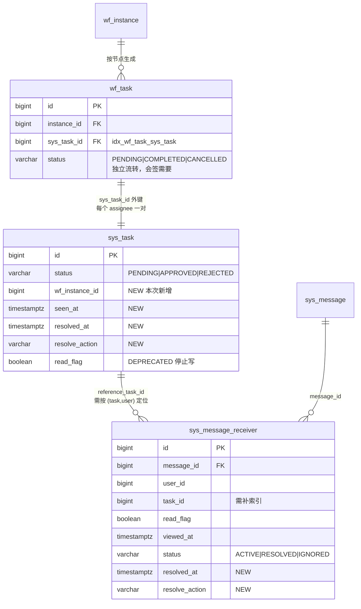
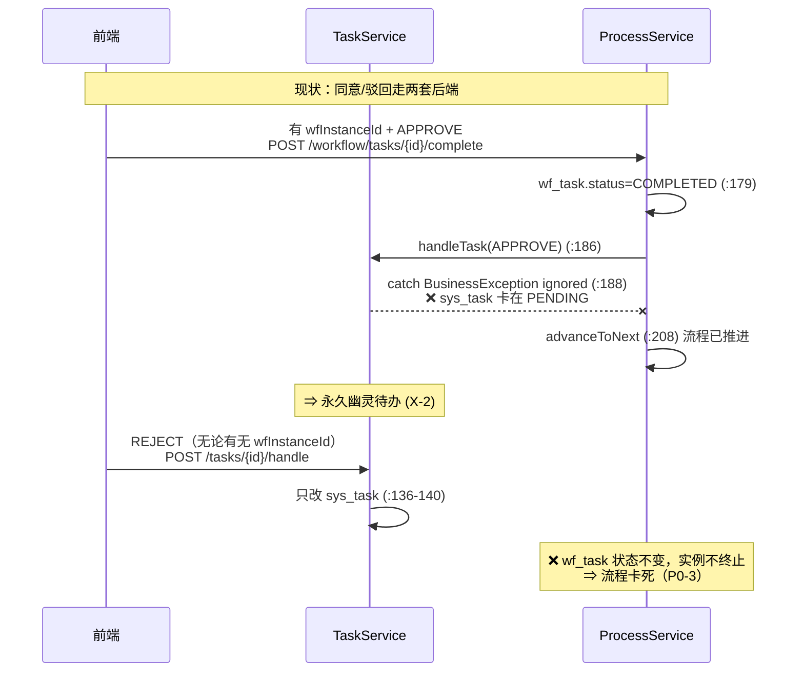
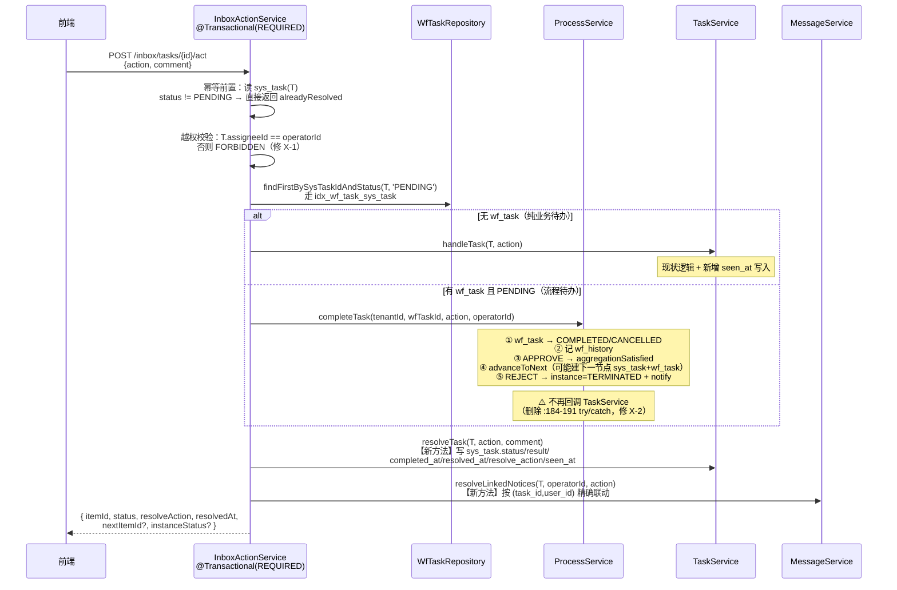
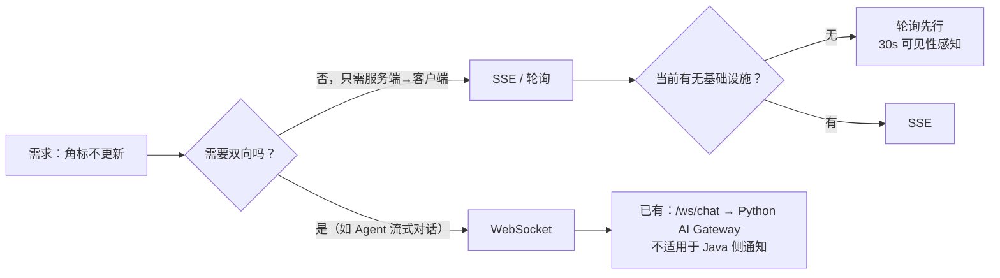
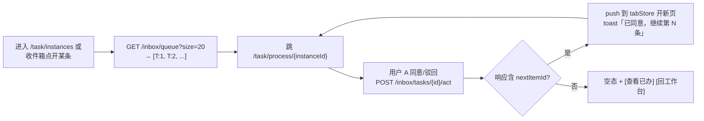
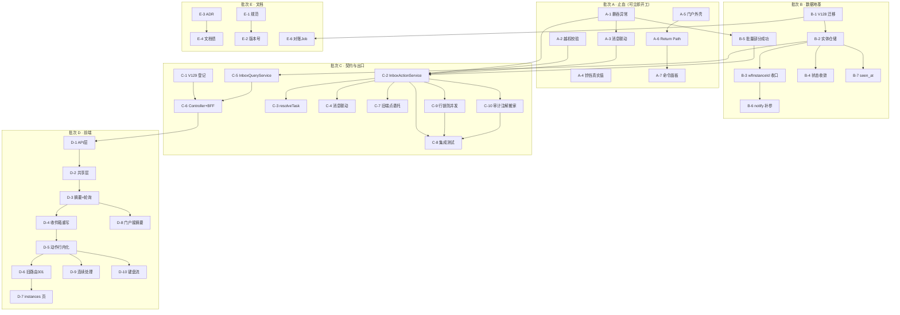

# 12 · 统一收件箱完整设计（消息 / 知会 / 待办 / 已办）

> 版本：**v1.1**（v1.0 + 交叉核对 `11-verification-report.md` O-3/O-4 后修订 R-16/R-17）
> 日期：2026-10-09
> 基线：现状由team-lead 本轮实测（18 项）+ 本人源码复核确认，标注 `文件:行号` / `Vx__*.sql:行号`
> 前序：`09-unified-inbox-plan.md`（v1.0-draft）—— **本文在5 处推翻其裁定**，理由见 §1.2
> 交叉引用：`11-verification-report.md`（现状核实，O-1~O-10）、`13-test-strategy.md`（测试策略）
> 性质：**设计**。含接口签名、类名、字段名与迁移列清单；**不含实现代码**
>
> **v1.1 修订摘要**（与 `11-verification-report.md` 交叉核对后追加，均为**原设计的实质缺陷**）：
> - **R-16** 遗漏真并发。实测 `@Version`/`@Lock` 全模块零命中，`handleTask` 无锁 ⇒ 两人同时点同一待办会双写；`transfer` 与 `act` 竞态会产生「已办但 assignee 是新人 + 新人收到待办提醒」的用户可见矛盾。**裁定：门面事务内 `PESSIMISTIC_WRITE` 行锁**（不用 `@Version`，不用 `DistributedLockService`——后者 `POLL_TIMEOUT=60s` 对交互式动作不可接受）
> - **R-17** 遗漏审计，且照搬会引入更糟缺陷。实测 `@BusinessOperation` 全后端仅 `TaskService.java:116` 一处 ⇒ **详情页点「同意」的实际落点无审计**。若注解同时挂门面与 `handleTask`，内层切面 `finally{AuditContext.clear();}`（`BusinessOperationAspect.java:49`）会冲掉外层 before/after ⇒ **双记 + 空 diff**。**裁定：注解只挂门面并从 `handleTask` 移除**
> - 相应新增任务 **C-9 / C-10**，验收断言从 5 条增至 7 条

---

## 0. 决策摘要

| # | 裁定 | 性质 |
|---|---|---|
| **A1** | 「乱」的根本原因：**"待办"在代码里没有实体，被拆成 `sys_task.status` / `wf_task.status` / `sys_message_receiver.status` 三个互不同步的字段，每个 UI 各取一个当真相** | 认知层根因 |
| **A2** | 动作出口 =新增 **`InboxActionService`** 作为唯一门面，**流程引擎在上、TaskService 在下**，共用一个物理事务。**禁止让 `TaskService` 反向注入 `ProcessService`**（循环依赖，Boot 3.2.5 启动即失败） | P0-3 解法 |
| **A3** | `wf_task` **不降级**为"身份表"。它与 `sys_task` **不是镜像，是"流程域待办"与"通用待办"两个不同实体**（0..1 : 1）。原规划此裁定会破坏会签 | 推翻原规划 §5.1 |
| **A4** | seen / resolved 正交，**seen 从布尔升为时间戳 `seen_at`**；**不改列名**（`read_flag` 保留兼容读），`resolved_at` + `resolve_action` 新增 |数据模型 |
| **A5** | IA 收敛为 **2 页 + 1 铃铛**：`/task/inbox`（待办/知会/已办）+ `/task/instances`（我发起的流程）。**明确反对**把 Agent/AI 审批合流进来 | 信息架构 |
| **A6** | 实时性：**30s 可见性感知轮询 → SSE**，**WebSocket 显式判死** | 决策 |
| **A7** | 连续处理队列由**后端出**（`GET /inbox/queue`），绝从前端列表派生（门户只取 5 条，派生必空） | 交互 |
| **A8** | 迁移只需**2 个新文件**（V128 索引+列，V129 sys_api 登记），全部幂等 | 落地 |
| **A9** | 并发与审计是**动作出口收口的隐含前提**，不是附加项：无行锁则「单一出口」仍会双写，无审计则「单一出口」仍查不到动作 | v1.1 修订 |

**本文额外挖出、原规划 743 行完全未提的 3 个问题**（严重度高于原规划 P0-1/2/3/4）：

| # | 问题 | 证据 | 严重度 |
|---|---|---|---|
| **X-1** | **`handleTask` 无越权校验 —— 任何人可处理任何人的待办** | `TaskService.java:119-145` 全程**未使用** `operatorId` 参数；`requireTask:197-204` 只校验 tenant。对比 `ProcessService.java:148` **有** `operatorId != assigneeId` 校验 |🔴 **安全漏洞** |
| **X-2** | **`ProcessService:184-191` 用 try/catch 吞掉 `handleTask` 异常** → 流程推进成功但 `sys_task` 停在 PENDING，**制造永久幽灵待办**（这正是原规划 P1-2 描述的现象，但根因在此处代码，不在"缺对账"） | `ProcessService.java:185-190` `catch (BusinessException ignored)` | 🔴 高 |
| **X-3** | **`batchHandle` 单事务无部分成功语义**：任一条抛异常 → 全部回滚，前端只能整体报错，无法"成功 3 条失败 2 条" | `TaskService.java:177-184` 单 `@Transactional` 内循环 | 🟡 中 |

---

## 1. 现状判断

### 1.1 原规划对的部分（保留）

| 原规划结论 | 评价 |
|---|---|
| D2 消息没有详情 | ✅ 正确。`/messages/{id}`（`MessageService.java:157`）能力完整但零调用方，是投入产出比最高的改造点 |
| D3 铃铛前端假算 | ✅ 正确。`header-toolkit.tsx:59`（`read:false` 硬编码）+ `:77`（`slice(0,8)`）+ `:92`（前端 filter）三重叠加 |
| D6 双表镜像 | ✅ 现象正确（但**因果解释错**，见 E1） |
| D8 两套已读模型 | ✅ 正确。`sys_task.read_flag` 全模块 0 处 `setRead(TRUE)`（只有 `TaskService.java:70,159` 两处 FALSE） |
| D9 门户是布局孤岛 | ✅ 正确且解法正确（`host-apps.ts:57` 确实已预留 `pathname === '/portal' → return 'task'`），属补完既定设计 |
| §11 连续处理闭环独立成章 | ✅ 判断正确。这是与数据一致性正交的体感问题，且原规划正确识别了 `process-shell.tsx:74` / `task-list-page.tsx:97` 只`await load()` |
| §4.4 判死 WebSocket | ✅ 正确。`README.md:37` 与 `01-*.md:52,405-414,550` 反复承诺，代码零落地 |
| P0 不新增表不改迁移 | ✅ 正确的风险控制 |

### 1.2 原规划错的 5 处（本文推翻）

#### E1 🔴 「`sys_task` 是唯一真相源，`wf_task` 降级为节点身份表，禁止独立流转 status」——**方向反了，且会破坏会签**

原文 `09-*.md:378`：「`wf_task` 降级为流程引擎的**节点身份表**……**禁止独立流转 status**，状态一律由 `sys_task` 单向驱动」。

**三条反证：**

1. **会签/或签判定完全依赖 `wf_task.status`。** `ProcessService.aggregationSatisfied:222-244` 用 `countPendingByNode` 与 `countCompletedByNode` 两个聚合决定是否推进。若 `wf_task.status` 不再独立流转、改为由 `sys_task` 单向驱动，则：
   - `countCompletedByNode` 统计的是 `wf_task.status='COMPLETED'`，其写入点只在 `ProcessService.completeTask:159,179` 和 `aggregationSatisfied:236`。禁止独立流转 ⇒ 这两个查询恒返回 0 ⇒ **`ALL_PASS` 会签永远不推进、`ANY_PASS` 或签永不触发**。
   - `aggregationSatisfied:236` 甚至把 `wf_task.status` 写成第三种值 `"CANCELLED"`（`WfTask` 无此常量），说明 `wf_task` 实际有 **4 态**（PENDING/COMPLETED/CANCELLED/+可能的），与 `sys_task` 的 6 态本就不对齐。
2. **两表基数关系是 0..1 : 1，不是 1:1。** `ProcessService.assignNode:346-376`：每个 assignee 建一条 `sys_task`，再**为其单独建一条 `wf_task` 并回填 `sys_task_id`**。但 `TaskService.createTask` 也可被业务代码单独调用（`TaskController.java:37` 暴露了 `POST /internal/v1/tasks`），此时**没有 `wf_task`**。所以「镜像」这个前提就不成立。
3. **数据流方向是 wf_task → sys_task，不是反过来。** `wf_task.sys_task_id` 是 `wf_task` 表上的**外键列**（`V121:96` + 索引 `idx_wf_task_sys_task`），`sys_task` 表上**没有任何**指向 `wf_task` 的列。真相源在有外键的一侧。

**本文裁定（A3）**：

- `sys_task` = **用户视角待办的唯一真相源**（对外列表、计数、角标只查它）
- `wf_task` = **流程引擎内部推进状态机**，继续独立流转 `status`，**不对外暴露为独立列表**
- 两者关系显式化为 `sys_task.wf_instance_id`（新列，见 B2）+ `wf_task.sys_task_id`（已有）
- 现状「靠 `metadata` JSON 藏 `wfInstanceId`」是**真正的病根**——前端 3 处 `JSON.parse`（`task-list-page.tsx:44-52`、`task-board.tsx:20-28`、`my-processed-page.tsx:82-86`）逐字重复，就是这个设计的必然代价

**代价对比**：原裁定需改`ProcessService` 4 处状态写入 + `WfTaskRepository` 3 个聚合查询 + 补对账任务，风险极高、且功能会被打断；本文裁定只需**新增一个冗余列 + 把 JSON 里的值搬进去**，零行为变更。

#### E2 🔴 §4.3「所有动作统一走 `POST /tasks/{id}/handle`」——**会导致 Spring 启动失败**

原裁定（`09-*.md:342-350`）要求前端删掉 `wfInstanceId` 判断分支，统一调`POST /tasks/{id}/handle`，由后端在同一事务内完成「`sys_task` 流转 → `wf_task` 同步」。

**问题**：`ProcessService.java:62,84` 已经构造注入 `TaskService`。要让 `handleTask` 触发流程推进，就必须让 `TaskService` 反向注入 `ProcessService`。项目 Spring Boot **3.2.5**（`backend/pom.xml:38`），全仓无 `allow-circular-references` 配置，而 Boot 2.6+ **默认禁止循环依赖** ⇒ **应用启动直接抛 `BeanCurrentlyInCreationException`**。

**已排除的三个备选方案**：

| 方案 | 为什么不行 |
|---|---|
| B. `handleTask` 内部调 `ProcessService` | 循环依赖，启动失败（同上） |
| C. 反向把 `ProcessService` 能力下沉进 `TaskService` | 流程推进依赖 `WfEdgeRepository`/`WfNodeRepository`/`AssignmentResolver`/`WfHistoryRepository` 4 个依赖，下沉等于把整个引擎搬进 `TaskService`；随后 `ProcessService` 又要复用下沉后的方法 ⇒ **第二轮循环** |
| D. 前端统一 URL、后端按 `metadata.wfInstanceId` 分支 | 只是把分支从前端挪到后端，`handleTask` 依然不推进流程，**卡死依旧** |
| **E. 新增门面 `InboxActionService`（本文采用）** | 依赖方向 `InboxActionService → {ProcessService, TaskService}`，单向无环。引擎在上、门面调度、`TaskService` 只管 `sys_task` |

**本文裁定（A2）**：见 §4.5。核心是「**入口统一在门面，事务统一在门面，判定统一在门面**」，`TaskService` 与 `ProcessService` **保持现有依赖方向不动**（现状 `ProcessService → TaskService` 的反向同步链`ProcessService.java:186` 已经是正确方向，且要保留）。

#### E3 🟡 §5.2「`read_flag` 一律改称 `seen`（含 `RENAME COLUMN`）」——**收益低于风险**

原文 `09-*.md:392` 要求在**新迁移文件**里 `ALTER TABLE ... RENAME COLUMN read_flag TO seen`。

**问题**：真正的病不是名字，是 (a) `sys_task.read_flag` **全模块 0 处写 TRUE**（从未通电）；(b) 知会侧与任务侧的「已处理」被混为一谈。改列名解决不了任何一条，反而：
- `RENAME COLUMN` 锁表；`sys_message_receiver` 有 `uk_msg_receiver UNIQUE(message_id,user_id)` 约束与 2 个索引，改名后索引定义连带变化
- JPA 实体 `@Column` 与 Flyway 顺序耦合，一旦迁移回滚不干净就永久不一致
- 中文「已读」歧义属**文案问题**，在 UI 层用「已看」/「已处理」区分即可

**本文裁定（A4）**：
- **列名一律不改**。`read_flag` 保留为兼容读字段，写入侧停止使用（标 `@Deprecated`）
- **新增 `seen_at TIMESTAMPTZ`**：布尔无法表达「何时看的」，也无法区分「从未看」与「看完后又有新内容」。时间戳是唯一能同时喂给「最近浏览」和「未读点」的正确形态
- 语义纠正只发生在 **API/前端层**：字段名 `seen`（boolean，计算自 `seen_at IS NULL`）+ `seenAt`（时间戳）

#### E4 🟡 §3.1 新造路由 `/instances`——**与既有命名空间割裂**

原裁定保留「我发起的」为独立页面并命名为 `/instances`（`09-*.md:258`）。

**问题**：项目里 `/instances` 这个名字没有先例，且真正的流程实例详情已占用 `/task/process/:id`（`keep-alive-outlet.tsx:141`）。新造 `/instances` 会让侧栏出现「收件箱在 /task、流程在 /instances、详情在 /task/process」三处割裂。

**本文裁定**：`/task/instances`（保留 `/task` 命名空间，语义是「我发起的流程实例」）。旧路由 `/task/my-sent` 301 到它。

#### E5 🟡 §6.2「规范先行」排期错——**会阻塞 P0 止血**

原文 `09-*.md:432` 要求「在动任何代码前，先把 R-1~R-10 写入 `docs/frontend/admin-web-design.md`」并作为独立任务排在改码之前。

**问题**：`admin-web-design.md` 是 v1.1-draft（`:3`），§3.2 路由表（`:95-105`）连 `taskflow`/`portal` 都没有。补齐规范本身要动路由表、页面规格、交互规范三节，是一份独立文档工作量。把它排在止血之前 ⇒ P0 停摆。

**本文裁定**：规范与代码**同批**推进，但只先落**本次改造必需的最小条目**（交互通则 R-1~R-12 + 收件箱页面规格 + taskflow/portal 路由行），完整规范补齐全量放到收尾批次E。

### 1.3 原规划漏掉的问题（本文新增）

| # | 问题 | 证据 | 处置 |
|---|---|---|---|
| **X-1** 🔴 | **`handleTask` 无越权校验**：`operatorId` 参数全程未使用，只校验 tenant。任何登录用户可处理任意 assignee 的待办 | `TaskService.java:119-145`；对比 `ProcessService.java:148` | §7 批次 A 任务 **A-2**（**优先级高于全部 UI 任务**） |
| **X-2** 🔴 | **`ProcessService:185-190` `catch (BusinessException ignored)`** 吞掉 `handleTask` 异常 → `wf_task` 标记 COMPLETED、`sys_task` 停在 PENDING ⇒ 永久幽灵待办。注释「代办可能已由其他路径处理，忽略」掩盖了真实故障 | `ProcessService.java:184-191` | §4.5 门面内重写同步逻辑，**删除该try/catch** |
| **X-3** 🟡 | `batchHandle` 单事务循环，任一条失败全回滚，无部分成功语义 | `TaskService.java:177-184` | 批次 B：`BatchActResultVO{successIds, failedItems[]}` |
| **X-4** 🟡 | **`sys_message_receiver.task_id` 有写入无索引**：`:101` 写入，`V120:55-56` 两个索引均不含该列，V122~V127 未补⇒ P0-1 接通后按 task_id 反查全表扫描 | `MessageService.java:101`、`V120:50,55-56` | 迁移 **V128** |
| **X-5** 🟡 | **`ProcessService.notify:408-410` 传 `referenceTaskId = null`** ⇒ 流程完成/驳回通知在收件箱里无上下文、点不出关联 | `ProcessService.java:408-410` | 批次 B：补传 `wfTask.getSysTaskId()` |
| **X-6** 🟡 | **转办的消息联动会误伤**：`transferTask:165-168` 给新处理人发 `REMIND`，`referenceTaskId` 是**同一个 taskId** ⇒ `syncLinkedMessagesToHandled` 若按 task_id 反查置 HANDLED，会把**原处理人**那条也置成已处理 | `TaskService.java:164-168` | §3.4 联动需按 `(task_id, user_id)` 精确置位，非按 task_id 批量 |
| **X-7** 🟡 | **`seen_at` 复位缺失**：`transferTask:159-160` 置`read=FALSE` + `viewedAt=null`，但 `handleTask` 全程不写 `viewedAt` ⇒ 任务侧 seen 时间戳永远为空 | `TaskService.java:159-160` vs `:119-145` | 批次 B |
| **X-8** ⚪ | **`receiver_ids[]` 与 `sys_message_receiver` 双写无对账**：`publish:82` 写数组、`:105` 写明细，两者可不一致；`findInbox` 走数组（`SysMessageRepository` nativeQuery `:userId = ANY(receiver_ids)`）而 `countUnread` 走明细表 ⇒ **角标与列表可能对不上** | `MessageService.java:82,105,219` | 批次 E：对账脚本（本期只加告警，不改行为） |
| **X-9** ⚪ | 「已办」数据源天然不承载知会：`findHandledByAssignee` 只查 `status in ('APPROVED','REJECTED')` | `SysTaskRepository.java:47-57` | §2.3：已办 Tab 需 union 知会 resolved，需新查询 |

### 1.4 「乱」的根本原因（一句话）

> **「待办」这件事在代码里没有实体。**
> 它被拆成 `sys_task.status`（用户视角）、`wf_task.status`（引擎视角）、`sys_message_receiver.status`（通知视角）三个**互不同步、各自独立流转**的字段，于是每个界面都可以挑一个当"真相"：铃铛挑前端硬编码、待办列表挑 `sys_task`、流程详情挑 `wf_task`、角标挑 `sys_message_receiver`。**界面乱是症状，三个 status 各自为政是病因。**

推论（决定了后续全部设计）：

1. 任何"统一界面"的工作，若不动status 归属，**改完还会长回来** → 必须先做数据模型裁定（§3）
2. 统一的关键不是"一个页面"，而是**一个动作出口 + 一个摘要口径**（§4）
3. `wf_task.status` **必须继续独立流转**（会签需要，见 E1），所以"收敛"不能理解为"合并两表"

### 1.5 诊断评分卡

| 维度 | 现状(1-5) | 目标 | 关键抓手 |
|---|---|---|---|
| 概念清晰度 | 1 | 4 | 术语表（§2.1）+ `kind=TASK\|NOTICE` |
| 信息架构收敛度 | 2 | 5 | 5 入口 → 2 页 + 1 铃铛 |
| 计数可信度 | 1 | 5 | 单一 `GET /inbox/summary` |
| **数据安全性** | **1** | **5** | **X-1 越权校验（新增维度，原规划未评估）** |
| 动作一致性 | 2 | 5 | `InboxActionService` 唯一门面 |
| 反馈及时性 | 1 | 3 | 30s 可见性感知轮询 |
| 数据一致性 | 2 | 5 | 删`ProcessService` try/catch；消息联动 |
| 交互一致性 | 2 | 4 | 共享组件层（§6.1） |
| 规范完备度 | 1 | 4 | `admin-web-design.md` 补taskflow 章节 |
| **加权综合** | **1.5** | **4.5** | |

---

## 2. 信息架构

### 2.1 术语表（消灭"消息/通知"混用）

现状 `msg_type` 实际只出现 4 种组合（实测全仓 `PublishMessageRequest(` 调用）：

| msg_type / category | 出现位置 | 语义 |
|---|---|---|
| `APPROVAL` / `TASK` | `TaskService.java:78` | 审批知会（需处理） |
| `REMIND` / `TASK` | `TaskService.java:166` | 转办提醒（需处理） |
| `NOTIFY` / `TASK` | `ProcessService.java:409` | 流程结果通知（**需知会**） |
| `NOTIFY` / `ANNOUNCEMENT` | 2 处 | 公告（只需知会） |

关键发现：**`SYSTEM_ALERT` 在全仓零调用**（`inbox-page.tsx:23` 却在 Tab 里展示了它），`inbox-page.tsx:18-24` 的 5 个 Tab 里有 1 个是空的。

| 术语 | 定义 | 覆盖旧称 | 判定依据 |
|---|---|---|---|
| **收件箱条目 InboxItem** | 一条待用户处理或知会的内容，统一结构 | 「消息」「通知」「待办」在列表层的合并呈现 | 列表层统一 |
| **待办 Task** | 需要用户**做动作**的条目（`kind=TASK`），载体 `sys_task` | 待办、代办、任务 | 有 `resolve_action` |
| **知会 Notice** | 只需用户**知晓**的条目（`kind=NOTICE`），载体 `sys_message_receiver` | 通知、提醒、消息、告警、`SYSTEM_ALERT` | 仅 `seen`/`status` |
| **已看 Seen** | 用户打开过。字段 `seen: boolean` + `seenAt: ts` | `read_flag`、`read`、前端 `read` | 时间戳为准 |
| **已处理 Resolved** | 用户做了动作或显式忽略。字段 `resolved: boolean` + `resolvedAt` + `resolveAction` | `sys_message_receiver.status`、`sys_task.status` | 与 seen 正交 |
| **摘要 Summary** | 顶部条 / 铃铛 / 侧栏徽标 / Tab 计数所需的全部数字，**一次返回** | `unread`、`pending`、`stats` | 单一接口 |

> **不引入**「通知中心」「提醒中心」「工作流中心」等新名词。**乱的原因不是概念少，是概念多。**

### 2.2 IA 图

```mermaid
flowchart TB
    subgraph NOW["现状：6 个入口，5 套交互"]
        direction TB
        N1["铃铛<br/>header-toolkit.tsx<br/>前端假算 slice(0,8)"]
        N2["侧栏 4 项<br/>task-nav.ts"]
        N3["/portal 自造 header<br/>router.tsx:51 裸挂"]
        N4["/agent/approvals<br/>Python ApprovalStore"]
        N5["/ai/approvals<br/>Python ApprovalStore<br/>函数重复两份"]
        N6["app-layout.tsx:248<br/>返回门户按钮"]
    end

    subgraph AFTER["目标：2 页 + 1 铃铛"]
        direction TB
        B["铃铛<br/>GET /inbox/summary<br/>前端零计算"]
        P["/task/inbox<br/>收件箱<br/>Tab: 待办 / 知会 / 已办"]
        I["/task/instances<br/>我发起的流程<br/>发起者视角，独立保留"]
        S["/task/process/:id<br/>流程详情<br/>已是唯一流程真相视图"]
        B --> P
        N3 --> B
        P --> S
        I --> S
    end

    N1 -.重定向.-> P
    N2 -.重定向.-> P
    N6 -.-> N3
    N4 ==保留不动== N4
    N5 ==保留不动== N5
```

**为什么不把 Agent/AI 审批合流（明确反对原规划 P3-3）：**

| 理由 | 证据 |
|---|---|
| 不同运行时、不同存储 | Python `agent/ai-platform/backend/src/hitl/approval.py` 自建 store，与 `sys_task` 无任何同步 |
| 语义不同：Agent 审批是**运行时管控**（人在环），个人事务是**业务待办** | `/agent/approvals` 挂在 AGENT_NAV 下（`app-layout.tsx:44`），`/task/*` 挂在 TASK_NAV 下（`:45`） |
| 函数重复实现两份是 Agent 侧的债，不该由收件箱偿还 | `services/approval.ts:102` 与 `agent-ops-api.ts:951` |
| 合流需要跨运行时状态机合并 | 远超本次范围 |

**裁定**：`/agent/approvals`、`/ai/approvals` **原样保留在Agent 侧栏**，不进收件箱。理由写进 ADR，避免下一轮又提。

### 2.3 入口处置表

| 原入口 | 处置 | 去向 | 说明 |
|---|---|---|---|
| `/task/inbox`（消息与待办） | **升级为唯一主页面** | `/task/inbox` | 加Tab、抽屉、摘要 |
| `/task/pending`（我的待办） | 301 重定向 | `/task/inbox?tab=todo` | 页面保留 redirect 一行，其余删除 |
| `/task/my-processed`（我审批的） | 301 重定向 | `/task/inbox?tab=resolved` | 同上 |
| `/task/my-sent`（我发起的） | 301 重定向 | `/task/instances` | 数据源不变（`/workflow/instances/my`） |
| `/task/process/:id` | **保留** | 同 | 已是流程详情唯一视图 |
| `/portal` | **保留 + 归位** `AppLayout` | 同 | 见 §6.6 |
| `/agent/approvals` | **保留不动** | 同 | 见 §2.2 |
| `/ai/approvals` | **保留不动** | 同 | 同 |
| `header-toolkit.tsx:129` 工作台按钮 | 保留 | `/portal` | 归位后仍是门户入口 |

> **重定向而非删除**：菜单表`sys_menu` 95002/95004/95005（`V123:28-33`）已入库；`V127:16-18` 已把它们的 permission 置NULL（登录即可见）。删路由会让「按菜单直接访问」的存量用户 404。**保留 3 行 `<Navigate replace>`，成本极低。**

### 2.4 完整路由表

| 路径 | 页面 | 布局 | 数据源 | 权限 |
|---|---|---|---|---|
| `/portal` | `PortalPage` | **AppLayout（本次改）** | 聚合看板 | 登录 |
| `/task/inbox` | `InboxPage`（重写） | AppLayout | `GET /inbox` | 登录（`V127` 已置 NULL） |
| `/task/inbox?tab=todo\|notice\|resolved` | 同上（query 驱动 Tab） | AppLayout | 同上 | 登录 |
| `/task/inbox/:itemType/:id` | **详情抽屉**（overlay，非路由页） | AppLayout 内 | `GET /inbox/{type}/{id}` | 登录 |
| `/task/instances` | `MyInstancesPage`（由 `my-sent-page` 改造） | AppLayout | `GET /workflow/instances/my` | 登录 |
| `/task/process/:id` | `ProcessDetailPage` | AppLayout | `GET /workflow/instances/{id}` | 登录 |
| `/task/pending` | → `Navigate /task/inbox?tab=todo` | — | — | — |
| `/task/my-processed` | → `Navigate /task/inbox?tab=resolved` | — | — | — |
| `/task/my-sent` | → `Navigate /task/instances` | — | — | — |
| `/dashboard` `/system/*` `/monitor/*` | 存量（`router.tsx:55-57`） | AppLayout | 不变 | 不变 |
| `/kb/*` | 知识库（`:59`） | AppLayout | 不变 | 不变 |
| `/agent/*` `/ai/*` | 智能体运营（`:60,65`） | AppLayout | 不变 | 不变 |
| `/agent/approvals` `/ai/approvals` | **保留不动** | AppLayout | Python store | 不变 |
| `/iqd/*` | 问数（`:62`） | AppLayout | 不变 | 不变 |
| `/finance/*` | 财务（`:63`） | AppLayout | 不变 | 不变 |
| `/iframe/:code` | 远程页（`:66`） | AppLayout | 不变 | 不变 |
| `/403` `/login` `/change-password` | 存量（`:48,52,67`） | 裸挂/特殊 | 不变 | 不变 |

> `/task/inbox/:itemType/:id` **不做成路由页**，做成**受控抽屉**（URL 可分享但渲染在页面内）。理由见 §6.3。

### 2.5 侧栏菜单结构

`task-nav.ts` 改为（1 个分组 3 项，其中 2 项带徽标）：

```
工作台 (ClipboardList, app.code='task')
├─ 收件箱        /task/inbox          [徽标= pending+unreadNotice]   ← 95003 改名
├─ 我发起的流程  /task/instances                                          ← 95004 改名+改路径
└─ （原 95002 我的待办 / 95005 我审批的：sys_menu 置 visible=0，路由保留 301）
```

- `sys_menu` 需要新迁移：95002/95005 `visible=0`（或 `status=0`），95003 `name='收件箱'`、95004 `name='我发起的流程'` + `path='/task/instances'`
- **徽标数据来自 `useInboxSummary()`**，不再自行 fetch（消灭 `header-toolkit.tsx:45-48` 那种「每次 open 都拉两个列表」）

**命令面板同步**：`command-palette.tsx:32` 把 `/portal` 收在「快捷」组—— 归位后 `/portal` 是首页，**从「快捷」组移除**。

---

## 3. 数据模型裁定

### 3.1 关系真相：`wf_task` 不降级



|裁定 | 内容 | 理由 |
|---|---|---|
| **D1** | `sys_task` = 用户视角待办**唯一真相源**。对外列表 / 计数 / 角标 / 动作**只认它** | 用户待办的定义就是「我该做什么」，`sys_task` 有 `biz_title`/`priority`/`due_date` 等展示字段，`wf_task` 没有 |
| **D2** | `wf_task` = **流程引擎内部推进状态机**，继续独立流转 `status`，**不对外暴露为独立列表** | 会签/或签/级联取消全依赖它（E1）。降级会打断功能 |
| **D3** | 关联从 `metadata` JSON 提升为一等列 `sys_task.wf_instance_id` | 消灭 3 处 `JSON.parse`；`sys_task` 表上可建索引；`ProcessService.assignNode:358` 写入路径唯一 |
| **D4** | `sys_message_receiver` = 知会收件状态**唯一真相源**。`sys_message.read_count` / `total_count` **停写**（不删列） | 三处口径不一致：`publish:85-86` 初值 0/`totalCount=receivers.size()`；`markRead:204-209` 回写；`stats:218-222` 又无视它。删列风险大（`MessageVO` 依赖），停写即可（对应 X-8） |
| **D5** | `V127` 把个人事务菜单 permission 置 NULL 是**正确的设计修正**，但 `sys_api` 95020-95029 仍全量登记 → 排障时会误判。**在 ADR 与 `admin-web-design.md` 各加一句显式说明** | 不改数据，只改认知 |

### 3.2 seen / resolved 正交建模

**核心：这两个轴回答不同问题，不能互相推导。**

| | seen（看过吗） | resolved（处理了吗） |
|---|---|---|
| 回答 | 「你有没有读过这条」 | 「这件事了结了吗」 |
| 待办侧 | `sys_task.seen_at` | `sys_task.status != 'PENDING'` + `resolved_at` + `resolve_action` |
| 知会侧 | `sys_message_receiver.read_flag` + `viewed_at` | `sys_message_receiver.status != 'ACTIVE'` + `resolved_at` + `resolve_action` |
| 置位时机 | 打开详情抽屉 / ProcessShell 挂载 | 完成动作 / 显式「知道了」/ 被任务联动 |
| 能否互相推导 | ❌ 看过 ≠ 处理 | ❌ 处理了必看过，但不能反推「看过但未处理」 |

**四种组合都要有UI 表达**（这是现状完全缺失的）：

| seen | resolved | 语义 | UI |
|---|---|---|---|
| ✗ | ✗ | 新待办 | 未读点 + 主色标题 |
| ✓ | ✗ | **看过但没处理**（最危险，最容易被现状漏掉） | 灰点 + 标题不加粗 + 「去处理」 |
| ✓ | ✓ | 已处理 | `✓` 徽标 + 次级色 |
| ✗ | ✓ | 罕见（批量处理时未逐条打开） | 灰点 + `✓` |

> 现状把「已读」当「已处理」（`MessageService.syncLinkedMessagesToHandled` 空实现就是这个混淆的症状），所以第2 行（看过但没处理）在UI 上完全无法表达——用户以为处理完了，其实没有。**这是本设计要修的核心体验缺陷。**

### 3.3 状态机收敛

| 对象 | 当前 | 问题 | 目标 |
|---|---|---|---|
| `sys_task.status` | 6 值：`PENDING/APPROVING/APPROVED/REJECTED/EXPIRED/CANCELLED` | `APPROVING` 仅 `TaskService.java:244` `isOpen` 判断出现，**无任何写入点**；`EXPIRED`/`CANCELLED` **零引用** | 收敛为 **3 态**：`PENDING` / `APPROVED` / `REJECTED`。**`APPROVING` 保留为兼容读**（`findOpenByAssignee`/`isOpen` 都判它，直接删会漏数据），但**停止写入**并在代码注释标注 `@Deprecated`；`EXPIRED`/`CANCELLED` 从枚举删除 |
| `wf_task.status` | 实际 4 值：`PENDING` / `COMPLETED` / `CANCELLED`（`aggregationSatisfied:236` 硬编码字符串，`WfTask` 无此常量） | 缺常量定义，靠魔法字符串 | 补 `WfTask.STATUS_CANCELLED` 常量，**值不变**（改值会打断存量数据） |
| `sys_message_receiver.status` | 4 值：`ACTIVE`/`HANDLED`/`IGNORED`/`ARCHIVED`，后 3 个零写入 | 定义了从未通电 | 收敛为 **3 态**：`ACTIVE` / `RESOLVED`（原 HANDLED，**改名以对齐术语表**）/ `IGNORED`（新接通：用户「忽略」）。`ARCHIVED` 删除 |
| `wf_instance.status` | 4 值，全部有写入 | 无问题 | 不动 |

**不可达值处理原则**：
1. **停止写入**优先于删除（避免存量数据变悬空）
2. 删除前必须跑一次**存量分布查询**（`SELECT status, count(*) FROM sys_task GROUP BY status`），非零值的映射必须显式写在迁移注释里
3. 迁移**只写 `UPDATE` 收敛存量，不做 `DROP COLUMN`**

### 3.4 消息联动（消灭空实现）

原P0-4 要求接通 `TaskService.syncLinkedMessagesToHandled`（`TaskService.java:206-208` 只有 `// P3 简化`）。**通电方式必须精确到 `(task_id, user_id)`，不能按 `task_id` 批量**——否则触发 X-6（转办误伤原处理人）。

```
动作成功（sys_task: id=T, status→APPROVED|REJECTED, resolved_at=now）
  │
  ├─ SELECT * FROM sys_message_receiver WHERE task_id = T AND user_id = :operatorId
  │     （索引 idx_msg_recv_task_user(task_id, user_id) ← V128 新增）
  │     ├─ 命中 → status=RESOLVED, resolved_at=now,
  │     │        resolve_action = 'APPROVE'|'REJECT'|'COMPLETE'|'IGNORE'|'ACK',
  │     │        read_flag=TRUE, viewed_at=COALESCE(viewed_at, now)
  │     └─ 未命中 → 无操作（纯知会，无关联消息）
  │
  └─ 不按 task_id 批量、不改其他 receiver 行
```

| 字段 | 变更 | 置位者 |
|---|---|---|
| `status` | `ACTIVE → RESOLVED` | 任务完成联动 / 用户显式「知道了」 |
| `resolve_action` | 新增，`VARCHAR(24)` | 同上，取动作名 |
| `resolved_at` | 新增，`TIMESTAMPTZ` | 同上 |
| `read_flag` | 联动时一并置 `TRUE` | 处理了必然看过 |
| `viewed_at` | `COALESCE(viewed_at, now)` | 联动时 |

**幂等**：`status != 'ACTIVE'` 时直接跳过，重复调用不报错（配合 §4.5 门面的幂等语义）。

### 3.5 迁移清单

>铁律：**Flyway 只追加**。绝不改V120~V127（checksum 变更阻塞整条链）。全部幂等：固定 ID + `IF NOT EXISTS` + `NOT EXISTS` + `ON CONFLICT DO NOTHING`。

#### `V128__taskflow_inbox_semantics.sql`

| 段 | 内容 | 幂等方式 |
|---|---|---|
| **128-1** | **补索引（修X-4，最高优先）**：`CREATE INDEX IF NOT EXISTS idx_msg_recv_task_user ON sys_message_receiver (task_id, user_id) WHERE task_id IS NOT NULL` | `IF NOT EXISTS` |
| 128-2 | `CREATE INDEX IF NOT EXISTS idx_msg_recv_tenant_status ON sys_message_receiver (tenant_id, user_id, status, created_at DESC)` | `IF NOT EXISTS`（`idx_msg_recv_user` 缺 `tenant_id`，多租户前缀过滤用） |
| 128-3 | `ALTER TABLE sys_task ADD COLUMN IF NOT EXISTS wf_instance_id BIGINT NULL` | `IF NOT EXISTS` |
| 128-4 | `ALTER TABLE sys_task ADD COLUMN IF NOT EXISTS seen_at TIMESTAMPTZ NULL` | `IF NOT EXISTS` |
| 128-5 | `ALTER TABLE sys_task ADD COLUMN IF NOT EXISTS resolved_at TIMESTAMPTZ NULL` | `IF NOT EXISTS` |
| 128-6 | `ALTER TABLE sys_task ADD COLUMN IF NOT EXISTS resolve_action VARCHAR(24) NULL` | `IF NOT EXISTS` |
| 128-7 | `ALTER TABLE sys_message_receiver ADD COLUMN IF NOT EXISTS resolved_at TIMESTAMPTZ NULL` | `IF NOT EXISTS` |
| 128-8 | `ALTER TABLE sys_message_receiver ADD COLUMN IF NOT EXISTS resolve_action VARCHAR(24) NULL` | `IF NOT EXISTS` |
| 128-9 | **存量回填**：`UPDATE sys_task SET wf_instance_id = (metadata::jsonb->>'wfInstanceId')::BIGINT WHERE metadata IS NOT NULL AND metadata <> '{}' AND metadata::jsonb ? 'wfInstanceId' AND wf_instance_id IS NULL` | 带 `WHERE` 守卫，重复执行结果相同 |
| 128-10 | 索引：`CREATE INDEX IF NOT EXISTS idx_task_wf_inst ON sys_task (wf_instance_id) WHERE wf_instance_id IS NOT NULL` | `IF NOT EXISTS` |
| 128-11 | 索引：`CREATE INDEX IF NOT EXISTS idx_task_open ON sys_task (assignee_id, tenant_id, priority DESC, due_date ASC NULLS LAST, created_at DESC) WHERE deleted = 0 AND status = 'PENDING'` —— 支撑队列查询（§6.5） | `IF NOT EXISTS` |
| 128-12 | `ALTER TABLE sys_message_receiver ADD CONSTRAINT ck_msg_recv_status CHECK (status IN ('ACTIVE','RESOLVED','IGNORED')) NOT VALID` | **`NOT VALID`**：只约束新行，不校验存量（存量若有 `HANDLED` 不会让迁移失败） |
| 128-13 | 存量状态收敛：`UPDATE sys_message_receiver SET status='RESOLVED' WHERE status='HANDLED'`；`UPDATE sys_message_receiver SET status='ACTIVE' WHERE status='ARCHIVED' OR status IS NULL` | 显式映射，注释写明 |
| 128-14 | `sys_task` 存量收敛（**执行前必须先跑 `SELECT status,count(*) FROM sys_task GROUP BY status`**）：`UPDATE sys_task SET status='PENDING' WHERE status IN ('EXPIRED','CANCELLED')`；`UPDATE sys_task SET status='APPROVED' WHERE status='APPROVING' AND resolved_at IS NOT NULL` | 同上，注释列出实测分布 |
| 128-15 | `sys_menu` 修正：95003 `name='收件箱'`；95004 `name='我发起的流程'`, `path='/task/instances'`；95002/95005 `visible=0` | `UPDATE ... WHERE id=... AND <条件>` 保证重复执行幂等 |
| 128-16 | 停写 `sys_message.read_count`/`total_count` 的**代码侧**开关（非数据库）；数据库侧仅注释标记 | — |

> 128-12 用 `NOT VALID` 是关键：PostgreSQL 的 `CHECK ... NOT VALID` 只对后续 INSERT/UPDATE 生效，**不扫描存量表**，因此零锁风险且存量脏数据不会阻塞迁移。校验可后续 `VALIDATE CONSTRAINT`（本期不做）。

#### `V129__taskflow_inbox_api_seed.sql`

登记新端点（**不做就40300 fail-closed**，`V123` 历史上曾因此踩坑）：

| sys_api id | code | 方法 | 路径 | 绑定 menu |
|---|---|---|---|---|
| 95050 | 00950050 | GET | `/api/v1/inbox/summary` | 95003 |
| 95051 | 00950051 | GET | `/api/v1/inbox` | 95003 |
| 95052 | 00950052 | GET | `/api/v1/inbox/queue` | 95003 |
| 95053 | 00950053 | GET | `/api/v1/inbox/task/{id}` | 95003 |
| 95054 | 00950054 | GET | `/api/v1/inbox/message/{id}` | 95003 |
| 95055 | 00950055 | POST | `/api/v1/inbox/tasks/{id:[0-9]+}/act` | 95003 |
| 95056 | 00950056 | POST | `/api/v1/inbox/tasks/{id:[0-9]+}/transfer` | 95003 |
| 95057 | 00950057 | POST | `/api/v1/inbox/tasks/batch-act` | 95003 |
| 95058 | 00950058 | POST | `/api/v1/inbox/notices/ack` | 95003 |
| 95059 | 00950059 | POST | `/api/v1/inbox/notices/read` | 95003 |
| 95060 | 00950060 | GET | `/api/v1/inbox/stream` | 95003 |

**兼容保留不删**：`/messages/*`、`/tasks/*`（95020-95029、95048）全部保留 1 个迭代，前端切换完成后再评估下线。段位95050-95060 经核实空闲（V126 用到 95048）。

`sys_menu_api` 同样用 `固定ID + NOT EXISTS + ON CONFLICT DO NOTHING`，并保留 V126 的 `EXISTS (SELECT 1 FROM sys_menu ...)` 守卫模式。

---

## 4. 接口契约

### 4.1 统一摘要（消灭两套 stats + 前端假算）

```
GET /api/v1/inbox/summary
```

| 项 | 值 |
|---|---|
| 入参 | 无（身份从 `LoginUser` 取，**不再要求前端传 tenantId/userId**） |
| 内部 | `GET /internal/v1/inbox/summary?tenantId&userId` |
| 权限 | `sys_api` 95050 |

**返回 `InboxSummaryVO`**：

| 字段 | 类型 | 语义 | 用途 |
|---|---|---|---|
| `pending` | long | `sys_task` 中 `status='PENDING'` 且 `assignee_id=me` | 待办 Tab 徽标 + 侧栏徽标 |
| `pendingUrgent` | long | 上式中 `priority=4` |铃铛副标 |
| `pendingOverdue` | long | 上式中 `due_date < now()` | 铃铛副标 |
| `unreadNotice` | long | `sys_message_receiver` 中 `read_flag=false` 且 `status='ACTIVE'` | 铃铛数字 |
| `unseenPending` | long | `sys_task` 中 `status='PENDING'` 且 `seen_at IS NULL` | 待办 Tab 内「未看」细分 |
| `resolvedToday` | long | `sys_task` 中 `resolved_at >= 今日 00:00` | 已办 Tab 副标 |
| `updatedAt` | ts | 摘要生成时刻 | 轮询判断是否变化 |

**铃铛数字定义（A2 原则的落地点）**：

```
badge = pending + unreadNotice          // 需要我做事 + 我没看过
         （pending 与 unreadNotice 天然去重：
           同一task 的关联消息不会同时计入 pending，
           因为 pending 来自 sys_task，unreadNotice 来自 receiver）
```

**替代清单（必须全部删掉）**：

| 位置 | 现状 | 处置 |
|---|---|---|
| `header-toolkit.tsx:59` | `read: false` 硬编码给所有待办 | 删|
| `header-toolkit.tsx:45-48` | `Promise.allSettled([fetchMyTasks, fetchInbox])` 两个列表 | 删，改调summary |
| `header-toolkit.tsx:77` | `out.slice(0, 8)` | 删 |
| `header-toolkit.tsx:92` | `items.filter((n) => !n.read).length` | 删 |
| `inbox-page.tsx:59` | `fetchMessageStats` | 删 |
| `workbench-overview.tsx:39` | `/messages/stats` | 删 |
| `task-list-page.tsx:72` | `fetchTaskStats` | 删 |

> `/messages/stats`（95024）与 `/tasks/stats`（95026）**保留端点不删**（兼容 + 排障需要），但**前端零调用**，且在文档标注 `@Deprecated`。

**查询成本**：6 个 `count`，全部走已有索引（`idx_task_assignee`、`idx_msg_recv_user`、128 新增的 `idx_msg_recv_tenant_status`）。P0 阶段可用单个 `SELECT count(*)` 多列子查询一次取回。

### 4.2 统一列表

```
GET /api/v1/inbox?tab=todo|notice|resolved&keyword=&page=&size=&sort=
```

| 参数 | 取值 | 默认 | 说明 |
|---|---|---|---|
| `tab` | `todo` / `notice` / `resolved` | `todo` | 三Tab |
| `keyword` | ≤ 100 字符 | 空 | 标题/摘要模糊（知会）+ `biz_title`/`biz_ref_id`（待办） |
| `page` | 1-based | 1 | |
| `size` | 1..100 | 20 | |
| `sort` | 见下| 按 tab 默认 | 白名单校验，非法值回落默认 |

**返回 `InboxPageVO`**：

| 字段 | 类型 | 说明 |
|---|---|---|
| `items` | `InboxItemVO[]` | 统一条目（下方） |
| `page` / `size` / `total` / `totalPages` | | |
| `summary` | `InboxSummaryVO` | **内嵌**，避免翻页后角标跳变 |

**`InboxItemVO`（11 个字段，全部有明确来源）**：

| 字段 | 类型 | 来源 | 备注 |
|---|---|---|---|
| `itemId` | string | `T:{sysTaskId}` / `N:{messageId}` | **幂等键**，前端 key |
| `kind` | `TASK`\|`NOTICE` | 判别式| 决定用哪套渲染 |
| `title` | string | `sys_task.biz_title` / `sys_message.title` | |
| `summary` | string? | `sys_task.task_type` / `sys_message.summary` | |
| `seen` | boolean | `seen_at IS NULL` 取反 | |
| `seenAt` | ts? | `seen_at` / `viewed_at` | |
| `resolved` | boolean | `status != PENDING` / `status != ACTIVE` | |
| `resolvedAt` | ts? | `resolved_at` | |
| `resolveAction` | string? | `resolve_action` | |
| `priority` | 1..4? | `sys_task.priority` | 知会为 null |
| `dueAt` | ts? | `sys_task.due_date` | 知会为 null |
| `createdAt` | ts | 两侧同名 | 排序键 |

**决策：offset分页，不是 cursor**

| 方案 | 优点 | 缺点 | 裁定 |
|---|---|---|---|
| **offset**（`PageRequest.of(page-1, size)`） | 项目现有 4 处列表全用offset（`TaskService.java:91`、`MessageService.java:115`）；`PageResult` 已封装；前端 4 处 Pagination 组件已按`第 N/M 页` 写 | 深翻页 offset 慢；处理后列表缩短会导致行漂移 | ✅ **采用** |
| cursor（keyset） | 深翻页稳定 | 项目零先例；需自建VO + 前端重写分页；`total` 仍需额外 count（不解决漂移）；128-11 的部分索引会失效 | ❌ |

**理由（关键）**：收件箱有**「批量处理后列表缩短」**的天然场景，offset 会导致第 2 页重复/跳过。**但解决它不该用 cursor，而该用「动作后失效重取 + 服务端排序稳定」**：
1. `sort` 白名单固定为 `priority DESC, due_date ASC NULLS LAST, created_at DESC, id DESC`（含 `id` 兜底，**保证全序**，无并列）
2. 动作成功后前端 **invalidate 整个 `['inbox']` queryKey**，从第 1 页重取
3. 「跳到第 N 页」场景在个人待办量级（几十条）下不构成性能问题

> 若未来待办量级到万级，再切 cursor；本期不提前付这个复杂度。

**三种 tab 的查询来源**：

| tab | 数据源 | 查询 |
|---|---|---|
| `todo` | `sys_task` | `status='PENDING' AND assignee_id=me AND deleted=0` |
| `notice` | `sys_message_receiver` JOIN `sys_message` | `receiver.user_id=me AND receiver.status='ACTIVE' AND m.deleted=0` |
| `resolved` | **union** | `sys_task` where `status IN ('APPROVED','REJECTED')` **UNION ALL** `receiver` where `status IN ('RESOLVED','IGNORED')` |

> `resolved` 是唯一需要 union 的 tab，也是X-9 的落地点。实现上用两条 `LIMIT size+1` 查询在内存归并排序（各自带 `ORDER BY`），**总数用两个 `count` 相加**。数据量小（个人事务），内存归并足够；**不建 DB 侧 union view**（会让 `total` 与分页语义更难控制）。

### 4.3 详情

| 接口 | 用途 | 权限码 |
|---|---|---|
| `GET /api/v1/inbox/message/{id}` | 知会详情：正文 + 附件 + 发送人 + 关联任务摘要 | 95054 |
| `GET /api/v1/inbox/task/{id}` | 待办详情：任务全字段 + 关联流程实例摘要（`instanceId` / `definitionCode` / `nodeName` / `businessType` / `businessId` / 历史条数） | 95053 |

**知会详情复用现有实现**：`MessageService.detail:157-178` 逻辑正确（含接收者可见性校验 `:159-160`），只需在 BFF 换路径 + 加 `resolved/resolveAction` 字段。**这是投入产出比最高的复用点。**

**待办详情是新能力**：`/tasks/{id}` 端点**当前不存在**（只有 `/tasks/my`、`/tasks/handled`、`/tasks/stats`）。`sys_task` 无 detail 端点。

**详情接口不返回业务单据数据** —— 原因见 §10（业务子系统详情页不存在，`PURCHASE_ORDER` 只在测试 fixture 出现）。

### 4.4 队列（连续处理的数据源）

```
GET /api/v1/inbox/queue?size=20
→ { "items": ["T:1001","T:1002", ...] }      // 有序的 itemId 列表
```

| 项 | 值 |
|---|---|
| 排序 | `priority DESC, due_date ASC NULLS LAST, created_at ASC, id ASC`（**与列表不同的稳定性排序**：队列取最紧急优先，与 `todo` tab 的「最近优先」体感一致但更适合连续处理） |
| 范围 | `sys_task` where `status='PENDING' AND assignee_id=me AND deleted=0`，走 128-11 部分索引 |
| 入参 | 仅 `size`（1..100，默认 20）。**无 keyword**（队列不搜索） |
| 权限 | 95052 |

> **A7 强调**：队列**必须后端出**。门户 `TaskBoard` 只取 5 条（`task-board.tsx:41` `size: 5`），前端若从门户列表派生队列，进收件箱后队列为空，闭环直接断掉。同理 `MessageBoard` 取 5 条。

### 4.5 动作出口（P0-3 流程卡死 —— 核心设计）

#### 现状三条路径与各自故障



#### 裁定 A2：`InboxActionService` 唯一门面

**新增类**：`com.mis.taskflow.service.InboxActionService`

**依赖方向（单向，无环）**：

```
InboxActionService ──> TaskService      （改 sys_task + 联动知会，行为不变）
InboxActionService ──> ProcessService   （驱动流程推进，行为不变）
InboxActionService ──> MessageService   （知会详情/已读）
TaskService        ──> MessageService   （现状，ProcessService:62 已注入 TaskService）
ProcessService     ──> TaskService      （现状 :62，保持不动）
```

**`TaskService` 与 `ProcessService` 之间的双向调用被切断** —— `ProcessService.java:184-191` 的那段（含 X-2 的吞异常 try/catch）**整段删除**，改由门面在两阶段调用。

#### 动作时序



#### 事务边界（关键设计点）

| 决策 | 理由 |
|---|---|
| `@Transactional` 标在 **`InboxActionService.act`** | 一个物理事务包住「`sys_task` + `wf_task` + `wf_instance` + `wf_history` + 新节点任务 + `sys_message_receiver`」全部写入。任一失败全回滚 |
| `ProcessService.completeTask` 的 `@Transactional`（`:140`）**保持 REQUIRED** | 默认传播行为即加入外层事务，**不新建事务** |
| `TaskService.handleTask` 的 `@Transactional`（`:115`）**保持 REQUIRED** | 同上 |
| **删除 `ProcessService.java:184-191`** | 它是「嵌套事务里的回调 + 吞异常」，是X-2 幽灵待办的直接制造者。改由门面在流程动作之后**显式**调用 `resolveTask` |

**为什么不用 `REQUIRES_NEW`**：那会让「流程推进成功但 `sys_task` 失败」再次变成可能——正是要消灭的现象。**这里必须是一个事务。**

#### 悲观锁：并发重复处理必须加锁（**设计修订 R-16**）

> 本节是交叉核对 `11-verification-report.md` O-3 后**追加**的。原设计只处理了「顺序重复提交」，**遗漏了真并发**。

**实测**：`grep '@Version|@Lock|LockModeType' mis-taskflow/src/main/java` → **0 命中**；`SysTask.java:24-25` 只有 `@Id`，**无 `@Version`**。`DistributedLockService` 虽存在，但**只被 `ExecutionTaskService.java:50` 用于流程执行业务锁**，`handleTask` 没用它。

**并发推演**（两个请求同时到达）：

```
T1: SELECT sys_task → status=PENDING
T2: SELECT sys_task → status=PENDING              ← 各自独立事务，各自快照
T1: isOpen() 通过 → setStatus(APPROVED) → save()
T2: isOpen() 通过 → setStatus(APPROVED) → save() ← 后写覆盖先写，completedAt 漂移
两个请求都返回 200                ← 前端完全无感知
```

**`transferTask` 与 `act` 竞态更糟**（用户可见的数据矛盾）：

```
T1: act     读到 PENDING
T2: transfer 读到 PENDING → setAssigneeId(新人) + setStatus(PENDING) + save()
T1: act     setStatus(APPROVED) + save()
⇒ 任务已办，但 assignee 是新人；且 TaskService.java:164-168 已给新人发了 REMIND
   ⇒ 新人收到「待办」提醒，点进去发现已办
反向顺序更糟：T1 act 先提交 → T2 transfer 的 isOpen 检查已过（读到旧值）
   ⇒ 转办成功把状态改回 PENDING ⇒ 已办任务复活成待办
```

**裁定：门面在事务内对 `sys_task` 行加 `PESSIMISTIC_WRITE`**（不是 `@Version`）

设计签名：`SysTaskRepository.findByIdForUpdate(id, tenantId)`，带 `@Lock(LockModeType.PESSIMISTIC_WRITE)`。

| 方案 | 优点 | 缺点 | 裁定 |
|---|---|---|---|
| **`PESSIMISTIC_WRITE`**（DB 行锁） | ① 语义**正好**是要的：T2 阻塞至 T1 提交，然后 `isOpen` 读到新值 → 正确抛「已处理」→ 门面转 `alreadyResolved` 200；② **无需迁移**；③ 跨实例有效（DB 级锁）；④ 与 `transferTask` 天然互斥（同一行锁） | 持锁期间阻塞同任务的其他请求（单任务处理是毫秒级） | ✅ **采用** |
| `@Version` 乐观锁 | 无锁开销 | ① 需**新增迁移列**；② 冲突抛 `OptimisticLockingFailureException`，语义是「你失败了」而非「已被他人处理」，需额外映射 | ❌ |
| `DistributedLockService` | 项目已有 | ① `POLL_TIMEOUT=60s` + `Thread.sleep(500)` 轮询（`DistributedLockService.java:30-31`），**用户动作等 60 秒不可接受**；② 锁走 `REQUIRES_NEW` 独立事务，与业务事务不原子 | ❌ |

**锁顺序（防死锁）**：**只锁一行**（`sys_task`），不锁 `wf_task`。`ProcessService.completeTask` 内的 `wf_task` 更新依赖业务主键，无循环等待。
`transfer` 走门面时**必须用同一把锁**，否则上面的竞态仍在。

**验收**：并发测试（§8.3）—— 两线程同时 `act` 同一 task，断言**恰好一个**写入 `resolveAction`，**另一个返回 `alreadyResolved=true`**（不是两个都 200 成功）。

#### 审计：注解必须搬家，否则双记 + 上下文被清空（**设计修订 R-17**）

> 本节是交叉核对 `11-verification-report.md` O-4 后**追加**的。原设计漏了审计，且若照搬会引入**比现状更糟的缺陷**。

**实测**：`@BusinessOperation` 全后端**仅 1 处** —— `TaskService.java:116`（在 `handleTask` 上）。切面为 `BusinessOperationAspect.java`，`@Around("@annotation(bizOp)")`（`:36`）。

**现状审计缺口（比「覆盖低」更严重）**：

| 落点 | 有审计？ |
|---|---|
| `POST /tasks/{id}/handle` | ✅ `TaskService.java:116` |
| **`POST /workflow/tasks/{id}/complete`** | ❌ **无** —— 而这是**详情页点「同意」的实际落点**（`process-shell.tsx:68-72`） |

⇒ **用户在流程详情页点「同意」，当前不留任何审计记录。**

**若照搬原设计会踩的坑**：`@BusinessOperation` 在**内层** `handleTask` 上，若门面 `act` 也加注解 → 切面**触发两次**，写**两条** `sys_audit_op`。更糟的是 `BusinessOperationAspect.java:49` 的 `finally { AuditContext.clear(); }` —— **内层切面返回时清空 ThreadLocal**（`AuditContext.java:42-44` `HOLDER.remove()`），外层切面随后读 `before/after` 只得到 `null` → `orDefault(...,"{}")`（`:71-72`）⇒ **外层审计的 before/after 全是空 `{}`，diff 为空**。

**裁定**：

| 动作 | 说明 |
|---|---|
| `@BusinessOperation` **上移到 `InboxActionService.act`** | 单一动作出口 = 单一审计点。**这是动作出口收口的额外收益** |
| **从 `TaskService.handleTask` 移除该注解** | 避免双记 + `AuditContext.clear()` 冲掉外层上下文 |
| `AuditContext.businessId/before/after` 的设置**上移到门面** | `handleTask:132-133` 迁出；`after` 在 `resolveTask` 之后设置，取 `{"status":"<终态>","resolvedAt":"..."}` |
| **给 `transfer` 补审计** | 转办是**改变责任归属**的动作，当前无痕。`@BusinessOperation(type="TRANSFER")` 挂在门面 `transfer` 上 |
| 流程动作的 `businessId` 用 `sys_task.biz_ref_id` | 即 `instance.businessId`（`ProcessService.assignNode:358` 一致） |

**收益**：门面收口后，**所有审批动作（含流程详情页点「同意」）都能在 `sys_audit_op` 查到**，且 before/after 有真实 diff。原规划 §4.3 只写「消灭 P0-3」时**未意识到这一收益**。

**验收**：`sys_audit_op` 可查到全部审批动作；**一次动作只产生一条记录**；`before_data`/`after_data` **非空 `{}`**。

#### 幂等与并发

| 场景 | 行为 |
|---|---|
| 重复提交同一动作 | 前置判定 `sys_task.status != 'PENDING'` → 返回 `{ alreadyResolved: true, status: <当前> }`，**HTTP 200，不报错**。前端可安全重试 |
| **两人同时点同一条** | **行锁（`PESSIMISTIC_WRITE`）保证串行**：T2 阻塞至 T1 提交，`isOpen` 读到新值 → 抛 `该代办已处理` → 门面捕获转 `alreadyResolved` 200。**替代 X-2 原来的吞异常写法**：吞异常只用于「幂等重试」这一种明确语义 |
| 转让后旧处理人再点 | `T.assigneeId != operatorId` → `FORBIDDEN`（X-1 的价值） |
| `wf_task` 已 COMPLETED 但 `sys_task` 仍 PENDING（存量脏数据） | 门面检测到 `wf_task.status != 'PENDING'` → **走补写路径**：只调 `resolveTask`，不动流程。**这是存量幽灵待办的清理通道** |
| **转办与处理并发** | 两者都经门面、用同一把行锁 ⇒ 必然串行，**不可能出现「已办但 assignee 是新人」**（见修订 R-16） |

#### 接口签名

```
POST /api/v1/inbox/tasks/{id}/act
{
  "action": "APPROVE" | "REJECT" | "COMPLETE" | "IGNORE",
  "comment": "string?",          // ≤ 500
  "targetUserId": "string?"      // 仅 TRANSFER 用（见下）
}

→ 200 {
  "itemId": "T:1001",
  "status": "APPROVED",
  "resolveAction": "APPROVE",
  "resolvedAt": "2026-10-09T10:00:00",
  "alreadyResolved": false,
  "instanceId": "2001",
  "instanceStatus": "RUNNING",       // 流程推进后的实例态（可能已 COMPLETED/TERMINATED）
  "instanceCurrentNode": "l2",// 推进到的下一节点（无则 null）
  "nextItemId": "T:1002"// 队列中的下一条；null = 已批完
}
```

**`TRANSFER` 独立成 `/transfer` 端点（95056）**，不放进 `act`。
理由：`transferTask`（`TaskService.java:151-169`）语义是「换人」而非「处理」，且 `HandleTaskRequest` 无 `newAssigneeId` 字段。硬塞进 `act` 需要给 `action` 加一个 `targetUserId` 语义分支，破坏 `act` 的封闭性。

```
POST /api/v1/inbox/tasks/{id}/transfer
{ "targetUserId": "string", "targetUserName": "string?", "comment": "string?" }
→ 200 { "itemId": "T:1001", "status": "PENDING", "seenAt": null }
```

#### 批量

```
POST /api/v1/inbox/tasks/batch-act
{ "action": "APPROVE"|"REJECT", "itemIds": ["T:1","T:2"], "comment": "string?" }
→ 200 BatchActResultVO { "successIds": [...], "failedItems": [{ itemId, code, message }] }
```

**事务边界（刻意不同于单条）**：**每条独立事务**（`REQUIRES_NEW`），逐条 try/catch。
> **理由（对比 X-3）**：批量处理的语义是「能批多少批多少」。若整体单事务，第 7 条因已被他人处理而抛异常 → 前 6 条全部回滚 → 用户白点一次。**批量场景下部分成功比原子性更有价值**。逐条独立事务 + 逐条结果返回，是唯一正确选择。
> 与单条 `act` 的 REQUIRED 事务**语义不同是有意的**，需在代码注释与 ADR 中写明。

#### 与现有端点的关系

| 端点 | 处置 | 说明 |
|---|---|---|
| `POST /tasks/{id}/handle` | **保留兼容，内部委托 `InboxActionService.act`** | `TaskController.java:70-77` 改一行委托。**必须委托**，否则老调用绕过统一出口，P0-3 复发 |
| `POST /workflow/tasks/{id}/complete` | **保留兼容，内部委托 `InboxActionService.act`**（反查 `wf_task.id` → `sys_task`） | `ProcessShell.tsx:69` 现有调用不用改也能得到统一语义 |
| `POST /tasks/{id}/transfer` | 保留兼容，委托门面 | |
| `POST /tasks/batch-handle` | **废弃**（前端零调用），映射到 `/inbox/tasks/batch-act` | `TaskStatsVO` 无对应；`tasks.ts:99` 确认无调用方 |
| `GET /messages/stats` `/tasks/stats` | 保留 + `@Deprecated`，前端零调用 | |
| `GET /tasks/my` `/tasks/handled` | 保留兼容（`inbox` 内部复用其repository 查询） | |

**过渡期双写风险控制**：委托后 `POST /tasks/{id}/handle` 也能推进流程了 ⇒ **行为变更**。这正是我们想要的（消灭 P0-3），但必须：
- 迁移上线前先跑一次只读验证脚本（见 §9 风险 R-2）
- 前后端**同批发布**，不留「后端已改、前端还按旧语义调」的窗口

### 4.6 前端不得判断 `wfInstanceId`（硬规则）

**删除**：`task-list-page.tsx:88-93`（`if (instId && action === 'APPROVE') navigate(...)`）、`task-board.tsx:57-60`、`inbox-page.tsx:84`。

**规则**：前端拿到 `InboxItemVO` 后，只看 `kind`：
- `kind='TASK'` → 行内按钮调 `POST /inbox/tasks/{id}/act`，**不再判断有没有流程实例**
- 需要看单据上下文 → 跳 `/task/process/{instanceId}`（`instanceId` **由后端在 `InboxItemVO` 之外提供**，缺失时按钮置灰）

`wfInstanceId()` 的 JSON.parse 工具函数（3 处重复）保留为内部工具，但**只在 `ProcessShell` 侧解析 `wf_instance` 信息时用**（或直接删——新 `InboxItemVO` 已带 `wfInstanceId`，不再需要 parse `metadata`）。

---

## 5. 实时性方案

### 5.1 决策：轮询先行，SSE 备选，WebSocket 判死



| 方案 | 决策 | 理由 |
|---|---|---|
| **轮询 30s** | ✅ **本期做** | 零基建（前端 `setInterval` + `refetchInterval`）。**实测Java 侧零 WebSocket/SSE**；`IqdAskFacadeService`/`AiProxyController` 的 SSE 只是**透传 Python Gateway**，不是 Java 原生实现。30s 延迟对「角标」这个场景完全够 |
| **SSE** | ⏸ P3（本期只留接口位95060） | 单向场景够用且比 WS 简单（自动重连走 `Last-Event-ID`，无需心跳协议与连接池管理）。项目已有前端范式可抄（`lib/chat/sse-client.ts` + `@microsoft/fetch-event-source` 已在 `package.json`）。**但 Java 侧需新建 emitter 管理 + 网关（Nacos）需允许长连接 + 多实例需广播（需 Redis pub/sub 或 MQ）** —— 本期不具备，故不做 |
| **WebSocket** | ❌ **显式判死** | 1) 单向需求用不上双向；2) 需自建心跳/重连/会话亲和；3)多实例广播问题与 SSE **完全相同**，没有额外收益；4) 文档反复承诺（`README.md:37`、`01-*.md:52,405-414,550`）但零落地，**是文档债不是技术债** |

> **判死要写进 ADR**。理由：这个项目已经因为「文档承诺 → 下一轮又翻出来」浪费过至少一轮。**明确写「WebSocket 判死，若未来需要双向，走既有 `/ws/chat` 通道扩展，不为通知另开 WS」**。

### 5.2 轮询规格

| 项 | 值 | 说明 |
|---|---|---|
| 间隔 | **30s**（`tab` 激活时） / **120s**（无焦点 5min 后） | 两档 |
| 触发条件 | `document.visibilityState === 'visible'` **且** 未登录态切换 **且** 距上次成功请求 > 间隔 | |
| 挂起 | `visibilitychange → hidden` 立即停；回`visible` 立即刷一次 | |
| 焦点 | `window.focus` 立即刷 | 用户从别处回来立刻看到新数字 |
| 失效时机 | 任何写动作成功后 `invalidateQueries({ queryKey: ['inbox'] })` | 动作后角标立即正确 |
| 请求量| 每用户每 30s 1 次 `summary` | 单查询 6 个 `count`，走索引。可接受 |
| 失败降级 | 连续 3 次失败 → **停止轮询**并显示一条 `destructive` toast「实时更新已暂停」+ 手动重试按钮 | 避免后端故障时前端刷屏 |
| 实现 | TanStack Query `refetchInterval` + `refetchOnWindowFocus` + `refetchOnReconnect` | 已在 `app/providers.tsx` 装好 Provider |

**TanStack Query 接入的额外收益**（原规划 P1-2 已指出，本design 确认）：
- 现状 taskflow/portal **全域 0 处 `useQuery`**（实测），6 处 `useCallback + useEffect + setState` 手工拉数
- 切过去后**自动获得**：缓存（Tab 来回切换不重复请求）、失效重取（消灭「处理完停在原地」）、乐观更新（行内动作可先变状态）

---

## 6. 前端组件设计

### 6.1 共享层清单

| 组件 / Hook | 位置 | 消灭的重复 | 优先级 |
|---|---|---|---|
| `InboxSummaryProvider` | `lib/inbox/summary-context.tsx` |铃铛/侧栏/Tab 三处各自 fetch | **P0** |
| `useInboxSummary()` | `lib/inbox/use-inbox-summary.ts` | `header-toolkit.tsx:45-48`、`inbox-page.tsx:59`、`workbench-overview.tsx:39`、`task-list-page.tsx:72` 四处 stats 拉取 | **P0** |
| `useInboxList(tab, params)` | `lib/inbox/use-inbox-list.ts` | `inbox-page` / `task-list-page` / `my-processed-page` 三套列表状态机 | **P0** |
| `useInboxAct()` | `lib/inbox/use-inbox-act.ts` | `task-list-page.tsx:86-103`、`process-shell.tsx:63-82`、`my-processed-page` 重试 三套动作逻辑 | **P0** |
| `UnreadDot` | `components/common/unread-dot.tsx` | `inbox-page.tsx:167`（`bg-destructive`）/ `message-board.tsx:76`（`bg-primary`）/ `header-toolkit.tsx:180`（`bg-primary`）**同语义 3 处 2 色** | **P0** |
| `EmptyState` | `components/common/empty-state.tsx` | 7 处手写 loading/error/empty 块，高度 `h-40`/`h-28` 两种随机值 | **P0** |
| `Pagination` | `components/common/pagination.tsx` | 4 处逐字重复 footer（`task-list-page.tsx:209-226`、`inbox-page.tsx:211-228`、`my-sent-page.tsx:99-111`、`my-processed-page.tsx:123-135`） | **P0** |
| `StatusBadge` | `components/common/status-badge.tsx` | `task-list-page.tsx:24-29` / `task-board.tsx:12-17` 逐字重复的 `PRIORITY_LABEL`；状态文案散落 | **P0** |
| `ListSkeleton` | `components/common/list-skeleton.tsx` | 固定行高骨架，消除加载时高度跳动 | P1 |
| `InboxItemRow` | `lib/inbox/inbox-item-row.tsx` | 行渲染统一，`kind` 判别式分支 | **P0** |
| `InboxDetailDrawer` | `lib/inbox/inbox-detail-drawer.tsx` | **新增能力**（现状零详情） | **P0** |
| `useDebouncedValue(v, 300)` | `lib/hooks/use-debounced-value.ts` | `inbox-page.tsx:65` 把 `keyword` 放进 `useCallback` 依赖 = **即输即查**，违反 `admin-web-design.md:420-433` | **P0** |
| `resolveBizLink(bizType, bizRefId)` | `lib/nav/resolve-biz-link.ts` | 见 §10，**本期只做优雅降级** | P1 |
| `useProcessingQueue()` | `lib/inbox/use-processing-queue.ts` | 连续处理闭环（§6.5） | P1 |

### 6.2 收件箱页面线框

```
┌───────────────────────────────────────────────────────────────────────────────┐
│ 收件箱                                    [🔍 搜索标题/单号] [全部已看] [⚙]   │  ← PageHeader（不加内层 padding）
├───────────────────────────────────────────────────────────────────────────────┤
│  ┌ 待办 12 ┐┌ 知会 5 ┐┌ 已办 38 ┐┌ 全部 55 ┐        ← Tab（数字来自 summary）   │
│  └────────┘└────────┘└────────┘└─────────┘                                   │
├───────────────────────────────────────────────────────────────────────────────┤
│ ● [采购审批]  请审批采购单 PO-2026-0913        ⏰剩2天  [紧急]     [同意][驳回] │  ← 整行可点→抽屉
│   采购部·张三 提出 · 09-05                                                  │     按钮 stopPropagation
│ ○ [系统通知] 您的账号将于 7 天后到期                          09-04        │  ← 无动作按钮
│ ● ✓ [采购审批]  请审批采购单 PO-2026-0912        已处理·同意      09-03        │  ← resolved+seen
├───────────────────────────────────────────────────────────────────────────────┤
│         ↑ min-h-0 flex-1 overflow-auto（单层滚动，禁嵌套）                    │
└───────────────────────────────────────────────────────────────────────────────┘
              [← 上一页]     第 1/6 页 · 共 55 条     [下一页 →]              │  ← Pagination 组件
                                    ↑ 不随滚动
```

**布局遵守项目硬约束**：
- 表格区 `min-h-0 flex-1 overflow-auto` **单层滚动**，**禁** `h-full overflow-auto` 嵌套
- **页面内不加内层 padding**（`AppLayout` 已有 `p-4 md:p-6`，见 `app-layout.tsx:430`）
- `MessageList` 用 `<ul className="divide-y">`（与现状一致），不用 `<table>`：单列内容、无需列对齐，且 `globals.css` 的 sticky th规则不适用

### 6.3 详情：抽屉，不是独立页

| 方案 | 优点 | 缺点 | 裁定 |
|---|---|---|---|
| **右侧抽屉 480px** | ① **上下文不丢**：列表滚动位置、筛选条件、页码全部保留 —— 这是「批量处理」场景的刚性需求；② 「下一条」只需换抽屉内容，**不重新加载列表**；③ 现状 `sheet.tsx` 已在`components/ui/`，零新依赖 | 内容窄 | ✅ **采用** |
| 独立路由页 | 可分享、URL 可刷新 | 每次看详情都离开列表 ⇒ 批量处理时反复进出，导航点击翻倍；返回后筛选/页码丢失（要额外存状态） | ❌ |
| 现状（跳 `/task/pending`） | — | 点任何消息都到无关页面 | ❌ |

**决策：知会用抽屉；待办用独立页 `ProcessShell`**

| kind | 详情载体 | 理由 |
|---|---|---|
| `NOTICE` | **抽屉**（`GET /inbox/message/{id}`） | 内容是通知正文 + 附件，看完即走。抽屉上下文不丢是关键 |
| `TASK` | **独立页 `/task/process/{instanceId}`** | 需展示**只读业务表单 + 审批历史 + 动态审批栏**（`process-shell.tsx:94-192` 已有），480px 塞不下；且处理动作在这里发生，天然是「聚焦模式」 |

> **重要澄清**：这条**推翻原规划 §3.2 R-3「统一右侧抽屉宽480px 展示完整正文 + 上下文 + 全部动作」**。原方案把待办也塞进抽屉，但待办的「业务数据（只读）+ 审批历史」是**两栏布局**（`process-shell.tsx:136` `lg:grid-cols-3`），480px 无法承载。**强行统一会让待办体验降级。**

**URL 语义**：抽屉用 `?detail=T:1001`（query，非路径），保证可分享、可刷新、且**不增加 KeepAlive 路由条目**（`keep-alive-outlet.tsx` 的 `PAGE_MAP` 不动）。

### 6.4 交互规范（R-1~R-12，写入 `admin-web-design.md`）

| # | 规则 | 内容 |
|---|---|---|
| R-1 | **行点击** | **整行可点** → 开抽屉（NOTICE）。禁「整行不可点只能点按钮」。待办的整行点击跳 `ProcessShell` |
| R-2 | **动作就地 + 阻止冒泡** | 行内 ≤3 个按钮；`onClick` 必须 `e.stopPropagation()`（现状 `inbox-page.tsx:197` 已正确示范） |
| R-3 | **驳回必填理由** | `REJECT` 弹`Textarea` 弹窗，**理由必填**；`APPROVE` 可选（预填「同意」） |
| R-4 | **seen / resolved 双徽标** | `●` = 未看（`bg-primary`，**禁 `bg-destructive`**——红色是错误）；`✓` = 已处理（`text-success`）。tooltip 明确写「已看 / 已处理」 |
| R-5 | **空态** | 统一 `EmptyState`：图标 + 一句原因 + **一个动作**（待办空→「刷新」；知会空→「去工作台」） |
| R-6 | **加载态** | `ListSkeleton` 固定行高，**禁止高度跳动**（消灭现状 `h-40` / `h-28` 两种随机值） |
| R-7 | **分页** | 统一 `Pagination` 固定底部；动作成功后 invalidate → 回第 1 页 |
| R-8 | **搜索** | **300ms 防抖**（`useDebouncedValue`）；输入中显示 `Loader2` 而非不发请求；可清空 |
| R-9 | **操作反馈** | 所有写操作走 `sonner`（已在 `app/providers.tsx` 装好）；**不设内联错误块** |
| R-10 | **乐观更新** | 动作瞬间把行置为 `resolved` + 淡出；`onError` 回滚 + toast |
| R-11 | **返回路径** | 跳转带 `state: { from, fromLabel }`；详情页面包屑读`location.state?.from ?? '/task/inbox'`（修`process-shell.tsx:99` 写死 `/task/pending`） |
| R-12 | **键盘** | `J`/`K` 上下条、`A` 同意、`R` 驳回、`Enter` 开抽屉、`Esc` 关抽屉、`⌘K` 命令面板、`⌘J` Copilot。**仅在 `/task/*` 下注册**，输入框聚焦时全部让位 |

### 6.5 连续处理闭环

**问题**：`process-shell.tsx:74`、`task-list-page.tsx:97` 都只 `await load()`，停在原地；`process-shell.tsx:99` 面包屑写死 `工作台 → /task/pending`，从门户进来回不去。

**队列从哪来（A7）**：**后端 `GET /inbox/queue`**（§4.4）。
> 绝从前端列表派生：门户 `TaskBoard` 只取 5 条（`task-board.tsx:41`），`MessageBoard` 也只 5 条（`message-board.tsx:44`）。前端派生 ⇒ 进收件箱后队列为空 ⇒ 闭环断掉。



| 环节 | 实现 | 备注 |
|---|---|---|
| 队列获取 | `useProcessingQueue()`：进流程详情前拉一次，存 React state | 最多 20 条 |
| 处理后跳转 | 响应里的 `nextItemId` → `openTab({ path: '/task/process/...' })` | **复用 `useTabStore`**（`app-layout.tsx:77` 已在用），不开新窗口 |
| `nextItemId` 从哪来 | 门面在事务提交后按队列排序查下一条 PENDING | **必须在事务内查**（同一 `READ_COMMITTED` 视图内，避免并发下重复推荐同一条） |
| 队列耗尽 | 空态 + 两个出口 | |
| 快捷键 | R-12 的 `J`/`A`/`R`，在 `ProcessShell` 内注册 | |
| **验收** | 连续处理 5 条，**导航点击 ≤ 1 次** | 与原规划 §8.3 同一指标 |

**Portal 入口的处理**：`/portal` 归位后（§6.6），`TaskBoard` 行点击 → `ProcessShell`，`state.from='/portal'` ⇒ 面包屑首级「工作台」可点回。**「返回门户」不再需要藏在侧栏里**（`app-layout.tsx:248` 可简化为纯 `/portal` 入口，因为门户已是常规页面）。

### 6.6 门户外壳归位（`/portal` 挂进 `AppLayout`）

**问题**：`router.tsx:51` `/portal` 裸挂（`element={<PortalPage />}`，在 `AppLayout` 外），`:54` `/task/*` 在 `AppLayout` 内 ⇒ 进出门户等于**换掉整个框架**（侧栏凭空出现 / 消失）。`portal-page.tsx:88-136` 自造整套 header。

**有利前提**：`host-apps.ts:57` 已有 `if (pathname === '/portal' || pathname.startsWith('/portal/')) return 'task'` —— **侧栏归属早已预留，只是路由层没接上**。这是**补完既定设计**，非新设计。

#### `router.tsx` 改法

```diff
  <Route element={<ProtectedRoute />}>
-   <Route path="/portal" element={<PortalPage />} />
    <Route path="/change-password" element={<ChangePasswordPage />} />
    <Route element={<AppLayout />}>
+     <Route path="/portal" element={null} />
      <Route path="/dashboard" element={null} />
      ...
```

> `/portal` 移入 `AppLayout` 的 `{/* 子路由仅作路径匹配；页面由 AppLayout 内 KeepAliveOutlet 渲染 */}` 组（`router.tsx:53` 注释所述模式）。**需在 `keep-alive-outlet.tsx` 的 `PAGE_MAP` 增 `'/portal': PortalPage`**，且**不进 `KEEP_ALIVE_META`**（门户是首页，每次进入应重新取数据，不需保活）。
> `app-layout.tsx:154` 已有 `if (path === '/portal') return;` 会跳过 `openTab` —— **门户不占Tab**，符合预期，无需改动。

#### `portal-page.tsx` 删什么留什么

| 区块 | 行号 | 处置 | 理由 |
|---|---|---|---|
|自造 `<header>` 全块 | `:88-136` | 🗑 **全删** | `AppLayout` 已有完整 header（`app-layout.tsx:247-352`）：logo 区、应用切换器、`HeaderToolkit`、主题按钮、用户菜单 |
| 其中主题切换 `:97-105` | | 🗑 删 | `AppLayout:310` 已有 |
| 其中用户菜单 `:106-134` | | 🗑 删 | `AppLayout:314-351` 已有（且**多了**「修改密码」入口） |
| 其中 `<HeaderToolkit>` `:96` | | 🗑 删 | `AppLayout:308` 已有 |
| `<CommandPalette>` `:164` | | 🗑 删 | `AppLayout:437` 已有 |
| `<CopilotPanel>` `:165` | | 🗑 删 | `AppLayout:438` 已有 |
| `useCommandPaletteHotkey(openCommand)` `:43` | | 🗑 删 | 同上 |
| **`Ctrl+J` 手动 `useEffect`** `:46-55` | | 🗑 **删（关键）** | 见下方「Ctrl+J 重复注册」 |
| `useTheme` / `setTheme` / `resolvedTheme` `:39` | | 🗑 删 | 随主题按钮一起删 |
| `mounted` state `:40,57` | | 🗑 删 | 只服务于主题按钮 |
| `userMenuOpen` state `:29` | | 🗑 删 | 只服务于自造菜单 |
| `openCommand` / `cmdOpen` `:30,42` | | 🗑 删 | 只服务于命令面板 |
| `handleLogout` `:80-84` | | 🗑 删 | `AppLayout:234-238` 已有 |
| `<main>` 内容网格 `:138-162` | | ✅ **保留** | 工作台四卡片 + AppRail，门户独有 |
| `WorkbenchOverview` / `TaskBoard` / `MessageBoard` / `ProcessBoard` `:148-151` | | ✅ 保留（**改接summary，见下**） | |
| `AppRail` `:159` | | ✅ 保留 | 门户独有（应用导航） |
| `fetchApps` + `registerIframeApps` `:59-67` | | ✅ 保留 | AppRail 需要 |
| `.portal-shell min-h-screen` 外层 `:87` | | ⚠️ **改** | AppLayout 已是 `h-screen flex flex-col overflow-hidden`（`:246`）；外层改`flex h-full flex-col overflow-hidden`，**否则双滚动条** |

#### Ctrl+J 重复注册怎么解

**现状**：`portal-page.tsx:46-55` 与 `app-layout.tsx:141-150` **各注册了一个 `window.addEventListener('keydown')`**，逻辑完全相同（`Ctrl/Cmd+J` → toggle Copilot）。

**当前不会出问题**——因为 `/portal` 裸挂（`router.tsx:51`）与 `AppLayout` 互斥，同一时刻只有一个在跑。

**⚠️ 但归位后必然炸**：一旦 `/portal` 移进 `AppLayout`，`PortalPage` 与 `AppLayout` **同时挂载** ⇒ 两个 listener 都响应**同一次** keydown ⇒ `setCopilotOpen(!...)` 执行两次 ⇒ **净效果为零（开了又关）**。

**解法（三选一，推荐 A）**：

| 方案 | 做法 | 评价 |
|---|---|---|
| **A. 单一注册点** | `Ctrl+J` 只在 `AppLayout:141-150` 注册；`PortalPage` **删掉自己的 `useEffect`**（归位后 `AppLayout` 必然挂载，覆盖所有页面） | ✅ **推荐**。零新增抽象，与现状 `⌘K` 的 `useCommandPaletteHotkey` 单点注册模式一致 |
| B. 抽 `useCopilotHotkey()` hook | 抽成 hook，AppLayout 调用一次 | 可行但**为一个 hook 建抽象不值得**；若将来 portal 出现在 AppLayout 之外再抽 |
| C. `e.defaultPrevented` 守卫 | 后注册者检查 `e.defaultPrevented` | ❌ 顺序依赖，两个 handler 都会 `preventDefault`，行为不可预测 |

> 同理 `⌘K`：`useCommandPaletteHotkey` 在 `app-layout.tsx:138` 与 `portal-page.tsx:43` 都调了，归位后同样重复。**`PortalPage` 的 `:43` 一并删除**（`app-layout.tsx:138` 已覆盖）。

#### 门户四卡片的数据源改造

| 组件 | 现状 | 改为 |
|---|---|---|
| `WorkbenchOverview` `:39` | `fetchMessageStats` | **`useInboxSummary()`** |
| `TaskBoard` `:41` | `fetchMyTasks({size:5})` | `useInboxSummary()` 取计数 + `useInboxList('todo', {size:5})` 取列表 |
| `MessageBoard` `:44` | `fetchInbox({size:5})` | `useInboxList('notice', {size:5})` |
| `ProcessBoard` | `/workflow/instances/my` | 不变 |

⇒ 门户与收件箱**共用同一份缓存**（TanStack Query 按 `queryKey` 复用）⇒ **从门户点进收件箱几乎零请求**，且**两处数字必然一致**（同一个 summary）。这直接消灭 P0-2。

---

## 7. 任务分解

> 批次间有依赖，**同批可并行**。风险等级：🔴 高 / 🟡 中 / 🟢 低。
> 路径均相对 `d:/code/mis-platform`。

### 批次 A · 止血与安全（**最高优先**，无契约变更，可当天发）

> 全部为纯逻辑修复，**不新增表、不改迁移**。A-1/A-2 是缺陷修复，与 UI 无关，应独立先合。

| # | 标题 | 涉及文件 | 前置 | 验收标准（可测） | 风险 |
|---|---|---|---|---|---|
| **A-1** | 删除 `ProcessService` 的吞异常同步块 | `backend/mis-taskflow/.../service/ProcessService.java`（删 `:184-191`，由门面接管） | 无（但**必须与 D-1 同批上线**，否则流程待办不再同步 sys_task） | 造流程待办 → 走 `/workflow/tasks/{id}/complete` → `wf_task=COMPLETED` 且 `sys_task` **同步变为 `APPROVED`**（当前必失败，X-2） | 🔴 |
| **A-2** | `handleTask` 加越权校验（修X-1） | `backend/mis-taskflow/.../service/TaskService.java:119-145` | 无 | ① 用他人 token 处理他人待办 → `FORBIDDEN`；② 处理自己待办 → 成功；③ `ProcessService.java:148` 行为不变；④ `mvn.ps1 -pl mis-taskflow test` 全绿 | 🔴 **安全** |
| **A-3** | 接通消息联动（**按 `(task_id,user_id)` 精确**，修X-6） | `TaskService.java:144,206-208` | 无 | 处理待办 T 后：`SELECT * FROM sys_message_receiver WHERE task_id=T AND user_id=me` 的 `status='RESOLVED'`；**其他user 的行不变** | 🟡 |
| **A-4** | 铃铛与Tab 改用真实统计 | `frontend/.../components/layout/header-toolkit.tsx:45-92`、`features/taskflow/inbox-page.tsx:59`、`features/portal/components/workbench-overview.tsx:39`、`features/taskflow/task-list-page.tsx:72` | 无（可先用现有两个 stats 接口拼接，**不等 `/inbox/summary`**） | 消息 57 条时铃铛数字 == 收件箱 Tab 数字；**前端零 `filter(!read).length`**；标已读后铃铛立即重算 | 🟡 |
| **A-5** | 门户外壳归位（§6.6） | `frontend/.../app/router.tsx:51,54`、`features/portal/portal-page.tsx`（删 `:29-30,39-57,80-84,88-136,164-165`）、`components/layout/keep-alive-outlet.tsx`（`PAGE_MAP` 增 `/portal`） | 无 | ① 门户 ↔ `/task/*` 往返，**侧栏/顶栏不消失也不重复**；② DOM 中 `.portal-shell header` **不存在**；③ **`Ctrl+J` 按一次 Copilot 开、按一次关**（不重复注册）；④ 门户页**无双滚动条** | 🟡 |
| **A-6** | 面包屑回原处（Return Path） | `frontend/.../features/taskflow/process-shell.tsx:99`、`my-sent-page.tsx`、`message-board.tsx`、`task-board.tsx:57-60` | 无 | 从门户进详情 → 面包屑首级「工作台」且点击回`/portal`；直接输 URL 访问 → 回落 `/task/inbox` 不报错 | 🟢 |
| **A-7** | 命令面板移除门户「快捷」项 | `frontend/.../components/layout/command-palette.tsx:32` | A-5 | `⌘K` 搜索不到「返回门户」（它是首页，不是快捷方式） | 🟢 |

**批次 A 门禁**：`pnpm typecheck` + `pnpm test`（前端） / `mvn.ps1 -pl mis-taskflow test`（后端）

---

### 批次 B · 数据地基（可与批次 C 并行开发，合并发布）

| # | 标题 | 涉及文件 | 前置 | 验收标准 | 风险 |
|---|---|---|---|---|---|
| **B-1** | `V128` 迁移：索引 + 列 + 存量回填 | 新建 `backend/mis-migrator/src/main/resources/db/migration/V128__taskflow_inbox_semantics.sql` | 无 | ① 对测试库**连续执行两次** `flyway:migrate` 均成功；② `idx_msg_recv_task_user` 存在；③ `sys_task.wf_instance_id` 从 `metadata` 回填率 100%；④ `CHECK` 约束 `NOT VALID` 不报错 | 🟡 |
| **B-2** | 实体与仓储扩展 | `SysTask.java`（+`wfInstanceId`/`seenAt`/`resolvedAt`/`resolveAction`）、`SysMessageReceiver.java`（+`resolvedAt`/`resolveAction`）、`SysTaskRepository.java`（+`findOpenQueue`）、`SysMessageReceiverRepository.java`（+`findByTaskIdAndUserId`、联合计数）、`WfTask.java`（+`STATUS_CANCELLED` 常量） | B-1 | `mvn.ps1 -pl mis-taskflow compile` 通过；`TaskflowStatusTest` 更新后全绿 | 🟢 |
| **B-3** | `wfInstanceId` 写入收口 | `TaskService.java`（`createTask:69` 写新列）、`ProcessService.java:358`（`CreateTaskRequest` 增 `wfInstanceId` 字段，替代塞 `metadata`） | B-2 | 新建流程待办后 `SELECT wf_instance_id FROM sys_task WHERE id=?` 非空，且 `metadata` 不再含 `wfInstanceId` | 🟡 |
| **B-4** | `TaskflowStatus` 收敛（§3.3） | `TaskflowStatus.java`（删 `EXPIRED`/`CANCELLED`，`APPROVING` 标 `@Deprecated`）、`SysMessageReceiver.java`（`HANDLED→RESOLVED`）、`TaskService.java:244`（`isOpen` 保留 `APPROVING` 兼容读） | B-1 | 全仓编译通过；`grep -rn "Task.EXPIRED\|Task.CANCELLED"` 零命中；`TaskflowStatusTest` 通过 | 🟡 |
| **B-5** | `batchHandle` 改部分成功语义（修 X-3） | `TaskService.java:177-184` → 新增 `BatchActResultVO` | A-1 | 传 3 条其中 1 条已处理 → 返回 `successIds` 2 条 + `failedItems` 1 条，**成功的 2 条真实落库** | 🟡 |
| **B-6** | `ProcessService.notify` 补 `referenceTaskId`（修 X-5） | `ProcessService.java:403-414`、`:408-410` 传 `wfTask.getSysTaskId()` | B-3 | 流程被驳回后，发起人收件箱该条 `referenceTaskId` 非空、点得进 | 🟢 |
| **B-7** | `seen_at` 写入与复位 | `TaskService.java:119-145`（完成时写 `seen_at`）、`:159-160`（转办重置，已有权重补 `resolved_at=null`） | B-2 | 处理后 `seen_at IS NOT NULL`；转办后 `seen_at IS NULL AND resolved_at IS NULL` | 🟢 |
| **B-8** | 停写 `sys_message.read_count/total_count`（裁定 D4） | `MessageService.java:85-86,204-209` | — | `MessageVO.readCount` 恒为 0；`stats` 不受影响（本来就不用它） | 🟢 |

**批次 B 门禁**：对测试库 `flyway:migrate` ×2；`mvn.ps1 -pl mis-taskflow test`

---

### 批次 C · 统一动作出口与契约（**设计核心**）

| # | 标题 | 涉及文件 | 前置 | 验收标准 | 风险 |
|---|---|---|---|---|---|
| **C-1** | `V129` 迁移：登记 11 个新端点 | 新建 `.../V129__taskflow_inbox_api_seed.sql` | 无 | 新端点全部返回 **非 40300**；重复执行两次均成功 |🟡 **易漏，40300 fail-closed** |
| **C-2** | `InboxActionService.act`（核心） | 新建 `backend/mis-taskflow/.../service/InboxActionService.java`、`dto/InboxActResultVO.java`、`dto/BatchActResultVO.java` | A-1,A-2,A-3,B-2,B-5 | 5 个用例见下方验收块 | 🔴 |
| **C-3** | `TaskService.resolveTask`（新方法） | `TaskService.java` | C-2 | 见C-2 用例 3 | 🔴 |
| **C-4** | `MessageService.resolveLinkedNotices`（新方法） | `MessageService.java` | C-2 | 见 C-2 用例 4 | 🟡 |
| **C-5** | `InboxQueryService`（summary + list + queue + detail） | 新建 `.../service/InboxQueryService.java`、`dto/InboxSummaryVO.java`、`dto/InboxItemVO.java`、`dto/InboxPageVO.java` | B-2 | 见 §4.1/4.2 字段逐项对齐 | 🟡 |
| **C-6** | `InboxController` + BFF 透传 + WebClient | 新建 `backend/mis-taskflow/.../controller/InboxController.java`；改 `backend/mis-admin-bff/.../controller/InboxController.java`（新建）+ `client/TaskflowWebClient.java`；删 `bff/.../client/model/TaskStatsVO.java` 的前端依赖（保留端点） | C-1,C-5 | 每个端点经 **BFF**（不是直连 taskflow）调用成功 | 🟡 |
| **C-7** | 旧端点委托门面 | `TaskController.java:70-77,80-87`（委托）、`WorkflowController` 的 complete（委托）、`BatchHandle` 废弃 | C-2 | 老前端不改一行代码也能得到统一动作语义（含流程推进） | 🔴 |
| **C-8** | 补集成测试 | 新建 `backend/mis-taskflow/src/test/.../InboxActionServiceIntegrationTest.java`、`InboxQueryServiceIntegrationTest.java` | C-2,C-5 | 见 §8.3 | 🟡 |
| **C-9** | **行锁防并发**（修订 R-16） | `SysTaskRepository.java`（新增 `findByIdForUpdate` + `@Lock(PESSIMISTIC_WRITE)`）、`InboxActionService.java`（`act` 与 `transfer` 均改用加锁查询） | C-2 | 并发测试：两线程同时 `act` 同一 task ⇒ **恰好一个**写入 `resolveAction`，另一个返回 `alreadyResolved=true`；`act` 与 `transfer` 并发 ⇒ **不可能**出现「已办但 assignee 是新人」 | 🟡 |
| **C-10** | **审计注解搬家**（修订 R-17） | `TaskService.java:116`（**移除** `@BusinessOperation`）、`:132-133`（`AuditContext` 设置移出）、`InboxActionService.java`（`act`/`transfer` 加 `@BusinessOperation` + 设置 `AuditContext`） | C-2 | ① `POST /workflow/tasks/{id}/complete` 路径的动作**在 `sys_audit_op` 可查到**（现状查不到）；② **一次动作只产生一条记录**；③ `before_data`/`after_data` **非空 `{}`** 且 diff 正确；④ `transfer` 有审计 | 🟡 |

**C-2 验收块（5 个用例，必须全绿）**：

1. **流程待办 APPROVE**：造两级流程 → 第 1 级处理人调 `act(APPROVE)` ⇒ `wf_task[0]=COMPLETED`、`sys_task[0]=APPROVED`、`instance.currentNode=l2`、**新建** `sys_task[1]`+`wf_task[1]`（验证 E1：禁止 wf_task 独立流转会破坏这里）
2. **流程待办 REJECT**：`instance.status=TERMINATED`，**发起人**收到通知且 `referenceTaskId` 非空（X-5）
3. **非流程待办 APPROVE**：`act` 成功，`wf_task` 查询为 0 行，`sys_task=APPROVED`
4. **消息联动**：处理后 `(task_id=me, user_id=me)` 的 `receiver.status='RESOLVED'`、`resolve_action='APPROVE'`、`read_flag=true`；**另一user 的同 `task_id` 行 `status` 不变**（X-6）
5. **越权 +幂等**：他人处理 → `FORBIDDEN`（X-1）；同一条再处理 → `200 + alreadyResolved=true`，**不抛异常**
6. **并发**（C-9）：两线程同时 `act` 同一 task ⇒ **恰好一个** `resolveAction=APPROVE`，另一个 `alreadyResolved=true`（**不是两个都 200**）
7. **审计**（C-10）：流程待办 `act` 后，`sys_audit_op` 有记录且 `before_data`/`after_data` **非空 `{}`**；**记录数恰为 1**

**批次 C 门禁**：`MIS_DB_TEST=true mvn.ps1 -pl mis-taskflow test`；`mvn.ps1 -pl mis-admin-bff test`

---

### 批次 D · 前端收件箱（依赖 A+B+C 全部完成）

| # | 标题 | 涉及文件 | 前置 | 验收标准 | 风险 |
|---|---|---|---|---|---|
| **D-1** | 前端 API 层 | 新建 `frontend/.../lib/api/inbox.ts`；改 `lib/api/tasks.ts`、`messages.ts`（标注 `@Deprecated`） | C-6 | `typecheck` 通过 | 🟢 |
| **D-2** |共享层组件（9 个） | 新建 `lib/inbox/*`、`components/common/{empty-state,pagination,unread-dot,status-badge,list-skeleton}.tsx`、`lib/hooks/use-debounced-value.ts` | D-1 | 每个组件 ≥1 个 `.test.tsx` | 🟡 |
| **D-3** | `useInboxSummary` +轮询 | 新建 `lib/inbox/use-inbox-summary.ts`、`summary-context.tsx`；改 `app/providers.tsx` 注入 Provider；`features/taskflow/process-shell.tsx:24` 的 `TENANT_ID` 常量清理 | D-1 | ① 可见时 30s 请求一次；② `hidden` 停、`visible` 立即刷；③ `focus` 立即刷；④ 连续 3 次失败后停止 + toast | 🟡 |
| **D-4** | `InboxPage` 重写（三Tab + 抽屉） | 重写 `features/taskflow/inbox-page.tsx` | D-2,D-3 | 三个 Tab 数字与铃铛**恒等**；点NOTICE 开抽屉；点TASK 跳 ProcessShell；搜索 300ms 防抖 | 🟡 |
| **D-5** | 动作行内化 | `features/taskflow/task-list-page.tsx:86-103`（删`wfInstanceId` 分支）、`lib/inbox/use-inbox-act.ts` | D-4 | **全仓 grep `wfInstanceId` 零命中于前端动作路径**；同意/驳回调同一端点；乐观更新 + 回滚 | 🟡 |
| **D-6** | 旧路由 301 | `keep-alive-outlet.tsx` 的 `PAGE_MAP`（`/task/pending` 等 → `<Navigate replace>`）、`lib/nav/task-nav.ts`（3 项）、迁移 128-15（`visible=0`） | D-4 | `/task/pending` 自动跳 `/task/inbox?tab=todo` 且**地址栏已替换**；`/task/my-sent` → `/task/instances` | 🟢 |
| **D-7** | `my-sent-page` → `my-instances-page` | 改名 `features/taskflow/my-sent-page.tsx` → `my-instances-page.tsx`；`PAGE_MAP` 更新 | D-6 | `/task/instances` 可访问；面包屑正确 | 🟢 |
| **D-8** | 门户四卡片接summary | `features/portal/components/{workbench-overview,task-board,message-board}.tsx` | D-3 | 门户与收件箱数字**必然一致**（同一 queryKey）；门户 → 收件箱几乎无新请求 | 🟡 |
| **D-9** | 连续处理闭环 | 新建 `lib/inbox/use-processing-queue.ts`；改 `process-shell.tsx:63-82`（响应 `nextItemId` + `openTab`）、`:94-99`（面包屑 R-11）、`task-board.tsx:57-60` | D-5,C-2 | **连续处理 5 条，导航点击 ≤ 1 次** | 🟡 |
| **D-10** | 键盘流（R-12） | `process-shell.tsx`、`inbox-page.tsx`（`/task/*` 下注册） | D-5 | 输入框聚焦时快捷键全部让位；`Esc` 关抽屉 | 🟢 |
| **D-11** | 修既存失败测试 | `frontend/.../lib/chat/useChat.test.ts:570` | 无 | `pnpm test` 全绿（见 §8.2） | 🟡 |
| **D-12** | 门户补测试（`features/portal/` 零测试） | 新建 `features/portal/portal-page.test.tsx`、`components/{task-board,message-board,workbench-overview}.test.tsx` | D-8 | 4 个新测试文件通过 | 🟡 |

**批次 D 门禁**：`pnpm typecheck` && `pnpm test`（**要求 0 failed**，不只是「新测试通过」）

---

### 批次 E · 规范与文档（可与批次 D 并行写，但最后合）

| # | 标题 | 涉及文件 | 前置 | 验收标准 | 风险 |
|---|---|---|---|---|---|
| **E-1** | 规范补 taskflow 章节 + R-1~R-12 | `docs/frontend/admin-web-design.md`（`:3` 版本号、§3.2 路由表 `:95-105` 补 `/portal`+`/task/*`、§5 页面规格 `:220-310` 补收件箱与门户、新增交互规范节） | 无 | 规范里能查到本文 §2.4 全部路由与 §6.4 全部规则 | 🟢 |
| **E-2** | 升级规范版本号 | 同上 `:3` `v1.1-draft` → `v1.2` | E-1 | 非 draft | 🟢 |
| **E-3** | ADR：5 项裁定固化 | 新建 `docs/architecture/msg-log-workflow/adr-022-inbox-unification.md`（真相源 / 动作出口 / seen-resolved / WebSocket 判死 / Agent 审批不合流） | 无 | 5 项裁定各有「决定+理由+被否方案+推翻09规划哪条」四段 | 🟢 |
| **E-4** | 文档债清理 | `docs/architecture/msg-log-workflow/README.md:37`（WebSocket 承诺）、`01-message-task-design.md:52,405-414,550`、`README.md:127-129`（`mis-notification` 不存在、`sys_biz_reference` 已废）、`08-taskflow-tryout-guide.md:40`（「最新123」→ V129）、`06-*.md` v3 标 DEPRECATED | E-3 | `grep -rn "WebSocket" docs/architecture/msg-log-workflow/` 仅出现在「判死」语境内 | 🟢 |
| **E-5** | 权限码说明 | `docs/architecture/msg-log-workflow/12-complete-design.md` §3.1 D5 + `admin-web-design.md` 各一句 | — | 排障者不会因`sys_api` 有登记而误判权限 | 🟢 |
| **E-6** | 对账脚本（只告警不改行为，修 X-8） | 新建 `backend/mis-taskflow/src/main/.../support/InboxReconcileJob.java` | B-1 | 每日扫：`wf_task.PENDING` 无对应 `sys_task.PENDING` / `receiver_ids` 与明细表行数不符 → **打日志告警，不自动改** | 🟡 |
| **E-7** | ADR：实时性升级路径 | 写入 E-3 的 ADR | — | 明确「若上SSE 需先解决多实例广播」 | 🟢 |

---

### 依赖图



---

## 8. 测试策略

### 8.1 各批次必须补什么

| 批次 | 前端测试 | 后端测试 |
|---|---|---|
| **A** | `header-toolkit.test.tsx`（新）：铃铛数字 == summary；`inbox-page.test.tsx` **改**：Tab 数字来自 summary；`portal-page.test.tsx`（**新**，D-12 前置） | `TaskServiceIntegrationTest`（**新 3 例**：越权拒绝 / `seen_at` 写入 / 消息联动只命中本人）；`ProcessServiceIntegrationTest`（**改**：删 `:184-191` 后仍能同步 `sys_task`） |
| **B** | — | `TaskflowStatusTest`（**改**：删 2 枚举后的断言）；**迁移幂等脚本**（对测试库跑两次） |
| **C** | `lib/api/inbox.test.ts`（mock fetch 校验 URL 与入参） | **`InboxActionServiceIntegrationTest`（新，5 用例见 §7-C-2）**；**`InboxQueryServiceIntegrationTest`（新，6 用例）**：summary 数字正确、3 个 tab 数据源正确、resolved union 分页正确、queue 排序正确、详情越权不可见、keyword 生效 |
| **D** | 见 §8.4逐文件 | — |

### 8.2 既存失败用例处理：**先修，不标注基线**

| 项 | 结论 |
|---|---|
| 现状 | `pnpm test` → **Test Files 1 failed \| 53 passed；Tests 1 failed \| 558 passed**。唯一失败 `src/lib/chat/useChat.test.ts:570` |
| 性质 | 聊天模块 SSE 安全超时，与本任务无技术关联（团队 lead 已确认） |
| **裁定** | 🔴 **必须修，不接受「标注为基线」** |
| 理由 | ① **本次要新增大量前端测试**，若基线是红的，无法区分「新测试挂了」与「本来就红」——CI 门禁失效；② 批次 D 门禁要求 `pnpm test` **0 failed**，若靠「豁免」实现就等于门禁不存在；③ 修一个测试的时间成本远低于维护一个永久红基线的沟通成本 |
| 动作 | **D-11**（可与批次 A 并行，不依赖任何新接口）：先定位是**实现 bug**（`isGenerating` 锁未在 265s 硬上限释放）还是**测试期望 bug**（计时器推进量算错），再决定改哪边 |
| 若短期修不出 | 临时用 `it.fails` 标注 **并登记为 D-11 的 blocker**（不是「基线豁免」），下一迭代必修。**不接受 `-t` 跳过整文件** |

### 8.3 后端测试写法

**范式**（照抄现有 8 个集成测试，如 `ProcessServiceIntegrationTest.java:29-32`）：

```
@SpringBootTest
@Transactional                                  // 测试后自动回滚
@EnabledIfEnvironmentVariable(named = "MIS_DB_TEST", matches = "true")
class XxxIntegrationTest { ... }
```

**分层**：

| 层 | 注解 | 覆盖 | 门禁 |
|---|---|---|---|
| **纯单元** | 无 | `TaskflowStatus` 枚举、`readStrategy:246-253`、`ConditionEvaluator`、`resolveBizLink` | 默认跑（无需 DB） |
| **集成** | `@SpringBootTest` + `@Transactional` + `MIS_DB_TEST` | 全部 Service 方法 | 需 `MIS_DB_TEST=true` |
| **Web 层** | `@SpringBootTest(webEnvironment=RANDOM_PORT)` + `TestRestTemplate` | 新端点契约、40300 fail-closed | 需 `MIS_DB_TEST=true` |

**必须新增的 Web 层测试**（`TestRestTemplate`，验证 `sys_api` 登记没漏）：

| 用例 | 断言 |
|---|---|
| `GET /api/v1/inbox/summary` | `code=0`，字段齐全，**不是 40300** |
| `GET /api/v1/inbox?tab=todo` | 同上 |
| `GET /api/v1/inbox?tab=resolved` | union 分页正确，`total` = 两段之和 |
| `POST /api/v1/inbox/tasks/{id}/act` | 越权 → 40300/403；正常 → 0 |
| `POST /api/v1/inbox/tasks/batch-act` | 部分成功语义 |

**关键断言（防回归）**：

1. 流程待办 `act(APPROVE)` 后 **必须新建下一节点的 `sys_task` + `wf_task`**（守住 E1 的裁定，防止有人把 `wf_task` 降级）
2. `act(REJECT)` 后 `instance.status='TERMINATED'`
3. 消息联动**只影响本人行**（守住 X-6 修复）
4. 越权处理返回 `FORBIDDEN`（守住 X-1 修复）
5. 重复 act 返回 `alreadyResolved=true` 而非抛异常

**并发与审计断言（修订 R-16/R-17，必须有）**：

| # | 断言 | 实现要点 |
|---|---|---|
6 | 两线程并发 `act` 同一 task，**恰好一个**成功 | `ExecutorService` + `CountDownLatch` 同时放行；**注意 `@Transactional` 测试类需 `TransactionTemplate` 包裹每线程**（否则不在事务里，测不到行锁） |
| 7 | `act` 与 `transfer` 并发 ⇒ **不可能**出现「`status=APPROVED` 且 `assigneeId=新人`」 | 断言最终态的**一致性**，不依赖顺序 |
| 8 | 流程待办 `act` 后 `sys_audit_op` **有**记录 | 守住 O-4 的核心缺口 |
| 9 | **一次动作恰产生 1 条** `sys_audit_op` | 守住 R-17（防双记） |
| 10 | `before_data`/`after_data` **非空 `{}`**，`diff_summary` 正确 | 守住 R-17（防 `AuditContext.clear()` 冲掉上下文） |

> **测试写法提醒**：现有 8 个集成测试都是 `@SpringBootTest` + `@Transactional`（类级事务，测试后回滚）。**并发用例无法用类级 `@Transactional`**（两个线程看不到同一未提交事务，且行锁会因外层未提交而阻塞到超时）⇒ 并发用例须用 `TransactionTemplate` **显式**开两个真实事务，且测试类**不加** `@Transactional`，改为手工清理。

**本地执行**：

```
# 单模块（注意本机需 -Dsurefire.forkCount=0）
mvn.ps1 -pl mis-taskflow test -Dsurefire.forkCount=0

# 含 DB 门控的集成测试
$env:MIS_DB_TEST='true'; mvn.ps1 -pl mis-taskflow test -Dsurefire.forkCount=0

# 迁移幂等
mvn.ps1 -pl mis-migrator flyway:migrate   # 连跑两次，均须成功
```

> JDK 路径 `D:\software\jdk-17.0.2`（`mvn.ps1` 包装器已处理 `config/jdk.properties`）。

### 8.4 前端测试补齐

**现状**：`features/taskflow/` 有 5 个 `.test.tsx`；**`features/portal/` 零测试**。

| 文件 | 动作 | 必测用例 |
|---|---|---|
| `features/portal/portal-page.test.tsx` | 🆕 | ① **归位后无`.portal-shell header`**（A-5 验收）；② `Ctrl+J` 按一次开、**再按一次关**（不重复注册）；③ 四卡片渲染 summary 数字 |
| `features/portal/components/task-board.test.tsx` | 🆕 | ① 空态；② 行点击跳 `ProcessShell` 且带 `state.from='/portal'`；③ 逾期角标 |
| `features/portal/components/message-board.test.tsx` | 🆕 | ① 空态；② 未读点用 `bg-primary`（**非 `destructive`**）；③ 行点击开抽屉 |
| `features/portal/components/workbench-overview.test.tsx` | 🆕 | 计数来自 summary，非自行 fetch |
| `features/taskflow/inbox-page.test.tsx` | ✏️ 改 | 改为断言三 Tab 数字 == summary；抽屉开合；300ms 防抖（`vi.advanceTimersByTime`） |
| `features/taskflow/task-list-page.test.tsx` | ✏️ 改 | **删除 `wfInstanceId` 分支相关用例**，改为断言同意/驳回调同一端点 |
| `features/taskflow/process-shell.test.tsx` | ✏️ 改 | 断言响应含 `nextItemId` 时自动开下一条（D-9） |
| `lib/inbox/*.test.ts(x)` | 🆕 | 共享组件各 ≥1 例（`EmptyState`/`Pagination`/`UnreadDot`/`StatusBadge`） |
| `lib/inbox/use-inbox-summary.test.tsx` | 🆕 | 轮询：30s 间隔、`hidden` 停、3 次失败降级 |
| `lib/api/inbox.test.ts` | 🆕 | URL 与入参正确 |
| `lib/chat/useChat.test.ts` | 🔧 **修** | §8.2 |

**测试环境**：`vite.config.ts:52` 默认 `environment: 'node'`，UI 测试需首行 `// @vitest-environment jsdom`（照抄 `inbox-page.test.tsx:1`）。

**门禁**：`pnpm test`（**注意必须是 `pnpm`**，node_modules 是 pnpm 布局，`npm install` 会崩）；全量约 3.5 分钟。

---

## 9. 风险登记

| # | 风险 | 等级 | 触发条件 | 缓解措施 | 回滚方案 |
|---|---|---|---|---|---|
| **R-1** | **`ProcessService → TaskService` → `ProcessService` 循环依赖导致启动失败** | 🔴 | 有人按原规划 §4.3 直接在 `TaskService` 注入 `ProcessService` | 设计层面已隔离（`InboxActionService` 门面单向依赖）；`InboxActionService` 放同一 service 包，`@Lazy` 不用| 回滚 C-2 提交；门面类整体删除即恢复原状（`TaskService`/`ProcessService` 代码未改） |
| **R-2** | **A-1 删掉 `ProcessService:184-191` 后，若C-2 未同期上线，`sys_task` 永不同步** | 🔴 | A-1 与 C-2 分开发布 | **A-1 与 C-2 标记为同一 MR，禁止拆分**；发布清单检查项 | 恢复 `:184-191`（但**去掉 try/catch**，改为向上抛）。**因此 A-1 实际不能独立发布**——见下注|
| **R-3** | **A-2 越权校验打破现有调用**（若某处依赖「任意人可处理」） | 🔴 | 上线后 403 增多 | 上线前**先用只读脚本**列出所有 `POST /tasks/{id}/handle` 的调用方（实测：仅 `process-shell.tsx:69` 走 workflow 端点、`task-list-page.tsx:96` 走 handle 端点，均为本人操作） | `isOpen` 前的校验改为**告警模式**（打日志不抛），观察一周后转强制 |
| **R-4** | **`V129` 漏登记 `sys_api` ⇒ BFF fail-closed 返回 40300** | 🔴 | 新端点未写进迁移 | C-1 与 C-6 **同一 MR**；每个新端点在 `TestRestTemplate` 测试里有「不是 40300」断言（§8.3） | 补发 `V130` 追加登记（**不改 V129**，Flyway 只追加） |
| **R-5** | **`V128` 的存量回填在生产数据量大时超时/锁表** | 🟡 | `sys_task`/`sys_message_receiver` 达百万级 | 128-9 用 `WHERE ... IS NULL` 守卫，重复执行是**空集更新**（第二次几乎瞬时）；128-12 用 `CHECK ... NOT VALID` 零扫描。上线前在**生产快照**上先跑一次计时 | 迁移已成功则不回滚；失败则 `flyway:undo`（若启用）或手工 `DROP` 新增列/索引（**只加不改，删新对象安全**） |
| **R-6** | **`/tasks/{id}/handle` 委托后行为变更**（现在也能推进流程） | 🟡 | 老前端未同步升级 | 前后端**同批发布**；`ProcessShell` 现有调用（`process-shell.tsx:69`）**不改也能得到统一语义**（C-7 已委托）⇒ 实际上老前端也是安全的 | BFF 层把 `/tasks/{id}/handle` 切回旧行为（一个 `if` 开关） |
| **R-7** | **`resolved` union 分页总数不准**（两段 `count` 相加，跨段排序后某页可能不足 `size`） | 🟡 | 「已办」Tab 数据量两种 kind 都很 large | 内存归并时每段取 `size+1`，不足则从另一段补；`total` 允许与末页实际条数**轻微不一致**（前端分页显示 `min(page*size, total)`） | `resolved` Tab 临时改为只显示待办侧（`size` 恒准），知会侧走独立 Tab |
| **R-8** | **前端 `useQuery` 改造引入缓存陈旧**（看到旧数据） | 🟡 | 切换到 TanStack Query | `staleTime: 10s`；任何写操作 `invalidateQueries(['inbox'])`；`refetchOnWindowFocus: true` | 降级 `staleTime: 0`（每次都新请求，牺牲缓存换正确性） |
| **R-9** | **门户外壳归位后双滚动条/布局破**（`.portal-shell min-h-screen` 与 AppLayout 的 `h-screen`冲突） | 🟡 | A-5 | A-5 验收标准里明确列「门户无双滚动条」；`<main>` 的 `max-w-[1400px]` 与 padding 在 AppLayout 内**需重算**（AppLayout 已有 `p-4 md:p-6`） | 恢复 `router.tsx:51` 的裸挂（一行改动），`portal-page.tsx` 从 git恢复 |
| **R-10** | **Ctrl+J 重复注册**（归位后 toggle 净零） | 🟡 | A-5 | 已在 §6.6 明确解法（A：删 `portal-page.tsx:46-55`）；A-5 验收标准里明确列「按一次开、按一次关」 | 同R-9 |
| **R-11** | **`sys_task.read_flag` 停写后旧代码仍读它** | 🟡 | 全仓 `getRead()` 消费方未清 | `grep -rn "getRead()\|\.read\b"` 逐个确认（实测消费方仅 `TaskService.toVo:238`、`task-list-page.tsx` 的 `item.read`）；全部改读 `seenAt` | 保留 `read_flag` 写入为**双写**（`seen_at` 与 `read_flag` 同时写），观察一迭代再停 |
| **R-12** | **`useChat.test.ts` 修不好** | 🟡 | D-11 定位困难 | §8.2 已给临时方案（`it.fails` + 登记 blocker） | — |
| **R-13** | **`resolveBizLink` 无映射时的死链** | 🟢 | P3 业务详情页仍不存在 | 本期**只做优雅降级**：无映射则**不渲染链接**（不是渲染 disabled 链接），不报错；`resolveBizLink` 返回 `null` 而非猜测路径 | — |
| **R-14** | **多租户身份收紧**（`tenantId='1'` 硬编码 7 处） | 🟡 | 多租户开启 | 本设计的所有新接口**从 `LoginUser` 取身份**（§4.1），**不引入新的硬编码**；7 处旧硬编码（`task-list-page.tsx:39`、`inbox-page.tsx:35`、`my-sent-page.tsx:19`、`my-processed-page.tsx:20`、`process-shell.tsx:24`、`header-toolkit.tsx:27`、`portal-page.tsx:34`）随 D-4/D-7/D-8 **自然消失** | — |
| **R-15** | **业务单据详情页不存在**（`bizType` 仅在测试 fixture 出现 `PURCHASE_ORDER`） | 🟡 | 用户期望「点待办看到单据」 | 本期**不承诺**（§10 Out of Scope）；`ProcessShell` 已展示 `businessType/businessId/definitionCode`，至少可定位 | — |
| **R-16** | **并发重复处理**（交叉核对 O-3 后新增）：全模块 `@Version`/`@Lock` **零命中**，两请求同时 `act` 会双写；`transfer` 与 `act` 竞态会产生「已办但 assignee 是新人」+ 新人收到待办提醒的**用户可见矛盾** | 🟡 | 两人同时点同一条；或一人点同意一人点转办 | **修订 R-16**：门面事务内对 `sys_task` 加 `PESSIMISTIC_WRITE` 行锁；`act` 与 `transfer` **用同一把锁**；并发测试断言「恰好一个成功 + 一个 `alreadyResolved`」 | 若行锁造成热点阻塞（实测不会，单任务毫秒级），降级为 `FOR UPDATE NOWAIT` + 失败转 `alreadyResolved` |
| **R-17** | **审计双记 + 上下文被清空**（交叉核对 O-4 后新增）：`@BusinessOperation` 若同时挂门面与 `handleTask`，切面触发两次；内层 `finally{AuditContext.clear();}`（`BusinessOperationAspect.java:49`）会让外层 before/after 变空 `{}` | 🟡 | 照搬「注解加门面」而不从 `handleTask` 移除 | **修订 R-17**：注解**只**挂门面并从 `handleTask` 移除；`AuditContext` 设置点上移门面。验收断言「一次动作**一条**记录 + before/after **非空**」 | 若切面行为不符预期，临时移除门面注解（**回到现状覆盖水平，不会更差**） |
| **R-18** | **动作出口收口后审计记录暴增**（此前无审计的动作开始留痕） | ⚪ | 门面收口后 `sys_audit_op` 行数上升 | 这是**预期行为**（补O-4 缺口），非缺陷；需提前告知运维 | — |

> **R-2 补充说明**：`A-1`（删 `ProcessService:184-191`）在语义上**依赖 C-2**（门面接管同步）。因此本设计把A-1 与 C-2 视为**一个原子变更单元**，虽然分处两个批次。**执行时：A-1 的代码可以先写（在 C-2 分支上），但发布必须在 C-2 就绪后一起。** 批次 A 的其余 6 项（A-2~A-7）不受此约束，可独立发布。

---

## 10. 明确不做（Out of Scope）

| 项 | 理由 |
|---|---|
| **业务单据详情页** | 各业务子系统详情路由**不存在**（`router.tsx` 无任何业务详情路由；`PURCHASE_ORDER` 只出现在 4 个测试 fixture）。收件箱只做**跳转解析**，不二次实现单据渲染。本期 `resolveBizLink` **无映射即不渲染链接** |
| **Agent / AI 审批合流收件箱** | 跨运行时（Python `hitl/approval.py` 自建 store）、语义不同（运行时管控 vs 业务待办）。已在 §2.2 明确判为「保留不动」并写进 ADR |
| **WebSocket** | §5.1 显式判死。文档承诺（`README.md:37`、`01-*.md:52,405-414,550`）改为轮询→SSE |
| **SSE 实时推送实现** | 需Java 侧 emitter 管理 + Nacos 网关长连接 + 多实例广播（Redis/MQ），本期不具备。**只留端点位95060 与 ADR 升级路径**（E-7） |
| **外部渠道**（企微/邮件/短信） | `mis-taskflow` **零 Channel/SMS/Email 抽象**。需先出 ADR |
| **删除 `wf_task` 表或列** | 只裁定「不降级为身份表」，物理表保留（会签需要）。不做破坏性变更 |
| **删除历史 Flyway 迁移**（V120~V127） | 铁律。checksum 变更阻塞整条链。所有变更走新文件 |
| **删除 `sys_message.read_count` / `total_count` 列** | 只**停写**（裁定 D4）。删列会破坏 `MessageVO` 契约与存量 API 兼容 |
| **删除 `read_flag` 列 / 改列名为 `seen`** | 裁定 E3。布尔保留兼容读，新写用 `seen_at` |
| **强制指定 `tenantId`** | 新接口从 `LoginUser` 取。旧硬编码随前端改造自然消除，不做集中大改（降低 R-14 风险） |
| **「我发起的」合并进收件箱** | 发起者视角（等人/看进度，按流程生命周期）vs 处理者视角（按待办状态切Tab），信息结构不同 |
| **收件箱内新建「业务单据中心」** | 属各业务子系统自治范围 |
| **删除 `/messages/*` `/tasks/*` 旧端点** | 兼容保留 1 个迭代。前端零调用 + `@Deprecated`，下个迭代再评估 |
| **多租户身份链路改造** | 与 BFF 鉴权链耦合，需独立批次（R-14 缓解即可） |
| **`useChat.test.ts` 豁免为基线** | §8.2 明确：**先修，不接受基线豁免** |

---

## 附录 A · 本设计新增证据（原文出处）

| 结论 | 出处 |
|---|---|
| **`handleTask` 无越权校验**（X-1） | `backend/mis-taskflow/.../service/TaskService.java:119-145`（`operatorId` 形参全程未出现在方法体）；`requireTask:197-204` 仅校验 tenant。对比 `ProcessService.java:148` 有 assignee 校验 |
| **`ProcessService` 吞异常**（X-2） | `ProcessService.java:184-191`，`catch (BusinessException ignored)` + 注释「代办可能已由其他路径处理，忽略」 |
| **`batchHandle` 无部分成功**（X-3） | `TaskService.java:176-184` 单 `@Transactional` 内 for循环 |
| **`task_id` 缺索引**（X-4） | `V120__taskflow_message_task_schema.sql:50`（列）、`:55-56`（两个索引均不含 task_id）；写入点 `MessageService.java:101` |
| **`notify` 丢 `referenceTaskId`**（X-5） | `ProcessService.java:408-410`，`PublishMessageRequest` 第 7 参（referenceTaskId）传 `null` |
| **转办消息联动会误伤**（X-6） | `TaskService.java:164-168`（新处理人消息用同一 `taskId` 作 reference） |
| **`seen_at` 永不写**（X-7） | `TaskService.java:159-160`（转办置 `read=FALSE`+`viewedAt=null`）vs `:119-145`（处理时从不写 `viewedAt`） |
| **`receiver_ids` 与明细表双写无对账**（X-8） | `MessageService.java:82`（数组）vs `:105`（明细）；`SysMessageRepository` nativeQuery 用 `:userId = ANY(receiver_ids)`，而 `countUnread`（`SysMessageReceiverRepository.java:18-22`）走明细表 |
| **「已办」不承载知会**（X-9） | `SysTaskRepository.java:47-57` `findHandledByAssignee` 仅 `status in ('APPROVED','REJECTED')` |
| **`wf_task.status` 有第4 态 `CANCELLED` 且是魔法字符串** | `ProcessService.java:236` `t.setStatus("CANCELLED")`，`WfTask` 无对应常量 |
| **`wf_task → sys_task` 是外键，反向不是** | `V121__taskflow_workflow_and_exec_schema.sql:96`（`sys_task_id BIGINT NULL`）+ `:105` `idx_wf_task_sys_task`；`V120:61-83` 的 `sys_task` 无任何 wf 列 |
| **会话/或签依赖 `wf_task.status` 聚合** | `ProcessService.java:222-244` `aggregationSatisfied`，用 `countPendingByNode` / `countCompletedByNode` |
| **Spring Boot 3.2.5 默认禁循环依赖** | `backend/pom.xml:38`；全仓无 `allow-circular-references` |
| **`ProcessService` 已注入 `TaskService`** | `ProcessService.java:62,84` |
| **实际只发布 4 种 msg_type/category 组合** | `TaskService.java:78`（APPROVAL/TASK）、`:166`（REMIND/TASK）、`ProcessService.java:409`（NOTIFY/TASK）、另 2 处 NOTIFY/ANNOUNCEMENT |
| **`SYSTEM_ALERT` 零调用但有 Tab** | `inbox-page.tsx:23` Tab 存在；全仓无 `publish(..., "SYSTEM_ALERT", ...)` |
| **Java 侧无原生 SSE** | `grep -rln "SseEmitter" backend` 零命中；`AiProxyController.java:142,178` 与 `IqdAskFacadeService` 仅为 Python Gateway 透传 |
| **前端已有 SSE 范式可抄** | `frontend/.../lib/chat/sse-client.ts:1-8`（`@microsoft/fetch-event-source`，已在 `package.json`） |
| **门户卡片取 5 条** | `task-board.tsx:41`（`size: 5`）、`message-board.tsx:44`（`size: 5`） |
| **Ctrl+J 在两处注册** | `portal-page.tsx:46-55`、`app-layout.tsx:141-150`（逻辑逐字相同）；⌘K 同理 `portal-page.tsx:43`、`app-layout.tsx:138` |
| **AppLayout 已预留门户侧栏归属** | `host-apps.ts:57` `if (pathname === '/portal' ...) return 'task'` |
| **AppLayout 已跳过门户开Tab** | `app-layout.tsx:154` `if (path === '/portal' ...) return;` |
| **AppLayout 的 header 与主题/用户菜单** | `app-layout.tsx:247-352`；用户菜单含「修改密码」`:334-340`（门户版没有） |
| **AppLayout 已有内容区内边距** | `app-layout.tsx:430` `p-4 md:p-6` ⇒ 门户归位后**不可再加内层 padding** |
| **`PAGE_MAP` 的 task 路由** | `keep-alive-outlet.tsx:140-144` |
| **测试环境默认 node，UI 测试需 jsdom** | `vite.config.ts:51-54`；`inbox-page.test.tsx:1` `// @vitest-environment jsdom` |
| **后端集成测试范式** | `ProcessServiceIntegrationTest.java:29-32`（`@SpringBootTest` + `@Transactional` + `@EnabledIfEnvironmentVariable(MIS_DB_TEST)`） |
| **sys_menu 段位与 permission 现状** | `V123:28-33`（95002-95005）；`V127:16-18`（置 NULL） |
| **sys_api 段位** | `V123:60-80`（95020-95044）、`V125`（95045-95047）、`V126`（95048）⇒ 95050+ 空闲 |
| **统计查询无租户前缀的隐患** | `SysMessageReceiverRepository.java:18-22` `countUnread` 有 tenantId；但 `countReadByMessageId:26-27`、`countByMessageId:30` 没有 |
| **前端 taskflow/portal 零 useQuery** | 实测 `features/taskflow/`、`features/portal/` 无 `@tanstack/react-query` 引用；Provider 在 `app/providers.tsx` |
| **sonner 已装但 taskflow/portal 零使用** | `app/providers.tsx` 引入；`features/agent/**` 大量使用；`features/taskflow/**` grep 为空 |

**v1.1 新增证据（交叉核对 `11-verification-report.md` O-3 / O-4 后本人复核）**：

| 结论 | 出处 |
|---|---|
| **全模块零乐观锁/悲观锁**（R-16 前提） | `grep '@Version|@Lock|LockModeType' backend/mis-taskflow/src/main/java` → 0 命中 |
| `SysTask` 无 `@Version` 字段 | `domain/entity/SysTask.java:24-25`（仅 `@Id private Long id;`） |
| `DistributedLockService` 未被 `handleTask` 使用，只服务流程执行 | `service/ExecutionTaskService.java:50,113`（唯一调用方） |
| `DistributedLockService` 轮询 60s + sleep 500ms（故不用于交互式动作） | `service/DistributedLockService.java:28-31`（`STALE_THRESHOLD=5min`、`POLL_TIMEOUT=60s`、`POLL_INTERVAL_MS=500`）；`:86` `sleep(POLL_INTERVAL_MS)` |
| **`@BusinessOperation` 全后端仅 1 处**（R-17 前提） | `service/TaskService.java:116`（`type="APPROVE"`, `businessType="SYS_TASK"`, `captureBefore/After=true`） |
| **流程详情页点「同意」无审计** | 落点 `WorkflowController` 的 complete（无注解）；前端调用 `process-shell.tsx:68-72` `POST /workflow/tasks/{id}/complete` |
| 审计切面 `finally` 清 ThreadLocal ⇒ 嵌套调用会冲掉外层上下文 | `support/BusinessOperationAspect.java:49` `finally { AuditContext.clear(); }`；`:71-72` `orDefault(AuditContext.get("before"), "{}")` |
| `AuditContext` 是 `ThreadLocal` + `HOLDER.remove()` | `support/AuditContext.java:21,42-44` |
| 审计切面为 `@Around("@annotation(bizOp)")`（注解驱动，无 AOP 类级兜底） | `support/BusinessOperationAspect.java:36` |
| `AuditContext.businessId` 当前用 `bizType + "/" + bizRefId` | `service/TaskService.java:132` |

## 附录 B ·术语对照速查（旧 → 新）

| 旧说法/字段 | 新术语 | 位置 |
|---|---|---|
| 消息中心 / 消息 | 知会 Notice / 收件箱 | 列表层统一为「收件箱」 |
| 通知、提醒（`NOTIFY`/`REMIND`）、`SYSTEM_ALERT` | 知会 Notice | `kind=NOTICE` |
| 待办 / 代办 / 任务 | 待办 Task | `kind=TASK`，载体 `sys_task` |
| `read_flag` / `read` / `read: false` 硬编码 | 已看 Seen | `seen`（bool）+ `seenAt`（ts） |
| 「已读」 | 已看 Seen（Task 侧）/ 已处理 Resolved（Task 侧） | **§3.2 两轴正交** |
| 未读数 `unread` | `summary.unreadNotice` | `GET /inbox/summary` |
| `pending` | `summary.pending` | 同上 |
| 我审批的（`/task/my-processed`） | 已办 Resolved（`tab=resolved`） | 301 → `/task/inbox?tab=resolved` |
| 我发起的（`/task/my-sent`） | 我发起的流程（`/task/instances`） | 301 → `/task/instances` |
| 消息与待办（`/task/inbox`） | 收件箱 | `/task/inbox`（升级为主页面） |
| `EXPIRED` / `CANCELLED`（sys_task） | 删除（不可达） | `§3.3` |
| `APPROVING`（sys_task） | 保留兼容读，停止写入 | `§3.3` |
| `HANDLED`（receiver status） | `RESOLVED` | 改名对齐术语表 |
| `ARCHIVED`（receiver status） | 删除（零写入） | `§3.3` |