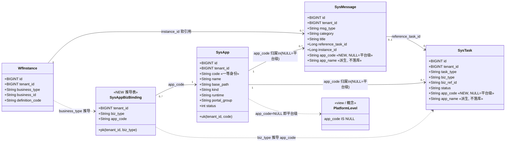
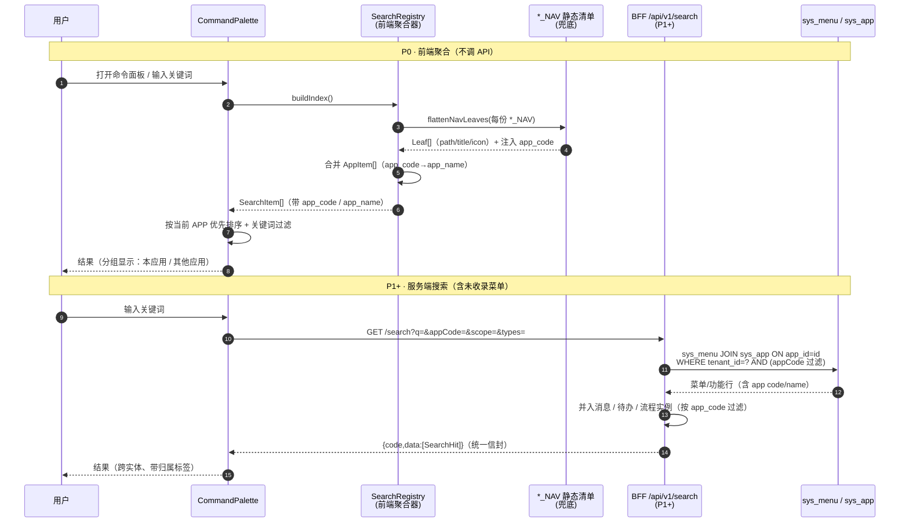

# 平台级 vs 应用级：消息 / 待办归属模型 与 全局搜索扩展 —— 设计文档

| 项 | 值 |
|---|---|
| 状态 | **设计评审（Design Review）** —— 仅设计，不含实现 |
| 范围 | ① 消息 / 待办的「平台级 vs 应用级」归属模型；② 全局搜索数据源升级 |
| 前置调研 | 两路独立调研已确认；本文只引用结论，不重复调研 |
| 产出约束 | **不改业务代码、不改迁移、不 commit**；本文档是唯一落盘物 |
| 关联文件 | `docs/design/app-scoped-message-task-and-search-design.class.mermaid`、`...sequence.mermaid` |

> **阅读约定**
> - 🟩 **已核实事实** = 有 `文件:行号` 出处，可直接引用。
> - 🟦 **设计建议** = 架构主张，需评审 / 用户拍板。
> - 🔴 = 需用户决策的阻塞点。

---

## 0. 现状摘要（已核实事实）

| # | 事实 | 来源 |
|---|---|---|
| F1 | **「当前 APP」不是平台一等概念**：无持久化事实，前端按路径前缀 if-else 猜测当前 APP | 🟩 `frontend/mis-admin-web/src/components/layout/host-apps.ts`（`resolveActiveHostAppCode`） |
| F2 | `sys_api` 的 `app_id` / `tenant_id` **已在 V8 被 DROP**，改归 `sys_module` | 🟩 `backend/mis-migrator/.../V8__module_api_refactor.sql:21-23`、`:1-3` |
| F3 | `sys_menu_api` 的 `UNIQUE(api_id)` 已放开，仅留 `uk_menu_api_pair(menu_id, api_id)` | 🟩 `V8__module_api_refactor.sql:34-37` |
| F4 | 因此 **APP ↔ 菜单/API 归属没有直接列**；APP 经 `sys_menu.app_id` → `sys_menu_api` → `sys_api` 间接、多值推导 | 🟩 由 F2+F3 推出；`sys_menu.app_id` 见 `V1__init_schema.sql` / `V5__sys_app_portal_fields.sql` |
| F5 | `sys_task` 有 `biz_type`，但**纯通知类消息无 `biz_type`** ⇒ `biz_type` **不能**承担 APP 归属 | 🟩 `V120__taskflow_message_task_schema.sql:65-90`（`sys_task`）、`:14-35`（`sys_message` 无 biz_type） |
| F6 | 消息 Tab / 待办六子 Tab **目前均无 APP 维度筛选** | 🟩 `frontend/.../portal/tabs/portal-message-tab.tsx:93`、`frontend/.../portal/lib/todo-tabs.ts:30-37` |
| F7 | 命令面板只搜**硬编码静态 `SYSTEM_NAV`**（18 叶 + 1 条「返回门户」= 19），**不调任何 API** | 🟩 `frontend/.../components/layout/command-palette.tsx:7,19-40` |
| F8 | `SYSTEM_NAV` = 18 个叶子；`flattenNavLeaves()` 是**泛型**函数，注释明写「可吃 AGENT_NAV / KB_NAV」 | 🟩 `frontend/.../lib/nav/system-nav.ts:20-94`（叶计数）、`:105-106` |
| F9 | 已存在多份 `*_NAV` 静态清单：`SYSTEM_NAV` / `AGENT_NAV` / `KB_NAV` / `IQD_NAV` / `finance-nav` / `task-nav` | 🟩 `lib/nav/system-nav.ts:20`、`agent-nav.ts:26`、`kb-nav.ts:14`、`iqd-nav.ts:28` |
| F10 | APP 一等身份标识：全链路一致使用 **`code`（字符串）** | 🟩 `types/api.ts:63-77`（`AppItem.code`）、`host-apps.ts`（`HOST_APP_LANDING` 键为 code）、BFF `AppController.java`（`ENTERABLE_CODES` 用 code） |
| F11 | `sys_app` 主键是**分段数字 ID**（system=1 / kb=91010 / agent=92010 / iqd=93010 / finance=94010），**跨环境不稳定** | 🟩 `V2__seed_data.sql:17`、`V13__kb_seed.sql:28`、`V19__agent_ops_seed.sql:68`、`V77__iqd_standalone_app.sql:16`、`V86__finance_pos_account_seed.sql:18` |
| F12 | `sys_app` 上有 `uk_app_tenant_code UNIQUE (tenant_id, code)` ⇒ `(tenant_id, code)` 可作候选键 | 🟩 `V1__init_schema.sql:38` |
| F13 | iframe APP **无本地菜单**，侧栏显式提示「远程页面，无本地菜单」 | 🟩 `components/layout/app-layout.tsx:433`；`lib/nav/iframe-apps.ts:18` 只注册 `{code,title,icon,basePath}` |
| F14 | `/portal` 被 `app-layout.tsx` **排除在 keep-alive Tab 体系之外**，三 Tab 不占 URL | 🟩 `docs/prd/portal-restructure-prd.md:57,66`、`features/portal/portal-page.tsx` 头注释 |

---

# 第一部分 · 归属模型（平台级 vs 应用级）

## 1.1 用户原问题的直接回答

> **用户问：「是不是每个消息和事项里都增加该信息（平台 或 某 APP）？」**

> ### 🟦 结论：**是，但要「部分」——不是二选一，而是「可空的应用级归属」**
>
> 具体说：**每条消息、每条待办都增加一个 `app_code` 列**，但它的取值是：
>
> | 取值 | 语义 | 典型场景 |
> |---|---|---|
> | `NULL` | **平台级**（跨应用 / 系统级） | 系统公告、系统告警（`SYSTEM_ALERT`）、跨应用通知、平台运维提醒 |
> | `'kb'` / `'agent'` / `'iqd'` / `'finance'` … | **应用级**（归属某 APP） | 该 APP 的业务待办、审批通知、应用内提醒 |
>
> **理由（4 条，逐条对应事实）**：
> 1. **不能靠现有字段推导** —— `biz_type` 对**纯通知类消息根本不存在**（🟩 F5），纯通知没有业务上下文，无从推导出 APP。若强行走映射，这些消息只能一律落「平台级」，而它们恰恰是最需要标明「来自哪个 APP」的（如某 APP 的健康告警）。
> 2. **「平台 或 某 APP」在语义上不是互斥枚举，而是「有归属 / 无归属」**。用 `NULL` 表达「无应用归属（平台级）」是关系模型里最自然的表达，且**存量数据零回填**（存量天然都是 NULL = 平台级，语义正确）。
> 3. **两个字段的职责不可混淆**：`app_code` 回答「**谁的消息**」，`msg_type`/`biz_type` 回答「**什么消息**」。把它们塞进同一列（如复用 `category`）会让后续两个维度都查不动。
> 4. **为「每 APP 自有首页」预留** —— APP 首页要「展示该 APP 的消息和待办」，查询就是 `WHERE app_code = :code`（单列等值，可走索引）。这是本设计能吃下的**唯一**低代价形态。

### 边界澄清（必须说清，避免评审误判）

| 场景 | 归属 | 说明 |
|---|---|---|
| 系统级公告 / 全域广播 | **平台级**（`app_code=NULL`） | 不属于任何 APP；所有 APP 首页**是否**要展示它 → 由 APP 首页查询策略决定（见 1.4） |
| 纯通知（`reference_task_id=NULL`，无 `biz_type`） | **取决于发布来源** | 若由某 APP 的业务逻辑发出 → 应带该 APP 的 code；若由平台定时任务发出 → `NULL`。**不能一律 NULL**，否则 APP 首页永远看不到自己的通知 |
| 审批结果通知（`msg_type=NOTIFY`，`instance_id!=null`） | **随其 `wf_instance`** | 由流程实例的 `business_type` → APP 映射得出（见 1.3） |
| 待办（`sys_task`） | **永不 NULL**（原则上） | 待办必来自某个业务流程 → 必有所属 APP。**例外**：人工/脚本直插的运维待办可 NULL |
| 平台运维待办（如「审核新租户」） | **平台级** | 归属「平台管理」，不属任何业务 APP |

## 1.2 归属模型类图

`.mermaid` 独立文件：`docs/design/app-scoped-message-task-and-search-design.class.mermaid`



> 说明：`app_name` **不落库**，由 `app_code` 在读取侧 join / 前端 `AppItem` 映射得到（避免改名不同步）。

## 1.3 落库位置建议：新增列 vs 关联表 vs metadata

| 方案 | 说明 | 优点 | 代价 / 风险 | 结论 |
|---|---|---|---|---|
| **A. 实体表各加一列 `app_code`** | `sys_message` / `sys_task` 各 `ADD COLUMN app_code VARCHAR(64) NULL` + 索引 | 查询单列等值可走索引；写入直白；**存量 NULL 即平台级，零回填**；DDL 完全幂等（`ADD COLUMN IF NOT EXISTS`），与 V134 既有手法一致 | 写入侧每个发起点都要带 code，**漏传即静默降级为平台级** | ✅ **采用** |
| **B. 单独关联表 `sys_entity_app_ref(entity_type, entity_id, app_code)`** | 多态关联 | 不动实体表 | 每次查询多一次 join 或回表；多态外键无约束；**存量 0 行 = 全部落平台级但语义模糊**；收益不抵复杂度 | ❌ 否决 |
| **C. 塞进 `sys_task.metadata` / `sys_message.content` JSONB** | 复用现有 JSONB 列（🟩 `V120:82`、`:44`） | 零 DDL | **无法建索引做等值过滤**（要 GIN/表达式索引，且 JSONB 取值类型不稳）；无 schema 约束、易漂移；读侧每个消费者各自解析 | ❌ 否决（仅可作过渡） |
| **D. 加列 + `sys_app_biz_binding` 推导表**（= A + 下表） | A 之上再加一张 `(tenant_id, biz_type) → app_code` 映射 | 写入侧可**只带 `biz_type`**，由服务端查绑定表补齐 `app_code`，**降低漏传风险**；绑定表可增量维护 | 多一张小表；绑定缺失时仍需回退规则 | ✅ **推荐（A 为必须，D 为增强）** |

> 🟦 **推荐：A + D**。
> - **A 是地基**：`sys_message.app_code`、`sys_task.app_code` 两列必须有，否则后面一切查询优化无意义。
> - **D 是防漏网**：写入 API 保持「可选传 `app_code`」，未传时服务端按 `biz_type` 查 `sys_app_biz_binding` 兜底；再兜不住 → `NULL`（平台级）。这样**无需改动所有历史写入点签名**，把改动面压到最小。
> - **不允许**用数字 `sys_app.id`（🟩 F11：跨环境不稳定）—— 一律 `code`。

### 建议 DDL 草案（设计稿，不在本次执行）

```sql
-- 设计草案：仅供评审，本次不执行
ALTER TABLE sys_message ADD COLUMN IF NOT EXISTS app_code VARCHAR(64) NULL;
ALTER TABLE sys_task    ADD COLUMN IF NOT EXISTS app_code VARCHAR(64) NULL;

CREATE INDEX IF NOT EXISTS idx_msg_app_time  ON sys_message (tenant_id, app_code, created_at DESC);
CREATE INDEX IF NOT EXISTS idx_task_app_stat ON sys_task    (tenant_id, app_code, assignee_id, status);

-- 平台级过滤用部分索引（app_code IS NULL 的数据量通常小）
CREATE INDEX IF NOT EXISTS idx_msg_platform ON sys_message (tenant_id, created_at DESC) WHERE app_code IS NULL;

CREATE TABLE IF NOT EXISTS sys_app_biz_binding (
    tenant_id BIGINT      NOT NULL,
    biz_type  VARCHAR(64) NOT NULL,   -- 对应 sys_task.biz_type / wf_instance.business_type
    app_code  VARCHAR(64) NOT NULL,
    created_at TIMESTAMPTZ NOT NULL DEFAULT NOW(),
    updated_at TIMESTAMPTZ NOT NULL DEFAULT NOW(),
    CONSTRAINT pk_app_biz_binding PRIMARY KEY (tenant_id, biz_type)
);
```

> ⚠️ **不建外键**到 `sys_app(code)`：`sys_app` 的唯一键是 `(tenant_id, code)`，且 APP 可被删除/停用；参照 `sys_message.instance_id` 的既有做法（🟩 `V134:35` 软引用、无外键），保持一致。

## 1.4 支撑「每 APP 自有首页（含该 APP 的消息/待办）」

**查询侧只需单列过滤**：

| 首页需求 | 查询谓词 |
|---|---|
| 某 APP 首页只看**本 APP** 的消息 | `WHERE tenant_id=? AND app_code='kb'` |
| 某 APP 首页只看**本 APP** 的待办 | `WHERE tenant_id=? AND app_code='kb' AND assignee_id=?` |
| 门户「平台级」视图 | `WHERE tenant_id=? AND app_code IS NULL` |
| 门户**全量**视图（现行为） | **不加 `app_code` 参数** ⇒ 行为完全不变，**零回归** |

🟦 **设计建议**：APP 首页查询引入一个显式的 `scope` 参数，取值 `APP | PLATFORM | ALL`（默认 `ALL`，保证旧调用不变）：

```
scope=ALL       → 不加 app_code 条件            （门户三 Tab 现状，默认）
scope=APP       → app_code = :code              （APP 自有首页）
scope=PLATFORM  → app_code IS NULL              （平台级专区，可选）
```

> 关键设计取舍：**`ALL` 必须能包含 `NULL` 行**。若把 `app_code` 设成 `NOT NULL DEFAULT ''`，「平台级」就会与「未分类」混淆，且 `ALL` 与 `APP` 的并集查询会变得别扭。**用 NULL 表达平台级是最简洁的**。

---

# 第二部分 · 全局搜索扩展

## 2.1 现状问题（对照事实）

| 问题 | 事实来源 | 后果 |
|---|---|---|
| 搜索源是**硬编码静态清单**，非运行时数据 | 🟩 F7 `command-palette.tsx:7,19-40` | 菜单增删必须改前端发版 |
| 只有 **19 条**（18 叶 + 返回门户），且**只覆盖系统管理** | 🟩 F7、F8 | kb / agent / iqd / finance / task 的页面**完全搜不到** |
| 搜索项**不含 APP 信息** | 🟩 F7（数据结构仅 `{path,title,icon,group}`） | 无法按 APP 分组、无法标注归属、无法跨 APP 定位 |
| 未收录的 APP 菜单/功能**搜不到**，且无补录机制 | 🟩 F7/F13 | 新增 APP 后搜索静默缺失，无告警 |
| iframe APP **无本地菜单可搜** | 🟩 F13 | 这类 APP 只能搜「APP 本身」，其内部页面不可达 |

## 2.2 搜索数据流（时序图）

`.mermaid` 独立文件：`docs/design/app-scoped-message-task-and-search-design.sequence.mermaid`



## 2.3 设计：从「静态清单」升级到「带 APP 归属的可搜索项集合」

### 统一数据结构（前端）

```ts
// 设计草案
export interface SearchItem {
  id: string;              // 稳定唯一键：`${appCode}:${path}`
  type: 'menu' | 'app' | 'message' | 'task' | 'process' | 'form' | 'doc' | 'user' | 'org';
  title: string;
  path: string | null;     // 可跳转路由（无则为 null）
  icon: string | null;
  appCode: string | null;  // «核心» NULL = 平台级
  appName: string | null;  // 显示用，由 appCode 映射得到
  keywords?: string[];     // 别名/拼音（P2）
}
```

**P0 实现要点（改动面极小，建议先做）**：
1. 把 `command-palette.tsx:20` 的 **硬编码 `SYSTEM_NAV`** 改为**遍历 `*_NAV` 清单表**（🟩 F9 已存在 6 份），每份 `*_NAV` 标注其 `appCode`，统一走已有的泛型 `flattenNavLeaves()`（🟩 F8）。
2. 把 `AppItem[]`（🟩 F10，已含 `code`/`name`）并入索引，产出 `type:'app'` 的搜索项，供「跳到某 APP」。
3. 结果**按 `appCode` 分组**：当前 APP 优先，其他 APP 次之，平台级最后。
4. **零 API 新增、零后端改动**。

**P1/P2 服务端化**：新增 `GET /api/v1/search`，数据源为 `sys_menu JOIN sys_app`（🟩 F4 的间接推导，用 `code` 作返回标识），解决「未收录菜单」（🟩 F7）——**因为 `sys_menu` 是运行时数据，天然覆盖所有已登记菜单**。

> ⚠️ 关键设计约束：**`sys_menu.app_id` 是数字 ID**（🟩 F11/F12）。服务端返回时**必须 join 出 `sys_app.code`** 作为跨层标识，**禁止把数字 id 透给前端**（否则造出平台第二套 APP 标识，正是 V8 想消灭的分裂，🟩 F2）。

## 2.4 「还有其他可用于搜索的吗」—— 可纳入实体清单

| 优先级 | 实体 | 数据源 | 是否含 APP 归属 | 纳入理由 / 代价 |
|---|---|---|---|---|
| **P0** | **菜单 / 功能（页面）** | 前端 `*_NAV`(🟩F9) → P1 起 `sys_menu`+`sys_app` | 是（`sys_menu.app_id`→`code`） | **当前唯一在搜的**，只是覆盖不全。改造面最小、收益最直接 |
| **P0** | **APP 本身** | `AppItem[]` / `sys_app`(🟩F10) | 是（就是它自己） | 已有数据；让用户可直接「跳去某 APP」 |
| **P1** | **消息** | `sys_message`（+ 新列 `app_code`，第 1 部分） | 是（新列） | 用户点名要按 APP 看消息；搜索是同一份数据的延伸，边际成本低 |
| **P1** | **待办 / 流程实例** | `sys_task` / `wf_instance`（+ `app_code` 推导） | 是 | 同上；待办是门户三 Tab 之一，搜索入口自然 |
| **P1** | **表单定义** | `sys_form_definition`(🟩 `V128`) | 经 `biz_type` 可推导 | 已有列表页可复用查询；注意表单已支持分类树 `wf_category`(🟩 `V131:38-52`) |
| **P2** | **知识库文档** | `sys_kb_document`（KB 域，🟩 `V12__kb_schema.sql:90` 含 `app_id`） | 是（KB 自带 `app_id`） | 量大、需专门分词/权限过滤；建议走 KB 自己的检索接口而非并入全局 |
| **P2** | **用户 / 组织** | `sys_user` / `sys_employee` / `sys_org` / `sys_dept` | **否（平台级）** | 天然平台级数据，`appCode=NULL`；有权限敏感性，须先做可见性收敛 |
| **P2** | **角色 / 岗位 / 字典 / 配置** | `sys_role` / `sys_post_type` / `sys_dict` / `sys_config` | 否（平台级） | 配置类，低频；建议仅在管理后台内搜 |

> 🟦 **建议节奏**：**P0 = 菜单 + APP（纯前端，1 天级）**；**P1 = 加服务端接口 + 消息/待办接入（与第一部分同批）**；**P2 = 文档 / 组织 / 配置（需权限模型先行）**。

## 2.5 「有些 APP 的菜单/功能还没被收录」如何增量纳入

| 措施 | 说明 | 阶段 |
|---|---|---|
| **以 `sys_menu` 为单一事实源** | 菜单是**运行时数据**，只要在菜单管理里登记，搜索自动可见，无需改前端 | **P1（根治）** |
| **`*_NAV` 仅作兜底** | 静态清单保留，用于「迁移未跑 / 权限未授」时结构不空洞（既有口径，🟩 `agent-nav.ts:6`、`iqd-nav.ts:6`） | P0 |
| **注册即入索引** | 新 APP 上线时把 `*_NAV` 注入 `SearchRegistry`（🟩 `registerIframeApps` 已是「注册即生效」范式，可仿） | P0 |
| **覆盖率自检** | 前端启动时比对「`sys_menu` 可见项集合」vs「已索引项集合」，差集非空则在开发模式告警 | P1 |
| **iframe APP 特别处理** | iframe 无本地菜单（🟩 F13）⇒ 只索引「APP 本身 + 其消息/待办」两类；不试图索引其内部页面（**无数据源，做不到**） | P1 |

---

# 第三部分 · 分期与代价

## 3.1 分期路线

| 阶段 | 交付 | 后端改动 | 前端改动 | 迁移 | 代价评估 |
|---|---|---|---|---|---|
| **P0**<br/>最小可交付 | ① 搜索数据源从「硬编码 SYSTEM_NAV」升级为「遍历全部 `*_NAV` + APP 列表」，结果带 `app_code`/`app_name` 并按 APP 分组<br/>② 消息/待办查询接口**加可选 `appCode`/`scope` 参数**（不传=现状，零回归） | 5 个端点加可选参数（`/tasks/my`、`/tasks/handled`、`/workflow/instances/my`、`/messages/inbox`、`/messages/search`）；VO 各 +1 字段 `appCode` | `command-palette.tsx` 改造；`portal-message-tab.tsx:93`、`portal-todo-tab.tsx` 传参；两处纯增 | **1 个迁移**：`sys_message`/`sys_task` 各 `ADD COLUMN app_code` + 索引 | **低**。DDL 全幂等（仿 🟩 `V134:35`）；参数可选故**旧前端不破** |
| **P1**<br/>数据可信 | ① `sys_app_biz_binding` 推导表 + 写入侧兜底（未传 `app_code` 时按 `biz_type` 推导）<br/>② 服务端 `GET /api/v1/search`（数据源 `sys_menu JOIN sys_app`）<br/>③ **APP 自有首页**落地（形态见 3.2-a） | 新表 + 新端点 + 写入侧兜底逻辑；`sys_api` 登记（注意 `deny-unmapped` 只放行已登记端点） | APP 首页路由/容器；复用现有 MessageBoard/TaskBoard | 第 2 个迁移（建绑定表 + 种子） | **中**。新增端点须配套 `sys_api`/`sys_menu_api` 登记，属既有踩坑点 |
| **P2**<br/>体验补全 | ① 纳入表单/知识库文档/组织等（2.4）<br/>② 搜索别名/拼音、结果排序权重<br/>③ 平台级专区视图 | 各域检索接口 or 统一检索服务 | 结果分组 UI、平台级 Tab | 视范围 | **高**。权限可见性、分词、性能均需单独评估 |

## 3.2 🔴 需用户拍板的决策点

### a) APP 自有首页的落地形态

| 选项 | 优点 | 代价 / 风险 |
|---|---|---|
| **`/app/:code/home`（独立路由）— 🟦 推荐** | 语义清晰、可分享 URL、可独立 keep-alive、与 `resolveAppEntry`（🟩 `host-apps.ts`）天然对齐 | 需新增路由 + `PAGE_MAP` 条目；⚠️ `PAGE_MAP` 是**精确匹配**（🟩 `keep-alive-outlet.tsx:217` 注释），`:code` 动态段会 miss ⇒ 须配 `matchDynamicPage`（🟩 同文件 `:247` 已有 `prefix` 机制可仿） |
| **`/portal?app=xx`（复用门户）** | 改动最小，直接复用三 Tab 容器 | ⚠️ 门户**刻意不占 URL**（🟩 F14）；且「切 URL 但常驻实例不重渲染」是既有踩坑（🟩 `portal-page.tsx` 头注释）。query 方案会与之冲突 |

> 🟦 **建议 `/app/:code/home`**，并在 `keep-alive-outlet.tsx` 的 `matchDynamicPage` 里加一条 `prefix: '/app/'`。理由：门户 URL 纪律是刻意设计的，不应为 APP 首页破例。

### b) host APP vs iframe APP 两档首页

| APP 类型 | 首页可挂内容 | 依据 | 处理建议 |
|---|---|---|---|
| **host APP**（system/kb/agent/iqd/finance/task） | 本应用导航（复用 🟩 F9 的 `*_NAV`）+ 消息 + 待办 | 有本地菜单 | 完整形态：导航区 + 消息区 + 待办区，均按 `app_code` 过滤 |
| **iframe APP** | **仅消息 + 待办**（受限形态） | 🟩 F13：无本地菜单，只有 `{code,title,icon,basePath}` | 首页不渲染导航区，只渲染「`app_code=:code` 的消息 + 待办」；并在 UI 明示「该应用为远程嵌入，仅展示通知」 |

> 🟦 **需用户确认**：iframe APP 的「首页」是否就是它唯一的门户呈现？（若否，需说明它从哪里进入。）这直接决定第 1 部分的数据模型是否够用——**恰好「消息+待办」正是本设计覆盖的范围，够用**。

### c) 应用级归属字段是否回填历史数据

| 选项 | 说明 | 建议 |
|---|---|---|
| **不回填（推荐）** | 存量 `app_code` 一律 `NULL` = 平台级。语义上「历史数据没有明确 APP 归属」是**事实**，NULL 如实表达 | ✅ **推荐**。零风险、零成本，且不会错标 |
| **按 `biz_type` 回填** | 用 `sys_app_biz_binding` 把存量 `sys_task` / `sys_message`（有 `biz_type` 的）刷成对应 APP | ⚠️ 仅对**有 `biz_type`** 的行有效（🟩 F5：纯通知无 `biz_type`，永远回填不了）；且**绑定表本身要先人工确定**，一旦映射错就污染历史 |
| **不区分，全部视为平台级** | 等价于不回填，但在 UI 上不说「平台级」而说「未归类」 | 可选，取决于产品文案 |

> 🟦 **建议：不回填**，并在 APP 首页查询里**默认不含 `NULL` 行**（即存量数据不会串进 APP 首页），需要时由用户在 APP 首页切「全部」查看。这样**存量与增量行为完全解耦**，是风险最低的路径。
>
> ⚠️ 需用户明确：**存量数据在 APP 首页是否可见？**（默认方案 = 不可见。）

---

## 附录 · 事实 vs 建议速查

| 类别 | 内容 |
|---|---|
| 🟩 已核实事实 | F1–F14（见 §0 表格，均带 `文件:行号`） |
| 🟦 设计建议 | ① 加可空 `app_code`（NULL=平台级）② 加 `sys_app_biz_binding` 推导表 ③ 引入 `scope=ALL/APP/PLATFORM` ④ 搜索 P0 前端聚合、P1 服务端化 ⑤ 存量不回填 ⑥ APP 首页用 `/app/:code/home` |
| 🔴 待拍板 | a) 首页形态 `/app/:code/home` vs `/portal?app=xx`（见 3.2-a）；b) iframe APP 首页是否为其唯一入口（见 3.2-b）；c) 存量是否回填 + 存量在 APP 首页是否可见（见 3.2-c） |
| ❌ 明确否决 | 用数字 `sys_app.id` 作跨层标识（违反 🟩 F11）；把归属塞进 JSONB `metadata`（无法索引）；单建多态关联表 `sys_entity_app_ref`（收益不抵复杂度） |
