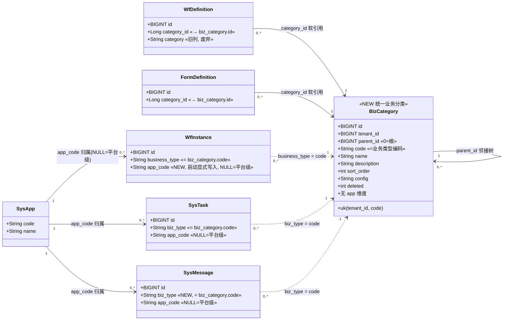
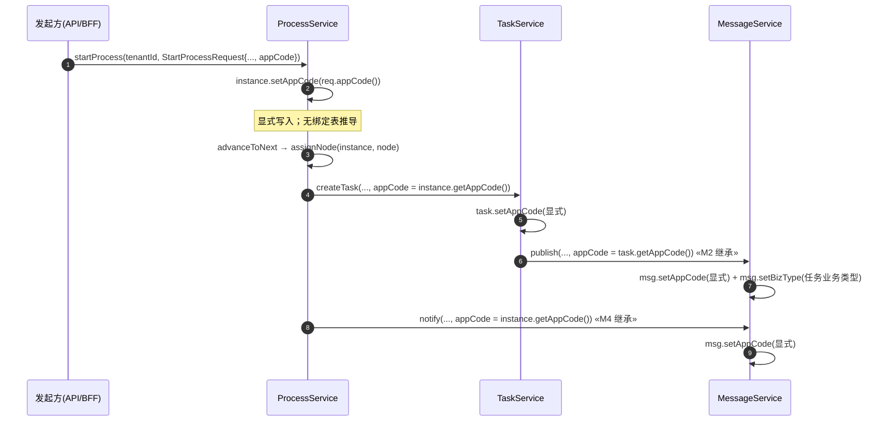

# 业务分类统一化 + app_code 显式化 —— 设计文档（修订）

| 项 | 值 |
|---|---|
| 状态 | **设计评审（Design Review）** —— 仅设计，不含实现 |
| 上游 | `docs/design/app-scoped-message-task-and-search-design.md`（P0 归属模型）；本次为其**模型修订** |
| 范围 | ① 新建**统一「业务分类」**模型（租户通用、与 APP 无关），流程定义/表单定义改引用它；② 消息/待办的「业务类型」关联统一业务分类；③ **app_code 显式化**（不再由业务类型推导）；④ 弃用 `wf_category` / `form_category` / P0 的 `sys_app_biz_binding` |
| 依据 | 用户需求原话（见下）+ 3 项已拍板（见下） |
| 产出约束 | **本文件仅设计；不改业务代码、不改迁移、不 commit** |
| 产出方式 | 新迁移编号自 **V138** 起（V136/V137 已落库，禁改其文件） |

> **用户需求（原话）**
> > 参考流程定义分类，开发实现 **业务分类** 的管理界面；**流程分类、表单分类，全部切换到关联这个业务类型分类**，不再关联原来的流程类型/表单分类；**业务类型是一个租户通用，跟 APP 没关系**；**流程分类/表单分类管理菜单不需要了**；消息和代办事项的业务类型也关联这个业务类型，因为**业务类型不关联 APP**，所以另外需要对应 平台 或 APP，**还是需要这个单独关联字段（app_code），不能根据业务类型找到 APP**。

> **3 项已拍板（直接采用，不再复议）**
> 1. **建模**：**新建**统一「业务分类」表；`wf_category` / `form_category` 两表**废弃**（不再作为分类源）。流程定义 / 表单定义改引用新统一表。
> 2. **存量数据**：**不迁移**。存量流程/表单定义统一挂到 **「未分类」兜底节点**，由业务后续自行重挂。
> 3. **内部流程路径的 app_code 来源**：**流程实例启动时由发起方显式写入**（`wf_instance` 新增 `app_code` 列）；流程分派待办（`ProcessService:assignNode`）、流程结果通知（`ProcessService:notify`）等内部路径**继承该实例的 app_code**。

> 图例：🟩 **已核实事实**（带 `文件:行号`）｜🟦 **设计决策**（本文给出理由）｜🔴 **需用户拍板**｜❌ **明确否决**

---

## 0. 现状事实（已核实，实地读码）

| # | 事实 | 出处 |
|---|---|---|
| F1 | 「流程分类」是**独立邻接树** `wf_category`（`parent_id` 自引用，`0`=根），列镜像 `form_definition` | 🟩 `V131__form_wf_category_schema.sql:38-52`、`WfCategory.java:19-64` |
| F2 | 「表单分类」是**逐列镜像** `wf_category` 的独立邻接树 `form_category`（V133 拆出） | 🟩 `V133__form_category_split.sql:39-53`、`FormCategory.java` |
| F3 | 流程定义经 `wf_definition.category_id` 软引用 `wf_category.id`（无外键） | 🟩 `V131:62-65`、`WfDefinition.java:41-46` |
| F4 | 表单定义经 `form_definition.category_id` 软引用 `form_category.id`（无外键）；旧列 `kind`/`parent_id` 已**软废弃（实体不映射）** | 🟩 `V133:74-77`、`FormDefinition.java:39-41,22-24` |
| F5 | V132 已建「未分类」节点 `id=990001`(tenant=1) 并把历史 `wf_definition.category_id` 回填到它（**先例**） | 🟩 `V132__perm_merge_and_backfill.sql:117-121` |
| F6 | 分类管理 UI **不是独立菜单**，而是**内嵌**在「流程定义」页与「表单注册」页里的树面板 | 🟩 `definitions-page.tsx:35`（`WfCategoryTree`）、`form-definition-manage-page.tsx`（`FormCategoryTree`）；`system-nav.ts:61-93` 无「分类」菜单项 |
| F7 | 分类端点已登记：`wf_category` = `sys_api 95060-95065`（绑菜单 95006），`form_category` = `sys_api 95066-95071`（绑菜单 95011）；对应 `sys_menu_api 95080-95085 / 95086-95091` | 🟩 `V132:41-56,100-112`、`V133:103-136` |
| F8 | `wf_instance` **当前无 `app_code` 列**；实例归属在 P0 里是**由 `business_type` 经 `sys_app_biz_binding` 派生** | 🟩 `WfInstance.java`（无该列）、`WfInstanceRepository.java:61-107`、`ProcessService.java:600` |
| F9 | P0 已落地的绑定表/推导：`sys_app_biz_binding`（V137）、`SysAppBizBinding` 实体/仓储、`AppScopeResolver.resolveByBizType/resolve`（三段式） | 🟩 `V137__app_biz_binding.sql`、`SysAppBizBinding.java`、`SysAppBizBindingRepository.java`、`AppScopeResolver.java:51-76` |
| F10 | P0 写入漏斗的 app_code 现状：`TaskService.createTask` 用 `resolve(tenantId, req.appCode(), req.bizType())`；`ProcessService.assignNode`/`notify` 用 `resolveByBizType(instance.getBusinessType())` | 🟩 `TaskService.java:80`、`ProcessService.java:445,511` |
| F11 | `sys_message` 有 `category`（小枚举 `TASK` 等，NOT NULL）但**无 `biz_type`**；`sys_task` 有 `biz_type` | 🟩 `SysMessage.java:35-36`、`SysTask.java`（`biz_type`） |
| F12 | `sys_task.app_code` / `sys_message.app_code` 已由 V136 加列，`scope=ALL/APP/PLATFORM` 查询过滤保留（拆 3 条查询，避免 native null 参数类型推断缺陷） | 🟩 `V136:20-21`、`SysTaskRepository.java:137-270` |
| F13 | 前端**无流程启动调用**（`/workflow/instances/start` 在 admin-web 无调用点），实例多为 API/业务侧发起或种子数据 | 🟩 `workflow.ts`（仅 `/my` 与 `/{id}`）、`V129__taskflow_purchase_demo_instances.sql` |
| F14 | 仓库已有先例：**端点退役采用「行保留、status=0 休眠」**而非删行（保迁移幂等测试） | 🟩 `V133:19-20`（`sys_api 95051 行保留（休眠）`） |

---

## 1. 模型设计

### 1.1 ✅ 核心裁决（已拍板 2026-10-11）：什么是「业务类型」，它如何被关联

> 用户要「业务分类管理界面（仿流程定义分类）」，并要「流程分类/表单分类切换到关联这个业务类型分类」，要「消息/待办的业务类型也关联它」。

**决策（✅ 已拍板，采用）**：

> 🟦 **单一 `biz_category` 邻接树**（租户通用、无 APP 维度）。**树节点即「业务分类」**；节点的 `code` 即**业务类型编码**（租户内唯一）。**叶子节点 = 具体业务类型，内部节点 = 业务类型分组**（与「流程定义分类」的文件夹树同构）。
> - **定义类**（需要树结构）→ 用 **`category_id`**（软引用 `biz_category.id`）：`wf_definition.category_id`、`form_definition.category_id`（**复用既有列**，仅改指向）。
> - **运行类**（只需具体业务类型）→ 用 **`biz_type` 字符串**（软引用 `biz_category.code`）：`sys_task.biz_type`（既有）、`wf_instance.business_type`（既有）、`sys_message.biz_type`（**新增列**）。

**理由（4 条）**：
1. **贴合大列表语义**：「业务分类」要像「流程定义分类」那样是可管理、可分层、可增删的树 —— 正好 = `biz_category` 树。
2. **不引入第二套身份**：把「业务类型」建模为**另起一张 `biz_type` 表再指回分类**会新增一次 join 与一个身份，且当前 `sys_task.biz_type` / `wf_instance.business_type` 已是**字符串**（F10/F11），强行改成 id 会波及大量既有查询与种子数据（F13）。**直接令「业务类型编码 = `biz_category.code`」** 最小改动、语义等价。
3. **定义 vs 运行分离是既有惯例**：定义侧已有 `category_id` 软引用惯例（F3/F4），运行侧已有 `biz_type` 字符串惯例（F11）。沿用两套惯例，各取所需，不制造新分裂。
4. **与 APP 解耦**：`biz_category` **无 `app_id`/`app_code` 列**（用户明确「业务类型跟 APP 没关系」）；APP 归属改由独立的 `app_code` 显式字段承载（见 §1.3），**不再由业务类型推导**。

**❌ 明确否决**：
- **另起 `biz_type` 表指回 `biz_category`**：收益不抵复杂度（多一次 join、多一个身份、多一套 CRUD）。
- **把「业务类型」建为非树扁平枚举**：无法满足「参考流程定义分类（树）」的用户诉求。

### 1.2 `biz_category` 表结构（镜像 `wf_category`，去掉 APP 维度）

```sql
-- 设计草案（不在本次执行）
CREATE TABLE IF NOT EXISTS biz_category (
    id          BIGINT       PRIMARY KEY,
    tenant_id   BIGINT       NOT NULL,
    parent_id   BIGINT       NOT NULL DEFAULT 0,   -- 0=根；自引用邻接表
    code        VARCHAR(64)  NOT NULL,             -- 业务类型编码（租户内唯一；运行侧 biz_type/business_type 的引用键）
    name        VARCHAR(128) NOT NULL,             -- 中文名
    description TEXT         NULL,
    sort_order  INT          NOT NULL DEFAULT 0,
    config      JSONB        NOT NULL DEFAULT '{}'::jsonb,
    deleted     SMALLINT     NOT NULL DEFAULT 0,
    created_by  BIGINT       NULL,
    created_at  TIMESTAMPTZ  NOT NULL DEFAULT NOW(),
    updated_at  TIMESTAMPTZ  NOT NULL DEFAULT NOW(),
    CONSTRAINT uk_biz_category_tenant_code UNIQUE (tenant_id, code)
);
CREATE INDEX IF NOT EXISTS idx_biz_category_tree
    ON biz_category (tenant_id, parent_id, sort_order) WHERE deleted = 0;
```

**约束与约定**：
- **租户通用**：仅 `tenant_id` 维度，**无 APP 维度**（对齐用户「跟 APP 没关系」）。
- `uk(tenant_id, code)`：`code` 即业务类型编码；与 `wf_category` 同法（软删后不可复用，见 F1 的 `findByTenantIdAndCode` 不过滤 deleted）。
- **不建外键**（`category_id` / `biz_type` 均为软引用），对齐仓库既有软引用风格（F3/F4，及 `V134` 的 `instance_id`）。
- **`biz_type` ↔ `code` 的完整性**由**服务端/迁移**保证（无 DB FK）：写入运行实体前校验 `code` 存在（可选）。

### 1.3 关联关系总览

| 实体 | 关联列 | 引用目标 | 形态 | 变更 |
|---|---|---|---|---|
| `wf_definition` | `category_id` | `biz_category.id` | 软引用（复用旧列） | **改指向**（原 → `wf_category.id`） |
| `form_definition` | `category_id` | `biz_category.id` | 软引用（复用旧列） | **改指向**（原 → `form_category.id`） |
| `sys_task` | `biz_type` | `biz_category.code` | 字符串软引用（既有列） | **语义明确**（值须为业务分类 code） |
| `wf_instance` | `business_type` | `biz_category.code` | 字符串软引用（既有列） | **语义明确** |
| `sys_message` | `biz_type` | `biz_category.code` | 字符串软引用（**新增列**） | **新增** |
| `sys_task` / `sys_message` / `wf_instance` | `app_code` | `sys_app.code` | 字符串（NULL=平台级） | **独立字段，不由业务类型推导** |

> ⚠️ **`app_code` 与「业务类型」正交**：`biz_category` 不携带 APP；`app_code` 是**独立**的归属字段（用户明确「不能根据业务类型找到 APP」）。二者由不同来源写入（见 §2）。

### 1.4 存量兜底：挂「未分类」节点（不迁移）

**决策（采用）**：🟦 **`category_id` 一律置为「未分类」兜底节点 id**（不使用 NULL 表示未分类）。

- 迁移建一个 `biz_category` 兜底节点：`id=991001, tenant_id=1, parent_id=0, code='UNCATEGORIZED', name='未分类'`（tenant 1 = 单租户阶段口径）。
- `UPDATE wf_definition SET category_id = 991001`（全部）；`UPDATE form_definition SET category_id = 991001`（全部）。
- 语义 = 「不保留旧分类结构（**不迁移**），统一挂兜底，由业务后续自行重挂」。

**理由（为何不置 NULL）**：
1. **既有先例**：V132 对 `wf_definition` 就是**回填 990001**（F5），而非留 NULL —— 保持一致。
2. **树上常驻可见**：兜底节点永远出现在树里，用户开箱即见「未分类」并重挂；留 NULL 则树里看不到、需另设虚拟节点。
3. **消除 NULL 分支**：删除守卫/引用计数/前端渲染无需到处判 `category_id IS NULL`。
4. **与「不迁移」不矛盾**：「不迁移」指不保留旧分类的层级/归属，不是「留空」。

> ✅ 已拍板（2026-10-11，§8 #2）：兜底节点采用**固定 id `991001`**（对齐 V132 先例），不用 `code='UNCATEGORIZED'` 动态解析。

### 1.5 旧表弃用策略（DROP vs 停读写）

| 对象 | 处置 | 理由 |
|---|---|---|
| `wf_category`（表） | 🟦 **保留表、停读写**（不 DROP） | 历史迁移 V131 建表；`WfCategoryMigrationIntegrationTest` 等断言行存在（F1）；不 DROP 零风险、可回滚 |
| `form_category`（表） | 🟦 **保留表、停读写**（不 DROP） | 同上（V133，F2） |
| `wf_category`/`form_category` 的**后端代码** | 🟦 **删除**（entity/repo/service/controller/dto） | 不再需要；表留 DB 但无 JPA 映射（`ddl-auto=validate` 只校验已映射实体，无碍） |
| 分类端点 `sys_api 95060-95071` | 🟦 **status=0 休眠**（不删行） | 对齐 `V133:19-20` 的「保留休眠」先例（F14）；避免破迁移幂等计数测试 |
| `sys_menu_api 95080-95091` | 🟦 **保留不动**（inert） | 端点休眠后绑定自然失效；删行有破测试风险 |
| `sys_app_biz_binding`（表，V137） | 🟦 **新迁移 `DROP TABLE`** | 该表已落库（不可改 V137 文件）；P0 返工明确作废「靠业务类型找 APP」（用户原话）。**DROP 与新代码删除必须同批发布**（否则 Hibernate validate 失败，见 §2.4） |
| `sys_app_biz_binding` 的后端代码 | 🟦 **删除**（entity/repo + `AppScopeResolver` 绑定逻辑 + 其单测） | 同上 |

> ❌ **不 DROP `wf_category`/`form_category`**：与「废弃」语义不冲突（废弃=停用），且避免动历史迁移验收测试与回滚能力。

---

## 2. app_code 显式化数据流（替代 P0 的绑定表推导）

### 2.1 新增列与写入

- **`wf_instance.app_code VARCHAR(64) NULL`（新增）**：流程实例的 APP 归属，**启动时由发起方显式写入**（`StartProcessRequest` 追加可选 `appCode`）。
- **`sys_message.biz_type VARCHAR(64) NULL`（新增）**：消息的业务类型（软引用 `biz_category.code`），在发布漏斗写入。
- `sys_task.biz_type` / `wf_instance.business_type`：**保持既有列**，语义明确为「= `biz_category.code`」。

### 2.2 app_code 继承/写入点（真实 `类名:方法`，全部实地读码核实）

| # | 写入点 | 位置 | `app_code` 来源 |
|---|---|---|---|
| A1 | `ProcessService:startProcess` | `ProcessService.java:102`（`instanceRepository.save` 在 `:134`） | **发起方显式**：`instance.setAppCode(req.appCode())`（`StartProcessRequest` 新增字段） |
| A2 | `ProcessService:assignNode` | `ProcessService.java:438`（内部调 `TaskService:createTask` 于 `:448`） | **继承实例**：`instance.getAppCode()` → 作为显式 `appCode` 传入 `createTask` |
| A3 | `ProcessService:notify` | `ProcessService.java:505`（`publish` 在 `:512`） | **继承实例**：`instance.getAppCode()` → 传入 `publish` |
| A4 | `TaskService:createTask` | `TaskService.java:57`（`save` 在 `:82`；通知 `publish` 在 `:89`） | **仅显式**：`task.setAppCode(trimToNull(req.appCode()))`；M2 通知透传同值 |
| A5 | `TaskService:transferTask` | `TaskService.java:238`（`publish` 在后续） | **继承既有任务**：`task.getAppCode()` |
| A6 | `MessageService:publish` | `MessageService.java:59`（`save` 在 `:91`） | **仅显式**：`msg.setAppCode(trimToNull(req.appCode()))`（自身不推导） |
| A7 | `MessageController:publish` / `TaskController:create` | `MessageController.java:41` / `TaskController.java:38` | **外部业务服务显式**（请求体 `appCode`） |

> **UPDATE 路径（禁止 `setAppCode`，保留原值）**：`TaskService:handleTask`(`:200`)、`TaskService:transferTask`(`:238` 的 task 保存)、`MessageService:markRead`。

### 2.3 查询侧：`scope` 仍在 `app_code` 列上（未变）

`scope=ALL/APP/PLATFORM` 保持 V136 既有实现（F12）：`sys_task` / `sys_message` 直接过滤 `app_code` 列；**`wf_instance` 改为直接过滤 `app_code` 列**（不再经 `business_type` 子查询）：

| 查询 | 旧（P0，经绑定表） | 新（显式列） |
|---|---|---|
| `WfInstanceRepository:findByInitiatorInApp` | `business_type in (select biz_type from sys_app_biz_binding where app_code=:appCode)` | `and i.appCode = :appCode` |
| `WfInstanceRepository:findByInitiatorPlatform` | `business_type not in (select biz_type from sys_app_biz_binding)` | `and i.appCode is null` |
| `ProcessService:toInstanceVo` | `appScopeResolver.resolveByBizType(...)` | `i.getAppCode()` |

### 2.4 发布顺序约束（必须同批）

`DROP TABLE sys_app_biz_binding` + 删除 `SysAppBizBinding` 实体 + 删除其子查询（§2.3）**必须在同一发布批次**：若表已 DROP 而实体仍在（或反之），Hibernate `ddl-auto=validate` 会失败。迁移在应用启动前由 Flyway 执行，故 DROP 迁移与新代码同批即可。

---

## 3. 端点与菜单调整

### 3.1 新增「业务分类」端点（对外 `/api/v1/biz-categories/*`）

镜像 `wf_category` 六端点（F7）：

| 方法 | 路径 | 说明 |
|---|---|---|
| GET | `/api/v1/biz-categories/tree` | 分类树（嵌套 children） |
| GET | `/api/v1/biz-categories` | 扁平列表 |
| GET | `/api/v1/biz-categories/{id:[0-9]+}` | 详情 |
| POST | `/api/v1/biz-categories` | 新增 |
| PUT | `/api/v1/biz-categories/{id:[0-9]+}` | 更新 |
| DELETE | `/api/v1/biz-categories/{id:[0-9]+}` | 删除（软删） |

> ⚠️ **`deny-unmapped:true`**：**新端点必须在 `sys_api` 登记 + `sys_menu_api` 绑定到启用菜单**，否则 403（本仓老坑，F7）。路径须与 BFF `@RequestMapping` 逐字一致。

### 3.2 新增「业务分类」管理菜单

| 菜单 | id（候选） | parent_id | code | path | permission |
|---|---|---|---|---|---|
| 业务分类（页面，type=2） | `95012` | `200`（系统管理） | `biz-category` | `/system/biz-category` | `biz:category:list` |

> 同步：前端 `system-nav.ts` 增补一条叶子（放进「基础数据」分支或新「流程中心」下），路由 `PAGE_MAP` 增补 `/system/biz-category`。

### 3.3 下线旧分类端点（不删行）

| `sys_api` | 说明 | 处置 |
|---|---|---|
| `95060-95065` | 流程分类（树/列表/详情/增/改/删） | 🟦 **status=0** |
| `95066-95071` | 表单分类（同上） | 🟦 **status=0** |

> `sys_menu_api 95080-95091` 保留不动（端点休眠后失效）。
> ⚠️ **无独立「流程分类/表单分类」菜单可删**（F6）：分类管理是内嵌在「流程定义」(95006) 与「表单注册」(95011) 两页里的树面板。「删菜单」在本仓落地为**删这两页内的分类面板 + 下线 12 个端点**，`sys_menu` 无行需删。

---

## 4. 类图（新模型）



**新旧对比（一句话）**：`wf_category` + `form_category` 两张**各自为政**的树 → 收敛成 **一张 `biz_category`**（定义侧经 `category_id` 引用、运行侧经 `biz_type`=code 引用）；APP 归属从「业务类型推导」→ **`app_code` 显式列**。被删：`sys_app_biz_binding`（表+实体+推导）、`AppScopeResolver` 的绑定逻辑。

---

## 5. Mermaid 时序图：启动流程 → 待办/通知 继承 app_code



---

## 6. 迁移规划（只产出文件、不执行；编号自 V138 起）

> ⚠️ **绝不修改 V136 / V137 或任何历史迁移文件**（checksum 覆盖全文件）。

### V138 —— 统一业务分类 + app_code 显式化（schema + 数据 + DROP 绑定表）

1. `CREATE TABLE IF NOT EXISTS biz_category (...)`（§1.2）+ `idx_biz_category_tree`。
2. 种子兜底节点：`id=991001, tenant=1, code='UNCATEGORIZED', name='未分类'`（`WHERE NOT EXISTS`）。
3. `ALTER TABLE wf_instance ADD COLUMN IF NOT EXISTS app_code VARCHAR(64) NULL;` + 索引。
4. `ALTER TABLE sys_message ADD COLUMN IF NOT EXISTS biz_type VARCHAR(64) NULL;` + 索引（+ 可选 `biz_category` 相关索引）。
5. 存量兜底：`UPDATE wf_definition SET category_id = 991001;`、`UPDATE form_definition SET category_id = 991001;`。
6. `DROP TABLE IF EXISTS sys_app_biz_binding;`（P0 返工）。

### V139 —— 菜单 / 端点登记（幂等）

1. `sys_menu` 新增 95012「业务分类」。
2. `sys_api` 新增 6 条「业务分类」端点（候选 `95093-95098`，**实施时核验空闲段**）。
3. `sys_menu_api` 绑定新端点 → 95012（候选 id `95093-95098`，**核验**）。
4. `sys_api` 休眠：`UPDATE sys_api SET status=0 WHERE id BETWEEN 95060 AND 95071`（旧分类端点）。
5. （可选）`sys_role_permission` 授予租户管理员。

---

## 7. P0 返工清单（必须删除/改造 —— 用户明确否掉）

| 类型 | 对象 | 动作 | 位置 |
|---|---|---|---|
| ❌删 | `sys_app_biz_binding` 表 | V138 `DROP TABLE` | `V137`（表）；`V138`（DROP） |
| ❌删 | `SysAppBizBinding` 实体 | 删文件 | `domain/entity/SysAppBizBinding.java` |
| ❌删 | `SysAppBizBindingRepository` | 删文件 | `domain/repository/SysAppBizBindingRepository.java` |
| ❌删 | `AppScopeResolver`（@Service，绑定兜底） | 删文件；`normalizeScope`/scope 常量迁至静态工具 `support/AppScope` | `service/AppScopeResolver.java` |
| ❌删 | `AppScopeResolverTest` / `AppScopeIntegrationTest` | 删/重写 | `src/test/.../service/` |
| ✏️改 | `TaskService.createTask` | 去 `resolve()`，改**纯显式** `req.appCode()` | `TaskService.java:80` |
| ✏️改 | `ProcessService.assignNode` / `notify` | 去 `resolveByBizType`，改**继承 `instance.getAppCode()`** | `ProcessService.java:445,511` |
| ✏️改 | `WfInstanceRepository.findByInitiatorInApp` / `findByInitiatorPlatform` | 去 `SysAppBizBinding` 子查询，改 `appCode` 列 | `WfInstanceRepository.java:61-107` |
| ✏️改 | `ProcessService.toInstanceVo` | 改 `i.getAppCode()` | `ProcessService.java:598-607` |
| ✅留 | `sys_message.app_code` / `sys_task.app_code`（V136 列） | **保留** | `V136` |
| ✅留 | `scope=ALL/APP/PLATFORM` 查询过滤 | **保留** | `SysTaskRepository`、`SysMessageRepository` |

> ⚠️ **迁移策略结论**：V137 **不改文件**；用 **V138 `DROP TABLE`** 落地「作废绑定表」。`AppScopeResolver` 等代码改动与新迁移**同批**（§2.4）。

---

## 8. 已拍板事项（2026-10-11）

> 以下三项均由用户于 2026-10-11 拍板定稿，**直接采用，不再复议**。相应措辞已同步至 §1.1 / §1.4。

1. ✅ **「业务类型」的载体** —— **采用推荐方案**：`biz_category` 节点本身即「业务分类」，**叶子 `code` = 业务类型编码**（租户内唯一）。**不另建业务类型表**。
   - 落地：`biz_category` 单树（§1.2）；定义侧经 `category_id` 引用 `biz_category.id`、运行侧经 `biz_type`/`business_type` = `biz_category.code` 引用（§1.3）。
   - ❌ 明确否决：另起 `biz_type` 表指回 `biz_category`（§1.1「明确否决」）。
2. ✅ **兜底节点标识** —— **固定 id `991001`**（对齐 V132 先例 `990001`）。不用 `code='UNCATEGORIZED'` 动态解析。
   - 落地：V138 建节点 `id=991001, tenant=1, code='UNCATEGORIZED', name='未分类'`（§1.4、§6）。
3. ✅ **存量重挂范围** —— **全部**存量 `wf_definition` / `form_definition` 的 `category_id` **一律置为兜底节点 `991001`**（丢弃旧归属，兑现「不迁移」）。
   - 落地：V138 `UPDATE wf_definition SET category_id = 991001;`、`UPDATE form_definition SET category_id = 991001;`（§6）。
   - 注：若后续用户希望**保留**现有流程/表单分类名作为新分类节点（= 实际迁移一次），属另行变更，需再次拍板。
