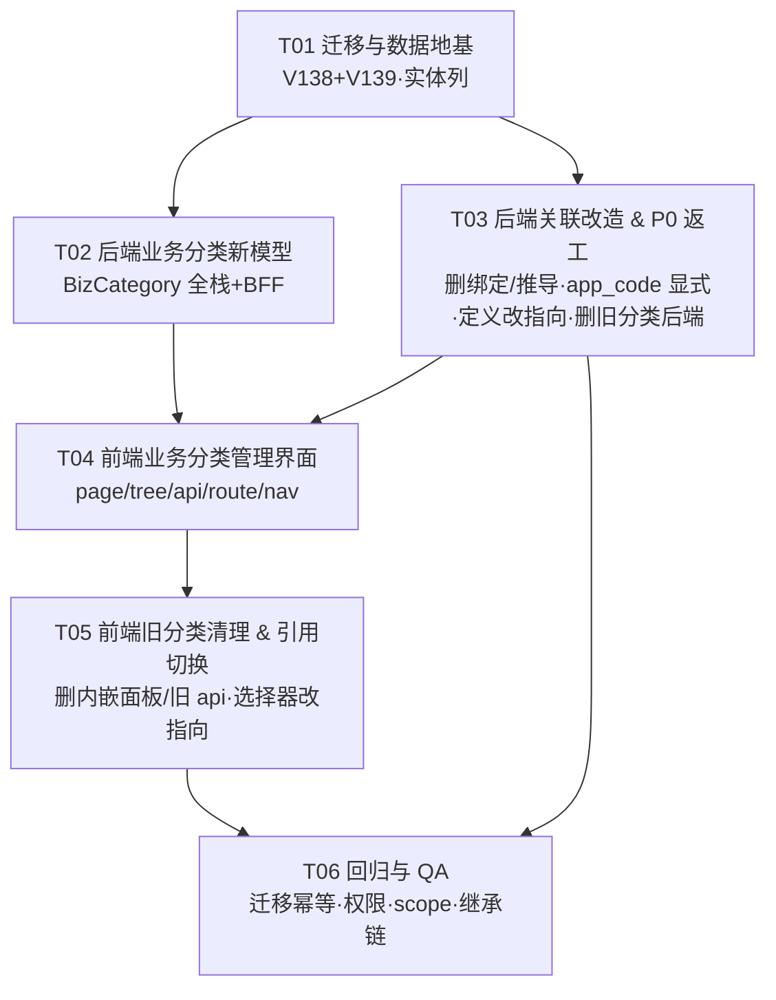

# 业务分类统一化 + app_code 显式化 —— 增量任务分解（实现前）

| 项 | 值 |
|---|---|
| 状态 | **实现前任务分解** —— 仅分解，不含实现 |
| 上游设计 | `docs/design/biz-category-unification-design.md`（本次新建，配套本文） |
| 范围 | 统一「业务分类」模型 + 消息/待办业务类型关联 + app_code 显式化 + **P0 返工清理** |
| 产出约束 | **只写本文档；不改业务代码、不改迁移、不 commit** |
| 迁移编号 | 新迁移自 **V138** 起（V136/V137 已落库，**禁改其文件**） |

> ⚠️ **红线**
> 1. **绝不修改 V136 / V137 或任何历史迁移文件**（Flyway checksum 覆盖全文件）。
> 2. **前端一律用 `pnpm`，禁 `npm`。**
> 3. `DROP TABLE sys_app_biz_binding`（V138）与「删 `SysAppBizBinding` 实体 + 删其子查询」**必须同批发布**，否则 Hibernate `ddl-auto=validate` 失败。
> 4. 只产出文件、不执行迁移。

---

## 1. 任务列表（6 个，按「迁移 → 后端新模型 → 后端关联改造 → 前端新界面 → 前端旧清理 → 回归」排序）

### T01 · 迁移与数据地基　`P0`

**目的**：建 `biz_category`、加 `wf_instance.app_code` / `sys_message.biz_type`、存量挂兜底、DROP 绑定表、登记新菜单/端点并休眠旧端点。**零业务逻辑**。

**涉及文件**：

| 文件 | 改/新 | 改动要点 |
|---|---|---|
| `backend/mis-migrator/src/main/resources/db/migration/V138__biz_category_unification.sql` | **新** | 见 §2（建表+种子兜底 991001+加列+索引+存量置兜底+DROP `sys_app_biz_binding`），全 `IF NOT EXISTS` / `WHERE NOT EXISTS` 幂等 |
| `backend/mis-migrator/src/main/resources/db/migration/V139__biz_category_menu_api.sql` | **新** | 见 §2：`sys_menu` 95012「业务分类」；`sys_api` 95093-95098（6 端点，**核验空闲段**）；`sys_menu_api` 绑定 → 95012；`UPDATE sys_api SET status=0 WHERE id BETWEEN 95060 AND 95071` |
| `backend/mis-taskflow/.../domain/entity/WfInstance.java` | 改 | 新增 `@Column(name="app_code", length=64) private String appCode;` + getter/setter |
| `backend/mis-taskflow/.../domain/entity/SysMessage.java` | 改 | 新增 `@Column(name="biz_type", length=64) private String bizType;` + getter/setter |

**完成判据**：
- V138/V139 在「到 V137 的库」与空库上**均可重复执行**；`biz_category`、`wf_instance.app_code`、`sys_message.biz_type` 存在；`sys_app_biz_binding` 已不存在。
- 兜底节点 `991001`（tenant=1, code=`UNCATEGORIZED`）存在；存量 `wf_definition`/`form_definition`.category_id 全部 = 991001。
- `sys_menu 95012` 存在；新 6 端点登记且绑 95012；`sys_api 95060-95071` 的 status=0。
- 应用可启动、Hibernate validate 无报错。

### T02 · 后端业务分类新模型（BizCategory 全栈）　`P0`　依赖 T01

**目的**：仿 `wf_category` 全栈实现「业务分类」CRUD/树，并在 BFF 透传。

**涉及文件**：

| 层 | 文件 | 改/新 |
|---|---|---|
| 实体/仓储 | `backend/mis-taskflow/.../domain/entity/BizCategory.java` | **新**（镜像 `WfCategory`） |
| | `backend/mis-taskflow/.../domain/repository/BizCategoryRepository.java` | **新**（`findByIdAndTenantIdAndDeleted` / `findByTenantIdAndCode`(不过滤 deleted) / `findByTenantIdAndDeletedOrderBy...` / `countByTenantIdAndParentIdAndDeleted` / **引用计数**：`wf_definition`+`form_definition` 两处） |
| DTO | `backend/mis-taskflow/.../dto/BizCategoryVO.java`、`.../dto/UpsertBizCategoryRequest.java` | **新**（镜像 `WfCategoryVO`/`UpsertWfCategoryRequest`） |
| 服务 | `backend/mis-taskflow/.../service/BizCategoryService.java` | **新**（list/tree/get/create/update/delete，含父子防环、删除前子节点+引用校验；**不得删除兜底 991001**） |
| 控制器 | `backend/mis-taskflow/.../controller/BizCategoryController.java` | **新**（`/internal/v1/biz-categories` 六端点，镜像 `WfCategoryController`） |
| BFF | `backend/mis-admin-bff/.../controller/BizCategoryController.java` | **新**（`/api/v1/biz-categories`，镜像 `WfCategoryController`） |
| BFF client | `backend/mis-admin-bff/.../client/TaskflowWebClient.java` | 改：加 `bizCategoryTree/List/Get/Create/Update/Delete` |
| BFF model | `backend/mis-admin-bff/.../client/model/BizCategoryVO.java` | **新** |

**完成判据**：
- 六端点经 BFF 可达（**前提**：V139 已登记 sys_api + 绑菜单，否则 403）。
- 树/列表/详情/增/改/软删可用；删除有子节点或已被 `wf_definition`/`form_definition` 引用 → 拒绝。
- 兜底节点不可删/改名（服务端拦截）。
- 与旧 `WfCategoryController` 行为逐字对齐（同一套测试思路）。

### T03 · 后端关联改造 & P0 返工清理　`P0`　依赖 T01

**目的**：① 定义改指向 `biz_category`；② 运行实体业务类型显式/继承；③ **删除 P0 绑定表推导**（用户明确否掉）；④ 删除 `wf_category`/`form_category` 后端与旧分类端点相关代码。

**涉及文件**：

| 子项 | 文件 | 改/删 | 要点 |
|---|---|---|---|
| P0 返工·删 | `.../domain/entity/SysAppBizBinding.java`、`.../domain/repository/SysAppBizBindingRepository.java` | **删** | 作废「靠业务类型找 APP」 |
| P0 返工·删 | `.../service/AppScopeResolver.java` | **删** | `normalizeScope`/scope 常量迁至新 `.../support/AppScope.java`（静态工具） |
| P0 返工·删 | `src/test/.../service/AppScopeResolverTest.java`、`AppScopeIntegrationTest.java` | **删/重写** | 绑定推导用例删除；scope 归一化用例迁至 `AppScopeTest` |
| P0 返工·改 | `.../service/TaskService.java` | 改 | `createTask`：去 `appScopeResolver.resolve(...)`，`task.setAppCode(trimToNull(req.appCode()))`（**纯显式**）；M2 通知透传同值；`transferTask` 透传 `task.getAppCode()` |
| P0 返工·改 | `.../service/ProcessService.java` | 改 | `startProcess`：`instance.setAppCode(req.appCode())`；`assignNode`：`appCode = instance.getAppCode()`（**继承**，去 `resolveByBizType`）；`notify`：同上；`toInstanceVo`：`i.getAppCode()` |
| P0 返工·改 | `.../domain/repository/WfInstanceRepository.java` | 改 | `findByInitiatorInApp` → `and i.appCode = :appCode`；`findByInitiatorPlatform` → `and i.appCode is null`（删 `SysAppBizBinding` 子查询） |
| P0 返工·改 | `.../service/MessageService.java` | 改 | `publish`：`msg.setAppCode(trimToNull(req.appCode()))` + **新增** `msg.setBizType(trimToNull(req.bizType()))` |
| P0 返工·改 | `.../dto/StartProcessRequest.java` | 改 | **末尾追加**可选 `String appCode` |
| 关联·改 | `.../dto/PublishMessageRequest.java` | 改 | **末尾追加**可选 `String bizType` |
| 关联·改 | `.../service/WfDefinitionService.java`、`.../service/FormDefinitionService.java` | 改 | 校验/写入 `categoryId` 时**改为对 `biz_category` 校验**（存在、未删、同租户）；VO 透出分类 |
| 关联·改 | `.../dto/WfDefinitionDTO.java`、`.../dto/FormDefinitionVO.java`、`.../dto/MessageVO.java` | 改 | 透出 `categoryId`/`bizType`（按需，**末尾追加**） |
| 旧后端·删 | `.../domain/entity/WfCategory.java`、`FormCategory.java`；`.../domain/repository/WfCategoryRepository.java`、`FormCategoryRepository.java`；`.../service/WfCategoryService.java`、`FormCategoryService.java`；`.../controller/WfCategoryController.java`、`FormCategoryController.java`；`.../dto/WfCategoryVO.java`、`FormCategoryVO.java`、`UpsertWfCategoryRequest.java`、`UpsertFormCategoryRequest.java` | **删** | DB 表保留（不 DROP），仅删代码 |
| 旧 BFF·删 | `backend/mis-admin-bff/.../controller/WfCategoryController.java`、`FormCategoryController.java`；`.../client/model/WfCategoryVO.java`/`FormCategoryVO.java`；`TaskflowWebClient` 中对应方法 | **删** | 与后端一并删，避免死角 |
| 调用方·改 | `.../controller/StartProcessController`（`WfProcessController.start`）/BFF `WorkflowController.start` | 改 | 透传 `appCode`；`TaskController.create`/`MessageController.publish` 请求体承接 `appCode`/`bizType` |
| 调用方·改 | 既有测试：`MessageServiceIntegrationTest`、`MessageInstanceLinkTest`、`ProcessServiceReplyTest` 等 | 改 | 构造 `PublishMessageRequest`/`CreateTaskRequest`/`StartProcessRequest` 处**同步补字段**（`null` 或显式值） |

**完成判据**：
- `grep` 不再出现 `SysAppBizBinding` / `AppScopeResolver` / `resolveByBizType`（除 `AppScope` 工具外）。
- 启动流程显式带 `appCode` → `wf_instance.app_code` 落库；其分派待办、结果通知**继承同值**（链式断言）。
- `scope=APP&appCode=x` 在 `wf_instance` 上按 `app_code` 列过滤（不再是 `business_type` 子查询）。
- `sys_message.biz_type` 随发布写入；`handleTask/transferTask/markRead` 不改 `app_code`/`biz_type`。
- 定义侧 `categoryId` 现在校验的是 `biz_category`；旧 `WfCategoryController`/`FormCategoryController` 已删除（其外部路径 404）。
- 全模块编译通过；既有测试同步补参后全绿。

### T04 · 前端「业务分类」管理界面　`P0`　依赖 T02、T03

**目的**：仿「流程定义分类」，新建独立「业务分类」管理页 + api + 路由 + 导航。

**涉及文件**：

| 文件 | 改/新 | 要点 |
|---|---|---|
| `frontend/mis-admin-web/src/lib/api/biz-category.ts` | **新** | 镜像 `wf-category.ts`（tree/list/get/create/update/delete，路径 `/biz-categories/*`） |
| `frontend/mis-admin-web/src/features/system/biz-category/biz-category-tree.tsx` | **新** | 镜像 `wf-category-tree.tsx`（左侧树 + 增删改） |
| `frontend/mis-admin-web/src/features/system/biz-category/biz-category-manage-page.tsx` | **新** | 管理页（树 + 编辑抽屉/对话框）；受 `PermissionGate`（`biz:category:list`）保护 |
| `frontend/mis-admin-web/src/lib/nav/system-nav.ts` | 改 | 增补「业务分类」叶子（`/system/biz-category`），放入「基础数据」分支 |
| `frontend/mis-admin-web/src/components/layout/keep-alive-outlet.tsx`（`PAGE_MAP`） | 改 | 增补 `/system/biz-category` → 新页面 |

**完成判据**：
- 侧栏出现「业务分类」，点开可增删改树；树含「未分类」兜底节点。
- 新页面所有请求经 BFF 200（依赖 V139 登记）。
- 无 `biz:category:list` 权限时按 `PermissionGate` 正确拦截。

### T05 · 前端旧分类页面清理 & 引用切换　`P0`　依赖 T04

**目的**：删除「流程定义」「表单注册」页内嵌的**旧分类面板**；其分类选择器改指向 `biz_category`；删旧 api/组件。

**涉及文件**：

| 文件 | 改/删 | 要点 |
|---|---|---|
| `frontend/.../features/system/workflow-designer/definitions-page.tsx` | 改 | 移除 `WfCategoryTree` 内嵌面板与其 CRUD 逻辑；保留流程定义列表/编排 |
| `frontend/.../features/system/workflow-designer/wf-category-tree.tsx`、`wf-category-catalog.ts`、`wf-category-tree.test.tsx` | **删** | 旧流程分类 UI |
| `frontend/.../features/biz/forms/form-definition-manage-page.tsx` | 改 | 移除 `FormCategoryTree` 内嵌面板 |
| `frontend/.../features/biz/forms/form-category-tree.tsx` | **删** | 旧表单分类 UI |
| `frontend/.../lib/api/wf-category.ts`、`wf-category.test.ts`、`form-category.ts`、`form-category.test.ts` | **删** | 旧 api（端点已休眠） |
| `frontend/.../features/system/workflow-designer/definition-dialog.tsx`、`.../features/biz/forms/form-definition-dialog.tsx` | 改 | 分类选择由「wf/form 分类」改指向「业务分类」（复用 `CategoryTreeSelect` + `biz-category` 数据源） |
| `frontend/.../components/common/category-tree-select.tsx` | 复用/改 | 确认可吃 `biz_category` 数据（字段一致，通常零改） |
| 相关测试 | 改/删 | `definitions-page.test.tsx`、`form-definition-manage-page.test.tsx`、`definition-dialog.test.tsx`、`wf-category-tree.test.tsx` |

**完成判据**：
- 「流程定义」「表单注册」页**不再出现旧流程/表单分类管理面板**；分类选择列出的是「业务分类」。
- 全站 `grep` 不再引用 `wf-category` / `form-category`（api/组件）。
- `pnpm build` / `pnpm lint` 通过；相关页面测试全绿。

### T06 · 回归与 QA　`P0`　依赖 T03、T05

**目的**：端到端回归 + 迁移幂等 + 权限。

**涉及范围**：迁移幂等（V138/V139 重跑）、新菜单权限、scope 过滤、app_code 继承链、旧端点 404/休眠。

**完成判据**（供 QA 写用例）：
- **迁移幂等**：V138/V139 重跑无副作用；`biz_category` 兜底节点唯一；`sys_app_biz_binding` 不存在。
- **继承链**：`startProcess(appCode='kb')` → 实例 app_code='kb' → 其 `sys_task.app_code`、关联 `sys_message.app_code` = 'kb'。
- **旧分类下线**：旧 `/api/v1/workflow/categories/*`、`/api/v1/form-categories/*` 返回 404（代码已删）或 403（api status=0）。
- **新分类可用**：`/api/v1/biz-categories/*` 全绿；无权限 403。
- **scope 过滤**：`wf_instance`/`sys_task`/`sys_message` 三者的 `ALL/APP/PLATFORM` 语义一致。
- 全量后端单测 + 前端 `pnpm test` 通过。

---

## 2. 迁移内容（只产出文件、不执行）

### V138 —— 统一业务分类 + app_code 显式化（schema+数据+DROP）

```sql
-- V138__biz_category_unification.sql
-- 统一「业务分类」+ app_code 显式化 + 作废 P0 绑定表 | PostgreSQL 16 | 幂等
--
-- ⚠️ 只追加；绝不修改 V1~V137（checksum 变更会阻塞整条迁移链）。

-- 1) 统一业务分类表（镜像 wf_category，去 APP 维度）
CREATE TABLE IF NOT EXISTS biz_category (
    id          BIGINT       PRIMARY KEY,
    tenant_id   BIGINT       NOT NULL,
    parent_id   BIGINT       NOT NULL DEFAULT 0,
    code        VARCHAR(64)  NOT NULL,
    name        VARCHAR(128) NOT NULL,
    description TEXT         NULL,
    sort_order  INT          NOT NULL DEFAULT 0,
    config      JSONB        NOT NULL DEFAULT '{}'::jsonb,
    deleted     SMALLINT     NOT NULL DEFAULT 0,
    created_by  BIGINT       NULL,
    created_at  TIMESTAMPTZ  NOT NULL DEFAULT NOW(),
    updated_at  TIMESTAMPTZ  NOT NULL DEFAULT NOW(),
    CONSTRAINT uk_biz_category_tenant_code UNIQUE (tenant_id, code)
);
CREATE INDEX IF NOT EXISTS idx_biz_category_tree
    ON biz_category (tenant_id, parent_id, sort_order) WHERE deleted = 0;

-- 2) 兜底「未分类」节点（tenant=1，单租户阶段口径）
INSERT INTO biz_category (id, tenant_id, parent_id, code, name, description, sort_order, config, deleted, created_by, created_at, updated_at)
SELECT 991001, 1, 0, 'UNCATEGORIZED', '未分类', '系统默认：承接历史未归类流程/表单定义', 0, '{}'::jsonb, 0, 1, NOW(), NOW()
WHERE NOT EXISTS (SELECT 1 FROM biz_category WHERE id = 991001);

-- 3) wf_instance.app_code（显式写入；NULL=平台级）
ALTER TABLE wf_instance ADD COLUMN IF NOT EXISTS app_code VARCHAR(64) NULL;
CREATE INDEX IF NOT EXISTS idx_wf_instance_app ON wf_instance (tenant_id, app_code);

-- 4) sys_message.biz_type（软引用 biz_category.code）
ALTER TABLE sys_message ADD COLUMN IF NOT EXISTS biz_type VARCHAR(64) NULL;
CREATE INDEX IF NOT EXISTS idx_msg_biz_type ON sys_message (tenant_id, biz_type);

-- 5) 存量兜底：统一挂「未分类」（不迁移，丢弃旧归属）
UPDATE wf_definition   SET category_id = 991001;
UPDATE form_definition SET category_id = 991001;

-- 6) P0 返工：作废「靠业务类型找 APP」的绑定表
DROP TABLE IF EXISTS sys_app_biz_binding;

-- 自检（取消注释手动执行）：
-- SELECT id, tenant_id, code, name FROM biz_category WHERE id = 991001;
-- SELECT column_name FROM information_schema.columns WHERE table_name='wf_instance' AND column_name='app_code';
-- SELECT column_name FROM information_schema.columns WHERE table_name='sys_message' AND column_name='biz_type';
-- SELECT count(*) FROM wf_definition WHERE category_id <> 991001;   -- 应为 0
```

### V139 —— 菜单 / 端点登记（幂等）

```sql
-- V139__biz_category_menu_api.sql
-- 新增「业务分类」菜单 + 端点登记，并休眠旧分类端点 | PostgreSQL 16 | 幂等
-- ⚠️ ID 段位须**实施时核验为空闲**（下文 95012 / 95093-95098 为候选）。
--    deny-unmapped:true：新端点必须登记 sys_api 且绑启用菜单，否则 403。

-- 1) 菜单：业务分类（挂系统管理 id=200 下）
INSERT INTO sys_menu (id, tenant_id, app_id, parent_id, code, name, type, path, component, permission, icon, sort, visible, status, created_at, updated_at)
SELECT v.* FROM (VALUES
  (95012, 1, 1, 200, 'biz-category', '业务分类', 2, '/system/biz-category', NULL, 'biz:category:list', 'FolderTree', 23, 1, 1, NOW(), NOW())
) AS v(id, tenant_id, app_id, parent_id, code, name, type, path, component, permission, icon, sort, visible, status, created_at, updated_at)
WHERE NOT EXISTS (SELECT 1 FROM sys_menu WHERE id = v.id)
  AND NOT EXISTS (SELECT 1 FROM sys_menu WHERE app_id = v.app_id AND code = v.code);

-- 2) 端点登记 sys_api（候选 95093-95098）
INSERT INTO sys_api (id, module_id, parent_id, code, type, name, http_method, path_pattern, sort, status, created_at, updated_at)
SELECT v.* FROM (VALUES
  (95093, 95010, 95010, 'biz_category_tree',   'api'::sys_api_node_type, '业务分类树',   'GET',    '/api/v1/biz-categories/tree',         93, 1, NOW(), NOW()),
  (95094, 95010, 95010, 'biz_category_list',   'api'::sys_api_node_type, '业务分类列表', 'GET',    '/api/v1/biz-categories',              94, 1, NOW(), NOW()),
  (95095, 95010, 95010, 'biz_category_create', 'api'::sys_api_node_type, '新增业务分类', 'POST',   '/api/v1/biz-categories',              95, 1, NOW(), NOW()),
  (95096, 95010, 95010, 'biz_category_update', 'api'::sys_api_node_type, '更新业务分类', 'PUT',    '/api/v1/biz-categories/{id:[0-9]+}',  96, 1, NOW(), NOW()),
  (95097, 95010, 95010, 'biz_category_delete', 'api'::sys_api_node_type, '删除业务分类', 'DELETE', '/api/v1/biz-categories/{id:[0-9]+}',  97, 1, NOW(), NOW()),
  (95098, 95010, 95010, 'biz_category_get',    'api'::sys_api_node_type, '业务分类详情', 'GET',    '/api/v1/biz-categories/{id:[0-9]+}',  98, 1, NOW(), NOW())
) AS v(id, module_id, parent_id, code, type, name, http_method, path_pattern, sort, status, created_at, updated_at)
WHERE NOT EXISTS (SELECT 1 FROM sys_api WHERE id = v.id)
  AND NOT EXISTS (SELECT 1 FROM sys_api a WHERE a.module_id = 95010 AND a.code = v.code)
  AND NOT EXISTS (SELECT 1 FROM sys_api a WHERE a.type='api' AND a.status=1
                  AND a.http_method=v.http_method AND a.path_pattern=v.path_pattern);

-- 3) 绑定 → 菜单 95012（候选 95093-95098）
INSERT INTO sys_menu_api (id, menu_id, api_id, sort, created_at)
SELECT v.* FROM (VALUES
  (95093, 95012, 95093, 1, NOW()),
  (95094, 95012, 95094, 2, NOW()),
  (95095, 95012, 95095, 3, NOW()),
  (95096, 95012, 95096, 4, NOW()),
  (95097, 95012, 95097, 5, NOW()),
  (95098, 95012, 95098, 6, NOW())
) AS v(id, menu_id, api_id, sort, created_at)
WHERE NOT EXISTS (SELECT 1 FROM sys_menu_api WHERE id = v.id)
  AND NOT EXISTS (SELECT 1 FROM sys_menu_api ma WHERE ma.menu_id = v.menu_id AND ma.api_id = v.api_id)
  AND EXISTS (SELECT 1 FROM sys_menu m WHERE m.id = v.menu_id AND m.status = 1)
  AND EXISTS (SELECT 1 FROM sys_api a WHERE a.id = v.api_id);

-- 4) 休眠旧分类端点（保留行，status=0；对齐 V133 先例）
UPDATE sys_api SET status = 0 WHERE id BETWEEN 95060 AND 95071;

-- 自检（取消注释手动执行）：
-- SELECT id, code, name, path, permission FROM sys_menu WHERE id = 95012;
-- SELECT id, code, http_method, path_pattern FROM sys_api WHERE id BETWEEN 95093 AND 95098 ORDER BY id;
-- SELECT id, menu_id, api_id FROM sys_menu_api WHERE api_id BETWEEN 95093 AND 95098 ORDER BY id;
-- SELECT id, status FROM sys_api WHERE id BETWEEN 95060 AND 95071 ORDER BY id;  -- 应全为 0
```

---

## 3. 依赖图



---

## 4. 汇总

- **任务总数**：**6**（T01–T06）。
- **新增文件**：约 **14**（2 迁移 + BizCategory 实体/仓储/VO/请求/服务/Controller(tf+BFF)/BFF model + 前端 api/tree/page）。
- **删除文件**：约 **16**（后端 WfCategory/FormCategory 各 6 ≈ 12 + 前端 wf-category/form-category 组件与 api ≈ 6 + `SysAppBizBinding` 实体/仓储 + `AppScopeResolver` + 2 测试）。*（精确计数以实施时为准）*
- **语义要点**：`biz_category` = 租户通用业务分类树（节点 `code` = 业务类型编码）；定义侧经 `category_id`、运行侧经 `biz_type`/`business_type`=code 引用；`app_code` **独立显式**，NULL=平台级。

---

## 5. 需用户/QA 关注的落点

1. 🔴 **「业务类型」载体**：本文采用「`biz_category` 节点即业务类型」（设计 §1.1）。若用户期望「业务类型」是独立于分类的第二种实体，T01/T02/T03 需重构。
2. 🔴 **兜底节点标识**：固定 id `991001`（推荐）vs `code='UNCATEGORIZED'` 动态解析。
3. 🟦 **存量重挂**：V138 会把**全部**存量定义 `category_id` 置为兜底节点（丢弃旧归属）。若需保留旧分类名 → 属「实际迁移一次」，与「不迁移」相反，需另行拍板。
4. ⚠️ **ID 段位核验**：V139 的 `sys_menu 95012` / `sys_api 95093-95098` / `sys_menu_api 95093-95098` 为**候选**，实施前须在目标库核验为空闲段（本文档未连库）。
5. ⚠️ **同批发布**：`DROP TABLE sys_app_biz_binding`（V138）必须与「删实体 + 删子查询」同批，否则 validate 失败。
