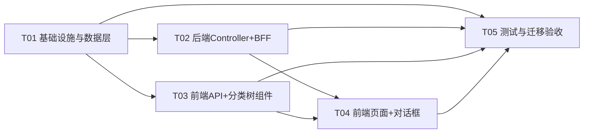

# 增量架构设计 + 任务分解：表单分类独立成表（form_category ⟂ form_definition）

> 作者：software-architect（高见远）｜协作：team-lead（齐活林）｜性质：**仅设计，不写业务代码**
> 依据：用户原话「将分类和表单分成两个表，而不是一个表，分类作为表单的属性而不是父级」+ 主理人已确认「保留分类层级（树）」+ 已核实的代码/DB 事实（见 §0 现状复核）
> 配套图：`docs/design/form-category-split-class.mermaid`、`docs/design/form-category-split-sequence.mermaid`
> ⚠️ 本文不覆盖仓库既有的 `docs/system_design.md`（那是上一个「wf_category + kind」任务的产出）。

---

## 0. 现状复核（对 team-lead 描述的核实与纠正）

已逐项核对代码与生产库 `mis_platform`（tenant=1）。**主理人描述基本准确，仅 3 处需纠正/补充**：

| # | 主理人描述 | 核实结果 | 证据 |
|---|---|---|---|
| C1 | `PUR_FORM=采购申请单(FORM, parent=BG)` | ❌ 实际 `parent_id=1791607381266` = **`CRM`（会员）**，而 CRM 的 parent 才是 BG。即采购申请单挂在「百购 → 会员」下 | DB：`PUR_FORM` 行 `parent_id=1791607381266` |
| C2 | 「V132 删 95007 时留下孤儿行 95057/95058」 | ❌ **无此孤儿行**：`sys_api` 与 `sys_menu_api` 中 `95057/95058/95059` 均**不存在**（0 行），是**完全空闲段** | DB：`select count(*) from sys_api where id between 95057 and 95059` = 0 |
| C3 | tenant=1 表单只有 PUR_FORM | ⚠️ 补充：另有 **`E2E_FORM`（tenant_id=900002，parent_id=0，deleted=0）**。迁移须按 `tenant_id` 分组处理，不能只处理 tenant=1 | DB：`E2E_FORM` 行 `tenant_id=900002` |

**其它已核实关键事实（作为设计的硬约束）：**

- `form_definition` 现有列（14）：`id, tenant_id, parent_id, code, name, description, status, sort_order, config, deleted, created_by, created_at, updated_at, kind`。
- `wf_category` 已存在，形态即目标镜像（990001 未分类已有）。
- `wf_definition.category_id` 已存在，全库仅 1 行且非空——**本次不动这条链**。
- **`FormDefinitionMigrationIntegrationTest`（V128 验收）断言**：`form_definition` 列含 **`parent_id`**、索引含 **`idx_form_def_tree`**、`sys_api 95050–95056` 恰 7 行。
- **`WfCategoryMigrationIntegrationTest`（V131 验收）断言**：`form_definition` 含 **`kind`** 列 + **`chk_form_def_kind`** 约束。
- **`FormDefinitionServiceIntegrationTest`（T1.4）** 深度依赖旧模型：`newFormUnder(parentId,…)`、`vo.parentId()`、`FormDefinition.ROOT_PARENT_ID`、`formService.tree(...)`、删除「有子项」校验。
- **`MigrationIdempotencyIntegrationTest`** 只重跑 `V128` 并断言 `sys_menu_api 95050–95056` 恰 7 行（**故 V133 严禁删除这些行**）。
- `mis-taskflow` 用 `ddl-auto: none`（`application.yml`）→ Hibernate **不做 schema 校验**，DROP/新增列由 Flyway 单方负责，实体与 DB 保持列映射一致即可。
- `WfDefinitionService.validateSupportedForms` 走 `formDefinitionService.listEnabledCodes`（**按 code**）→ 拆表后**不受影响**。
- 空闲 ID 段（已实测）：`sys_api 95057–95059 空闲`、`95066–95071 空闲`；`sys_menu_api 95077–95079、95086–95091 空闲`。

---

## 1. 实现方案 + 框架选型

### 1.1 技术难点与处理

| 难点 | 处理 | 理由 |
|---|---|---|
| 单表双用 → 双表：分类独立成树，表单只引用分类 | 新建 `form_category`（**镜像 `wf_category`**）；`form_definition` 新增 `category_id`（软引用） | 用户需求；且流程侧已跑通同形范式，直接复用，零新范式 |
| 分类层级（树）要保留 | `form_category` 沿用邻接表 `parent_id`（`0`=根）+ 应用层防环（复用 `WfCategoryService` 逻辑） | 用户已确认保留树；分类树与表单解耦后**不再有 3 层上限**（旧 `MAX_DEPTH=2` 作废） |
| `kind` / `parent_id` 如何处置 | **软废弃（保留列，代码停读写），本次不 DROP** | 见 §1.3 决策理由——DROP 会迫使改动 V128/V131 两个「迁移验收」测试，触碰红线且回滚性差 |
| 数据无损迁移 | 保留原 `id`/`parent_id`/`deleted` 迁入 `form_category`；表单 `category_id=原parent_id`（仅当 parent 是「未软删分类」，否则 NULL） | 保证引用映射稳定；边界（`E2E_FORM` parent=0、`BH` 软删分类）按规则兜底 |
| 端点权限（BFF `deny-unmapped:true`） | 6 个新端点登记 `sys_api 95066–95071` + 绑菜单 `95011`（`sys_menu_api 95086–95091`） | 与 V128/V132 同款幂等登记手法 |

### 1.2 框架选型结论

- **后端**：沿用 Spring Boot + Spring Data JPA + Flyway + `mis-common-core`（`Result` / `BusinessException` / `ResultCode`）。**不引入新依赖**。
- **BFF**：沿用 `TaskflowWebClient` 透传（`/internal/v1/**`），BFF 仅做身份注入与路径透传，**不落业务逻辑**。
- **前端**：沿用 Vite + React + shadcn + Tailwind。**不引入新依赖**。
- **测试**：后端 `@SpringBootTest` + JdbcTemplate 读系统表；前端 `vitest`。

### 1.3 关键决策

**决策 A：目标模型 = 「分类树表 `form_category`」+「表单表 `form_definition.category_id` 软引用」**
分类是表单的**属性**（`category_id`），不再是表单的**父级**（`parent_id`）。分类仍是一棵可任意深度的树。

**决策 B：`kind` / `parent_id` —— 采用「① 保留列但停止使用」，本次不 DROP。**
理由（grep/读测全量核实后）：
1. **保测试红线**：`FormDefinitionMigrationIntegrationTest` 断言 `form_definition.parent_id` + `idx_form_def_tree`；`WfCategoryMigrationIntegrationTest` 断言 `kind` + `chk_form_def_kind`。DROP 会**强制修改这两个测试的断言**——而红线要求「不得删测试/改断言迎合」。保留列可让这两个迁移验收测试**原样保持绿**。
2. **增量可回滚**：列仍在，回退代码即可继续用旧列（对生产库无需反向迁移）。
3. **收益低风险高**：列默认值已满足 NOT NULL（`parent_id DEFAULT 0`、`kind DEFAULT 'FORM'`），实体移除字段后 INSERT 会**省略**这两列由 DB 默认值兜底。
4. 代码侧**彻底停止读写**这两列；如后续确需清理，另起 `V134` DROP（本期不做，记为遗留项）。

> 若 product 强要求物理删除，可改走「② DROP」但必须同步改上述两个测试断言（届时需 team-lead 明确放行对测试断言的修改）。**本设计默认走 ①。**

**决策 C：不 seed `form_category` 的「未分类」节点。**
`category_id` 允许 `NULL`（与 `wf_definition.category_id` 一致），UI 对 `NULL` 显示「未分类/—」。
理由：tenant=1 迁移后**没有任何孤儿表单**（PUR_FORM→CRM），seed 会凭空造一个空节点；`E2E_FORM`(tenant=900002) 属测试租户，保持 NULL 即可。
> 备选（若 product 坚持要桶）：seed `form_category(id=990002, tenant_id=1, code='UNCATEGORIZED', name='未分类')` 并把所有 `category_id IS NULL` 的表单回填到它（id 段与 `wf_category.990001` 不冲突，但因跨表故用 990002 避免视觉混淆）。

**决策 D：`form-definitions` 的 `/tree` 端点移除；`sys_api 95051` 行保留（休眠）。**
表单已无树，`/tree` 语义消失。为**不破坏 `MigrationIdempotencyIntegrationTest`（95050–95056 恰 7 行）**，V133 **不删** `95051`（及其 `sys_menu_api` 绑定）——留作休眠登记行（`deny-unmapped` 只拦「未登记路径」，多一条休眠登记不影响）。

**决策 E：表单列表的分类过滤用查询参数 `categoryId`（`GET /api/v1/form-definitions?categoryId=`）。**
路径未变 → `sys_api 95052` 无需改动（`deny-unmapped` 只匹配 method+path，不含 query）。

---

## 2. 文件清单（相对路径 · 新建/修改/删除）

### 2.1 迁移（mis-migrator）
| 操作 | 文件 |
|---|---|
| 新建 | `backend/mis-migrator/src/main/resources/db/migration/V133__form_category_split.sql` |

### 2.2 后端 mis-taskflow
| 操作 | 文件 |
|---|---|
| 新建 | `backend/mis-taskflow/src/main/java/com/mis/taskflow/domain/entity/FormCategory.java` |
| 新建 | `backend/mis-taskflow/src/main/java/com/mis/taskflow/domain/repository/FormCategoryRepository.java` |
| 新建 | `backend/mis-taskflow/src/main/java/com/mis/taskflow/dto/FormCategoryVO.java` |
| 新建 | `backend/mis-taskflow/src/main/java/com/mis/taskflow/dto/UpsertFormCategoryRequest.java` |
| 新建 | `backend/mis-taskflow/src/main/java/com/mis/taskflow/service/FormCategoryService.java` |
| 新建 | `backend/mis-taskflow/src/main/java/com/mis/taskflow/controller/FormCategoryController.java` |
| 修改 | `.../domain/entity/FormDefinition.java`（删 `kind`/`parentId` + `KIND_*`/`ROOT_PARENT_ID` 常量；加 `categoryId`） |
| 修改 | `.../domain/repository/FormDefinitionRepository.java`（删 kind/parentId 派生查询；加 categoryId 查询） |
| 修改 | `.../service/FormDefinitionService.java`（删 tree/parent/kind/深度校验；加 categoryId 存在性校验） |
| 修改 | `.../controller/FormDefinitionController.java`（删 `kind` 参数与 `/tree`；list 加 `categoryId`） |
| 修改 | `.../dto/FormDefinitionVO.java`（删 `parentId`/`kind`；加 `categoryId`） |
| 修改 | `.../dto/UpsertFormDefinitionRequest.java`（`parentId`→`categoryId`；删 `kind`；7 参便捷构造保持签名兼容） |

### 2.3 BFF mis-admin-bff
| 操作 | 文件 |
|---|---|
| 新建 | `backend/mis-admin-bff/src/main/java/com/mis/adminbff/controller/FormCategoryController.java` |
| 新建 | `backend/mis-admin-bff/src/main/java/com/mis/adminbff/client/model/FormCategoryVO.java` |
| 修改 | `.../client/TaskflowWebClient.java`（加 `formCategory*` 6 方法 + `ParameterizedTypeReference`；`formDefinitions` 参数 `kind`→`categoryId`） |
| 修改 | `.../controller/FormDefinitionController.java`（删 `kind` 与 `/tree`；list 加 `categoryId`） |
| 修改 | `.../client/model/FormDefinitionVO.java`（删 `parentId`/`kind`；加 `categoryId`） |

### 2.4 前端 mis-admin-web
| 操作 | 文件 |
|---|---|
| 新建 | `frontend/mis-admin-web/src/lib/api/form-category.ts`（镜像 `wf-category.ts`） |
| 新建 | `frontend/mis-admin-web/src/features/biz/forms/form-category-tree.tsx`（镜像 `wf-category-tree.tsx`） |
| 修改 | `src/lib/api/form-definition.ts`（删 `FormKind`/树/`kind`；`parentId`→`categoryId`） |
| 修改 | `src/features/biz/forms/form-definition-manage-page.tsx`（分类 Tab 改用 form-category；表单 Tab 加「分类」列 + `categoryId` 过滤） |
| 修改 | `src/features/biz/forms/form-definition-dialog.tsx`（「父级分类」改为「分类」下拉，值=`categoryId`，来源 form_category） |
| 删除 | `src/features/biz/forms/form-definition-tree.tsx`（被 `form-category-tree.tsx` 取代；确认无其它引用后删） |

> 注：`src/components/layout/keep-alive-outlet.tsx` 只按路由 `'/system/forms'` 懒加载页面组件，**无需改动**。

### 2.5 测试
| 操作 | 文件 |
|---|---|
| 新建 | `backend/mis-taskflow/src/test/java/com/mis/taskflow/service/FormCategoryMigrationIntegrationTest.java`（镜像 `WfCategoryMigrationIntegrationTest`，验收 V133） |
| 新建 | `backend/mis-taskflow/src/test/java/com/mis/taskflow/service/FormCategoryServiceIntegrationTest.java`（承接从表单服务测试**平移**的树/父子/防环/删除子项用例） |
| 修改 | `.../service/FormDefinitionServiceIntegrationTest.java`（表单服务改纯表单：`parentId`→`categoryId`；树相关用例移出，**意图保留、不弱化、不 skip**） |
| 保持 | `.../service/FormDefinitionMigrationIntegrationTest.java`（V128 验收 → 因保留 `parent_id`/`idx_form_def_tree` 而**保持绿，无需改**） |
| 保持 | `.../service/WfCategoryMigrationIntegrationTest.java`（V131 验收 → 因保留 `kind`/`chk_form_def_kind` 而**保持绿，无需改**） |
| 新建 | `frontend/mis-admin-web/src/lib/api/form-category.test.ts`（镜像 `wf-category.test.ts`） |
| 修改 | `src/features/biz/forms/form-definition-manage-page.test.tsx`（mock 目标从 `form-definition` 的树改为 `form-category`；类型 `kind/parentId`→`categoryId`；**用例意图不变**） |

---

## 3. 数据结构 & 接口

### 3.1 DDL（V133 摘要，完整见 §4.1 迁移脚本）

```sql
CREATE TABLE IF NOT EXISTS form_category (
    id BIGINT PRIMARY KEY, tenant_id BIGINT NOT NULL,
    parent_id BIGINT NOT NULL DEFAULT 0,           -- 邻接树，0=根
    code VARCHAR(64) NOT NULL, name VARCHAR(128) NOT NULL,
    description TEXT, sort_order INT NOT NULL DEFAULT 0,
    config JSONB NOT NULL DEFAULT '{}'::jsonb, deleted SMALLINT NOT NULL DEFAULT 0,
    created_by BIGINT, created_at TIMESTAMPTZ NOT NULL DEFAULT NOW(), updated_at TIMESTAMPTZ NOT NULL DEFAULT NOW(),
    CONSTRAINT uk_form_category_tenant_code UNIQUE (tenant_id, code)
);
CREATE INDEX IF NOT EXISTS idx_form_category_tree ON form_category (tenant_id, parent_id, sort_order) WHERE deleted = 0;

ALTER TABLE form_definition ADD COLUMN IF NOT EXISTS category_id BIGINT NULL;   -- 软引用 form_category.id，无外键
CREATE INDEX IF NOT EXISTS idx_form_def_category ON form_definition (tenant_id, category_id) WHERE deleted = 0;
```

### 3.2 类图
见 `docs/design/form-category-split-class.mermaid`（含 taskflow 与 BFF 双侧）。

### 3.3 VO / DTO 变更

| 类型 | 变更 | 说明 |
|---|---|---|
| taskflow `FormDefinitionVO` | 删 `parentId`、`kind`；**加 `categoryId:Long`** | `id` 仍为 `String`（保持既有契约） |
| taskflow `UpsertFormDefinitionRequest` | 首参 `parentId`→`categoryId`（`Long`，可空）；删 `kind` | 保留 7 参便捷构造（签名不变，首参语义改为 categoryId），减少既有调用点改动 |
| taskflow `FormCategoryVO` | 新建，镜像 `WfCategoryVO`（`id:String, tenantId:String, parentId:Long, code, name, description, sortOrder, config, children, createdAt, updatedAt`） | — |
| taskflow `UpsertFormCategoryRequest` | 新建，镜像 `UpsertWfCategoryRequest`（`parentId, code, name, description, sortOrder, config`） | — |
| BFF `FormDefinitionVO` | 同 taskflow（删 `parentId`/`kind`，加 `categoryId:Long`） | — |
| BFF `FormCategoryVO` | 新建，镜像 taskflow | — |
| 前端 `FormDefinitionItem` | 删 `parentId`、`kind`；加 `categoryId: number \| null` | — |
| 前端 `FormCategoryItem` | 新建，镜像 `WfCategoryItem`（`id: string`） | — |

> ⚠️ **类型坑（务必写入共享知识）**：`FormDefinitionVO.categoryId` 是 `Long`（=number），而 `FormCategoryVO.id` 是 `String`。前端做 id↔name 映射时必须统一 `String(categoryId)` 后比对。

### 3.4 接口清单（逐字路径）

**mis-taskflow 内部（新）** `FormCategoryController` `@RequestMapping("/internal/v1/form-categories")`
| 方法 | 路径 | 入参 |
|---|---|---|
| GET | `/internal/v1/form-categories/tree` | `tenantId` |
| GET | `/internal/v1/form-categories` | `tenantId` |
| GET | `/internal/v1/form-categories/{id}` | `tenantId` |
| POST | `/internal/v1/form-categories` | `tenantId, operatorId` + body |
| PUT | `/internal/v1/form-categories/{id}` | `tenantId` + body |
| DELETE | `/internal/v1/form-categories/{id}` | `tenantId` |

**BFF 对外（新）** `FormCategoryController` `@RequestMapping("/api/v1/form-categories")` —— **与上表同形**（`GET /tree`、`GET`、`GET /{id}`、`POST`、`PUT /{id}`、`DELETE /{id}`），**必须逐字一致**（deny-unmapped）。

**mis-taskflow 内部（改）** `FormDefinitionController`
| 变化 | 详情 |
|---|---|
| 删 | `GET /internal/v1/form-definitions/tree`（连同 BFF 同名端点） |
| 改 | `GET /internal/v1/form-definitions`：删 `kind`，**加 `categoryId`**（`@RequestParam(required=false) Long categoryId`） |
| 不变 | `GET /{id}`、`POST`、`PUT /{id}`、`DELETE /{id}`（仅 body 字段变化） |

**BFF 对外（改）** `FormDefinitionController` `@RequestMapping("/api/v1/form-definitions")`
- 删 `GET /tree`；`GET` 删 `kind` 加 `categoryId`；其余路径**逐字不变**。
- `sys_api 95052`(`GET /api/v1/form-definitions`) **无需改动**（路径未变）。

### 3.5 `sys_api` / `sys_menu_api` 登记（V133 第 6/7 段）

| sys_api id | method | path_pattern | sys_menu_api id | menu |
|---|---|---|---|---|
| 95066 | GET | `/api/v1/form-categories/tree` | 95086 | 95011 |
| 95067 | GET | `/api/v1/form-categories` | 95087 | 95011 |
| 95068 | POST | `/api/v1/form-categories` | 95088 | 95011 |
| 95069 | PUT | `/api/v1/form-categories/{id:[0-9]+}` | 95089 | 95011 |
| 95070 | DELETE | `/api/v1/form-categories/{id:[0-9]+}` | 95090 | 95011 |
| 95071 | GET | `/api/v1/form-categories/{id:[0-9]+}` | 95091 | 95011 |

- 菜单 `95011`（`biz-form-list`, permission=`biz:form:list`）**已**由 V128 授权给 role_id=1 → **无需新增 `sys_role_permission`**。
- **不触碰** `sys_api 95050–95056` / `95060–95065` 与 `sys_menu_api 95050–95056 / 95076 / 95080–95085`。

---

## 4. 程序调用流程

见 `docs/design/form-category-split-sequence.mermaid`（4 个场景：列表加载带分类列 / 新建分类 / 新建表单选分类 / 删除分类引用校验）。

### 4.1 V133 迁移脚本（完整、幂等、可重跑）

> 关键顺序：建表 → 迁分类 → 加列 → 回填 → 删分类行 → 登记端点。**不做 DROP**（决策 B）。
> 幂等：`IF NOT EXISTS` / `ON CONFLICT DO NOTHING` / 固定 ID + 双层 `NOT EXISTS`。
> ⚠️ 绝不修改 V120–V132。

```sql
-- V133__form_category_split.sql  (PostgreSQL 16)
-- ===== 1) form_category 邻接树（镜像 wf_category）=====
CREATE TABLE IF NOT EXISTS form_category (
    id BIGINT PRIMARY KEY, tenant_id BIGINT NOT NULL, parent_id BIGINT NOT NULL DEFAULT 0,
    code VARCHAR(64) NOT NULL, name VARCHAR(128) NOT NULL, description TEXT,
    sort_order INT NOT NULL DEFAULT 0, config JSONB NOT NULL DEFAULT '{}'::jsonb,
    deleted SMALLINT NOT NULL DEFAULT 0, created_by BIGINT,
    created_at TIMESTAMPTZ NOT NULL DEFAULT NOW(), updated_at TIMESTAMPTZ NOT NULL DEFAULT NOW(),
    CONSTRAINT uk_form_category_tenant_code UNIQUE (tenant_id, code)
);
CREATE INDEX IF NOT EXISTS idx_form_category_tree
    ON form_category (tenant_id, parent_id, sort_order) WHERE deleted = 0;

-- ===== 2) 迁移分类行（保留 id/parent_id/deleted；含软删行如 BH）=====
INSERT INTO form_category (id, tenant_id, parent_id, code, name, description, sort_order, config, deleted, created_by, created_at, updated_at)
SELECT id, tenant_id, parent_id, code, name, description, sort_order, config, deleted, created_by, created_at, updated_at
FROM form_definition WHERE kind = 'CATEGORY'
ON CONFLICT DO NOTHING;

-- ===== 3) form_definition.category_id（软引用，无外键）=====
ALTER TABLE form_definition ADD COLUMN IF NOT EXISTS category_id BIGINT NULL;
CREATE INDEX IF NOT EXISTS idx_form_def_category
    ON form_definition (tenant_id, category_id) WHERE deleted = 0;

-- ===== 4) 回填：表单 category_id = 原 parent_id（仅当 parent 是同租户、未软删的分类）=====
UPDATE form_definition fd
SET category_id = fd.parent_id
WHERE fd.kind = 'FORM'
  AND fd.parent_id IS NOT NULL AND fd.parent_id <> 0
  AND EXISTS (SELECT 1 FROM form_category fc
              WHERE fc.id = fd.parent_id AND fc.tenant_id = fd.tenant_id AND fc.deleted = 0);
-- parent=0 / parent 指向软删分类 / 指向另一表单 / 不存在  → category_id 保持 NULL

-- ===== 5) form_definition 只留表单：物理删除已迁出的分类行 =====
DELETE FROM form_definition WHERE kind = 'CATEGORY';

-- ===== 6) 新端点登记 sys_api 95066-95071（见 §3.5 表格；module_id/parent_id=95010）=====
--   INSERT INTO sys_api (...) SELECT ... WHERE NOT EXISTS(同id) AND NOT EXISTS(同code) AND NOT EXISTS(同method+path);
-- ===== 7) 绑定 sys_menu_api 95086-95091 → menu 95011（同款双层 NOT EXISTS 守卫）=====
```

**迁移后 tenant=1 期望态**：`form_category` 含 `CS/BG/CRM/BH(软删)`（id 原值保留）；`form_definition` 仅 `PUR_FORM`（`category_id=CRM.id`）；tenant=900002 的 `E2E_FORM` 保留、`category_id=NULL`。

---

## 5. 任务列表（Part B · 有序、含依赖、按实现顺序）

> 硬性约束：≤5 个任务；每任务 ≥3 文件；首任务为「基础设施/数据层」。
> 顺序对齐 team-lead 要求：schema → entity/repo/service → controller → BFF → 前端 api → 前端页面/dialog → 测试。

### T01 · 基础设施与数据层（迁移 + 后端领域/仓储/DTO/服务）
- **目标**：落地 `form_category` 表与数据无损迁移；改造表单领域模型（去父级/kind，加 categoryId）；实现分类的领域与仓储与服务。
- **涉及文件**：`V133__form_category_split.sql`；`FormCategory.java`、`FormCategoryRepository.java`、`FormCategoryVO.java`、`UpsertFormCategoryRequest.java`、`FormCategoryService.java`；`FormDefinition.java`、`FormDefinitionRepository.java`、`FormDefinitionService.java`、`FormDefinitionVO.java`、`UpsertFormDefinitionRequest.java`。
- **关键实现点**：① V133 严格按 §4.1 顺序、幂等；② `FormCategoryService` 移植 `WfCategoryService` 的 tree 内存组装 + `validateParent` 防环 + 删除前「子分类 / 被表单引用」双校验（引用计数用 `countByTenantIdAndCategoryIdAndDeleted` 查 `form_definition.category_id`）；③ `FormDefinitionService` 删除 `tree/validateParent/depthOf/normalizeKind/validateKindAndCode`，`create/update` 改为校验 `categoryId`（非空时须存在、同租户、未软删），保留 `assertEnabled/listEnabledCodes/delete(白名单+实例引用校验)` 不动；④ 实体移除 `kind/parentId` 字段（DB 列保留，靠默认值兜底）。
- **验收点**：`FormDefinitionMigrationIntegrationTest`、`WfCategoryMigrationIntegrationTest` **保持绿**；`FormCategoryMigrationIntegrationTest` 绿；编译通过（无残留 `kind/parentId` 引用）。
- **依赖**：无。

### T02 · 后端 Controller + BFF 透传
- **目标**：暴露 taskflow 内部端点并打通 BFF 对外透传。
- **涉及文件（taskflow）**：`FormCategoryController.java`（新）、`FormDefinitionController.java`（改）；**（BFF）**`FormCategoryController.java`（新）、`FormDefinitionController.java`（改）、`TaskflowWebClient.java`（改，加 6 方法 + 改 `formDefinitions` 参数）、`client/model/FormCategoryVO.java`（新）、`client/model/FormDefinitionVO.java`（改）。
- **关键实现点**：① taskflow 内部路径 `/internal/v1/form-categories/**` 6 端点；② BFF 对外 `/api/v1/form-categories/**` 与 §3.5 `sys_api` **逐字一致**；③ BFF `create` 多收 `operatorId`、经 `TaskflowIdentity` 注入；④ 删除 `form-definitions/tree` 两端点；`GET /form-definitions` 加 `categoryId` 透传；⑤ BFF **不落业务逻辑**。
- **验收点**：BFF 六个新端点 200（非 403）；`/form-definitions?categoryId=` 过滤生效；`kind` 参数已从两端移除。
- **依赖**：T01。

### T03 · 前端 API 层 + 分类树组件
- **目标**：新增分类 API 与树组件；清理表单 API 的 kind/树依赖。
- **涉及文件**：`src/lib/api/form-category.ts`（新）、`src/features/biz/forms/form-category-tree.tsx`（新）、`src/lib/api/form-definition.ts`（改）、`src/features/biz/forms/form-definition-tree.tsx`（删）。
- **关键实现点**：① `form-category.ts` 镜像 `wf-category.ts`（tree/list/get/create/update/delete，路径 `/form-categories*`）；② `form-definition.ts` 删 `FormKind/FORM_KIND_*/fetchFormDefinitionTree`，`FormDefinitionItem` 去 `kind/parentId` 加 `categoryId:number|null`，`fetchFormDefinitions(tenantId,status?,categoryId?)`；③ `form-category-tree.tsx` 镜像 `wf-category-tree.tsx`；④ id↔name 映射统一 `String(categoryId)`。
- **验收点**：TS 编译通过；`form-category.test.ts`（在 T05）可对其断言端点路径逐字正确。
- **依赖**：T01（接口契约已在本文冻结）；可与 T02 并行推进，联调时依赖 T02。

### T04 · 前端页面 + 对话框
- **目标**：分类管理 Tab 改用 form_category；表单 Tab 增「分类」列与筛选；对话框「分类」下拉。
- **涉及文件**：`form-definition-manage-page.tsx`（改）、`form-definition-dialog.tsx`（改）；如有需要 `form-category-tree.tsx`（T03 产物）联调微调。
- **关键实现点**：① 页面并行拉取 `fetchFormCategoryTree` + `fetchFormDefinitions`；用分类树建 `id→name` 映射渲染「分类」列（null→「未分类」）；② 移除「父级/类型(kind)」列；③ 表单 Tab 增加分类筛选（可选，传 `categoryId`）；④ 对话框「分类」为 `form_category` 下拉（可空=未分类），提交 `categoryId`；⑤ 保留 `hasFormLoader` 标红「未关联组件」逻辑与「表单组件」下拉；⑥ `parentOptions/collectSubtreeIds/findCategoryNode` 等改到分类树数据类型上。
- **验收点**：双 Tab 可用；分类列正确解析；编辑表单能改分类；标红逻辑保留。
- **依赖**：T03。

### T05 · 测试与迁移验收
- **目标**：补齐迁移/服务/前端测试，确保真实性与回归。
- **涉及文件**：`FormCategoryMigrationIntegrationTest.java`（新）、`FormCategoryServiceIntegrationTest.java`（新）、`FormDefinitionServiceIntegrationTest.java`（改）；`src/lib/api/form-category.test.ts`（新）、`form-definition-manage-page.test.tsx`（改）。
- **关键实现点**：① 迁移验收断言：`form_category` 列/唯一索引/树索引齐全、`form_definition` 含 `category_id`、分类行已迁出（`form_definition` 无 `kind='CATEGORY'` 行）、`PUR_FORM.category_id=CRM.id`、`sys_api 95066–95071` 6 行且路径逐字正确、`sys_menu_api 95086–95091` 全绑 95011；② V133 幂等（连跑两次计数不变）；③ 服务测试**平移**树/父子/防环/删除子项用例到 `FormCategoryServiceIntegrationTest`（**意图保留，不 skip、不弱化**）；④ 前端 `form-category.test.ts` 断言 6 端点路径；⑤ 更新 `form-definition-manage-page.test.tsx` 的类型与 mock 目标（用例意图不变）。
- **验收点**：`MIS_DB_TEST=true` 下后端相关用例全绿；前端 vitest 全绿；无 `as any`/skip/删用例。
- **依赖**：T01–T04。

### 任务依赖图


---

## 6. 共享知识 / 跨文件约定

1. **ID 类型不一致坑**：
   - ✳️ `FormCategoryVO.id` = **`String`**（沿用 `WfCategoryVO` 契约），而 `FormDefinitionVO.categoryId` = **`Long`（number）**、`UpsertFormCategoryRequest.parentId` = `Long`。
   - 前端做关联/映射/回填表单时，**必须 `String(x)` 归一化**后再比较；提交 bundle 时 `Number(id)`。
2. **`category_id` 是软引用**：无外键；跨表引用计数与删除保护**只能在 service 层**（`countByTenantIdAndCategoryIdAndDeleted` 查 `form_definition.category_id`）。
3. **`form_definition.code` 语义不可变**：仍是 `wf_instance.started_form_code` 的字符串软引用；`uk_form_def_tenant_code` **不带** `WHERE deleted=0`，软删后 code 不可复用——**保持不变**。
4. **`kind`/`parent_id` 为 deprecated 列**：DB 保留、Java 停用。新增表单时这两列由 DB 默认值（`'FORM'`/`0`）兜底，**不得**在实体/仓储/服务中重新引入。
5. **删除规则的差异**：
   - 删**分类**：有子分类 → 拒；被表单引用（`category_id`）→ 拒。
   - 删**表单**：保持原逻辑——被 `wf_definition.supported_form_codes` 或 `wf_instance.started_form_code` 引用 → 拒（`assertEnabled/listEnabledCodes` 不变）。
6. **不改流程链**：`wf_category`、`wf_definition.category_id` 一行不动。
7. **错误码**：统一用 `ResultCode.VALIDATION_ERROR`（校验）/ `ResultCode.NOT_FOUND`（不存在）；返回体 `Result{code,data,message}`（`code=0` 成功）。
8. **事务边界**：查询 `@Transactional(readOnly=true)`，写 `@Transactional`；树组装在内存（读一次全量再组装），无 N+1。
9. **deny-unmapped**：BFF 每个对外路径必须与 `sys_api.path_pattern` **逐字一致**（含 `{id:[0-9]+}` 正则片段）；query 参数不参与匹配。
10. **迁移红线**：Flyway 只追加 `V133`；**绝不**改 V120–V132；迁移幂等（`IF NOT EXISTS`/`ON CONFLICT DO NOTHING`/固定 ID + `NOT EXISTS`）。
11. **不新增依赖**：后端/前端均沿用现有栈。

---

## 7. 待明确事项（真正的开放问题）

1. **`kind`/`parent_id` 是否最终物理删除**：本设计默认「软废弃不 DROP」（决策 B，为保 V128/V131 迁移验收测试不被改）。若团队接受「修改这两个迁移测试的断言」，可改为 V134 DROP。**需 team-lead 拍板**。
2. **是否 seed `form_category` 的「未分类」桶**：本设计默认**不 seed**（`category_id` 可空、UI 显示「未分类」）。若 product 要求统一桶（含多租户），需明确 id 段与是否回填 `category_id IS NULL` 的行。
3. **表单「分类筛选」交互**：单选分类（含其子分类？即按子树过滤）还是精确匹配？本设计默认**精确匹配 `categoryId`**；如需「含子分类」需前端展开子树 ids 或后端换 `IN` 查询——请确认。
4. **`form-definitions/tree` 是否保留兼容**：本设计**移除**。若有外部调用方依赖该端点，需改为保留（返回按分类分组的表单树）——请确认无外部依赖。

---

## 8. 红线核对（逐条对照团队五条红线）

| 红线 | 本设计如何满足 |
|---|---|
| 1. Flyway 只追加、V120–V132 不可改、迁移幂等 | 仅新增 `V133`；全脚本 `IF NOT EXISTS`/`ON CONFLICT DO NOTHING`/固定 ID + `NOT EXISTS`（§4.1）；T05 加幂等验收 |
| 2. `form_definition.code` 语义不可变、uk 不限 deleted | `code` 相关逻辑**完全不动**（`uk_form_def_tenant_code` 保留；`assertEnabled/listEnabledCodes/delete` 保留） |
| 3. deny-unmapped 路径逐字对齐、新端点登记 sys_api + 绑菜单 | §3.4/§3.5 逐字列出；`95066–95071` + 绑 `95011`；沿用 V128 已授权菜单（免新增 role_permission） |
| 4. 测试真实性（不删/skip/as any/改 fixture 迎合） | 树/父子用例**平移**至 `FormCategoryServiceIntegrationTest`（意图保留）；**V128/V131 迁移验收测试因决策 B 保持原样绿**，不改断言 |
| 5. 增量、可回滚 | 决策 B 保留旧列 → 回退代码即回旧行为；迁移只做「迁出+加列+回填+登记」，不做 DROP |

---

## 9. 架构结论

- **用户目标达成**：分类与表单**两个表**；分类是表单的**属性**（`form_definition.category_id`）而非父级；分类树层级**保留**（`form_category` 邻接表，任意深度）。
- **复用最大化**：`form_category` 完全镜像已跑通的 `wf_category`（表/仓储/服务/控制器/前端 api/前端树组件），工程师可「照葫芦画瓢」，风险与工作量最低。
- **低风险增量**：`kind`/`parent_id` 软废弃（决策 B）→ 保两个迁移验收测试原样绿、保可回滚；`sys_api` 只增不改；流程分类链一行不动。
- **无损迁移**：保留分类原 id/parent_id/软删态；表单 `category_id` 由原 `parent_id` 回填，边界（parent=0/软删/缺失/跨租户）一律 NULL。
- **唯一需 team-lead 拍板项**：§7 的 4 个开放问题，其中 #1（DROP 与否）影响是否触碰迁移测试断言，优先级最高。
