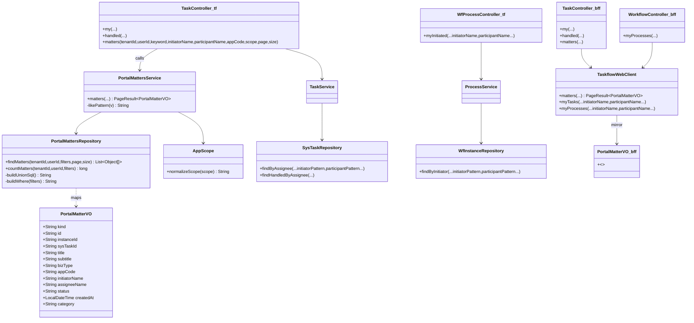
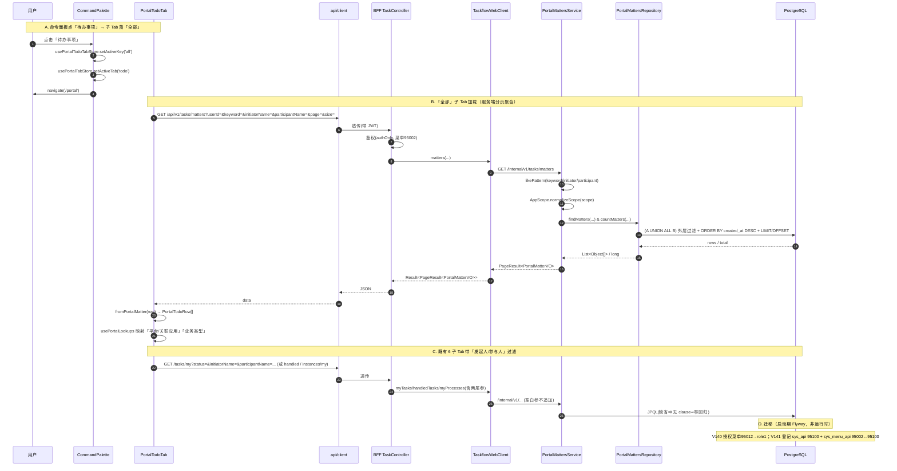

# 门户「待办事项 · 全部」聚合 + 事项搜索增强 + 首页板块表格化 + 业务分类按钮修复 —— 增量设计

| 项 | 值 |
|---|---|
| 状态 | **设计评审（Design Review）** —— 仅设计，不含业务实现 |
| 分支 | `flow` |
| 范围 | ① 待办事项新增子 Tab「全部」（三源聚合、服务端分页、默认选中）；② 命令面板「待办事项」→ 子 Tab 落「全部」；③ 事项搜索新增「发起人 / 参与人」（作用全部子 Tab，缺省零回归）；④ 首页三板块改表格 + 两列（平台/关联应用、业务类型）；⑤ 修复「业务分类」编辑按钮消失（菜单 95012 授权） |
| 产出约束 | **本文件仅设计**；不改业务代码、不改迁移、不 commit |
| 新迁移 | 自 **V140** 起（V1~V139 已落库，禁改） |
| 图例 | 🟩 已核实事实（带 `文件:行`）｜🟦 设计决策（附理由）｜🔴 需用户拍板｜❌ 明确否决 |

---

## 0. 现状事实（已核实，实地读码）

| # | 事实 | 出处 |
|---|---|---|
| F1 | 门户三 Tab（首页/待办事项/消息中心）激活态在全局 store，**不进 URL** | 🟩 `stores/portal-tab-store.ts:50-53`、`features/portal/portal-page.tsx:45-66` |
| F2 | 「待办事项」6 个子 Tab 配置驱动 `TODO_TABS`，键类型 `TodoTabKey` | 🟩 `lib/todo-tabs.ts:30-37`、`stores/portal-todo-tab-store.ts:12,22` |
| F3 | `my` → `/tasks/my?status=`；`sent` → `/workflow/instances/my`；`handled` → `/tasks/handled` | 🟩 `portal-todo-tab.tsx:114-147`、`lib/api/tasks.ts:69-77`、`lib/api/workflow.ts:190-209` |
| F4 | 三源适配器把三类接口映射为统一行 `PortalTodoRow` | 🟩 `lib/todo-adapters.ts:20-62`、`types.ts:20-59` |
| F5 | 命令面板点击：`setActiveTab(item.portalTab)` → `navigate('/portal')`，**不设子 Tab** | 🟩 `components/layout/command-palette.tsx:59-65`；`SearchItem.portalTab` 仅三值 `search/types.ts:34` |
| F6 | 首页三板块目前是 `ul` 紧凑列表：`TaskBoard`(`/tasks/my?status=PENDING&size=5`)、`MessageBoard`(`/messages/inbox?size=5`)、`ProcessBoard`(`/workflow/instances/my?size=4`) | 🟩 `task-board.tsx:46,102-128`、`message-board.tsx:42,84-105`、`process-board.tsx:47,100-119` |
| F7 | 门户内页表格已有「平台/关联应用」「业务类型」两列，映射 hook 三态规则 | 🟩 `portal-todo-tab.tsx:300-305`、`lib/use-portal-lookups.ts:68-82`（`null→平台/—`，命中取 name，回退 code） |
| F8 | taskflow `TaskController`：`/internal/v1/tasks/{my,handled,stats}`；`WfProcessController`：`/internal/v1/workflow/instances/my` | 🟩 `controller/TaskController.java:44-67`、`controller/WfProcessController.java:44-55` |
| F9 | `SysTask` 字段含 `appCode`，**无 initiator 字段**；`WfInstance` 有 `initiatorId/initiatorName`；`WfTask` 有 `sysTaskId/instanceId/assigneeName` | 🟩 `entity/SysTask.java:30-101`、`entity/WfInstance.java:58-62`、`entity/WfTask.java:31,71-78` |
| F10 | `TaskVO` 记录字段（新字段须末尾追加）；`mapstruct` 无，构造点唯一在 `TaskService.toVo` | 🟩 `dto/TaskVO.java:10-29`、`service/TaskService.java:338-358` |
| F11 | `wf_task.sys_task_id` **无唯一约束**（同任务可被多节点指向），JOIN 会多行 → 须 `EXISTS`/标量子查询去重 | 🟩 `entity/WfTask.java:43-72` 注释、`V135` 自检 |
| F12 | 现有仓储查询用 JPQL，nullable 参以「Java 侧预算 pattern + `(:p is null or ...)`」处理；`scope` 拆 3 条查询 | 🟩 `SysTaskRepository.java:47-64,137-146`、`WfInstanceRepository.java:35-102` |
| F13 | `scope` 语义：`app_code` 列三态（`ALL`/`APP`/`PLATFORM`），归一化在 `AppScope.normalizeScope` | 🟩 `support/AppScope.java:20-44` |
| F14 | BFF 出站统一走 `uriOf()`（防二次编码），透传空白参**不追加** | 🟩 `client/TaskflowWebClient.java:137-159,309-337` |
| F15 | 鉴权注册表：`sys_api(type='api',status=1)` ⋈ `sys_menu_api` ⋈ `sys_menu(status=1)`；菜单 `permission` 为空 ⇒ `authOnly`（登录即可） | 🟩 `mis-system/.../SysApiRepository.java:44-59`、`ApiService.java:36-44`、`ApiPermissionInterceptor.java:52-74` |
| F16 | 菜单 **95002** =「我的待办」（现 permission=**NULL**，登录即可），`/tasks/my`(sys_api 95025) 已绑它 | 🟩 `V123__taskflow_menu_api_seed.sql:30,71,106`、`V127__taskflow_personal_vs_admin_menu.sql:16-18` |
| F17 | 菜单 **95012** =「业务分类」(`biz:category:list`)，已登记但**未授权给 role_id=1**；前端按钮被 `PermissionGate` 隐藏 | 🟩 `V139__biz_category_menu_api.sql:24-29`、`biz-category-manage-page.tsx:4,30-31,177,214`、`permission-gate.tsx:10-16` |
| F18 | 迁移 id 段位：`95000–95099` 已占用（sys_api/sys_menu_api/sys_menu），**95100 起空闲**；`sys_role_permission` 种子用小幅 id（95001-95009）与 `970000000+…` 公式，运行时 id≈10^12 | 🟩 grep `9[0-9]{4}` × migration/*.sql；`V123:122-136`、`V127:26-36`、`support/IdGenerator.java:12-15` |
| F19 | Flyway 只追加，`V136~V139` checksum 锁死 | 🟩 迁移目录 + `V138:27` 红线注释 |

---

## 1. 实现方案与关键取舍

### 1.1 🟦 为什么「全部」用**服务端 UNION** 而不是前端合并

- 三源（`my`/`handled`/`sent`）在前端各自分页，若合并到「全部」，需同时拉 N 页再本地排序/去重，**分页语义崩坏**（第 k 页无法从三个后端游标拼出），且 `total` 不可信。服务端 `UNION ALL + ORDER BY created_at DESC + 独立 COUNT` 是唯一能保证「全局有序 + 精确总数 + 稳定分页」的做法。
- 「全部」= **我相关的全部事项**，定义为两支：
  - **A（kind=TASK）**：`sys_task` 中 `assignee_id = 我`、`deleted = 0` 的**全部状态**（PENDING/APPROVING/APPROVED/REJECTED 合并）；
  - **B（kind=INSTANCE）**：`wf_instance` 中 `initiator_id = 我` 的（我发起的）。
- ❌ 否决「前端把 6 个子 Tab 的接口结果本地合并」：分页/总数不可靠，且与既有三源适配器的分页契约冲突。

### 1.2 🟦 为什么用 `wf_task` 关联实例，而不是解析 `sys_task.metadata` JSON

- `sys_task.metadata` 里的 `wfInstanceId` 是**脏 JSON**（`SysTask.java:63-65`，写入为字符串拼接 `ProcessService.java:459`），解析脆弱、无法在 SQL 里做 `EXISTS` 过滤（PostgreSQL 对脏 JSON 解析失败即整行报错）。
- 纯 Java 关联路径可靠：`wf_task.sys_task_id ↔ sys_task.id`、`wf_task.instance_id ↔ wf_instance.id`（`WfTask.java:31,71`）。
- ⚠️ `wf_task.sys_task_id` **无唯一约束**（F11）：**只允许**在标量子查询/`EXISTS` 内引用 `wf_task`，**禁止**直接 `JOIN` 到 `sys_task`（会多行膨胀、污染分页与 COUNT）。取 `instance_id` 用 `ORDER BY wt.id LIMIT 1` 的标量子查询去重。

### 1.3 🟦 过滤条件在**外层**统一施加（保证两支一致）

两支各自只负责「算出统一列」（不含 keyword/发起人/参与人/scope），把这些条件放到 `SELECT ... FROM ( A UNION ALL B ) m WHERE ...` 的**外层**。好处：
- keyword/发起人/参与人/scope 语义**天然两支一致**，无需写两遍；
- 排序、`LIMIT/OFFSET`、`COUNT` 都在外层，去重与分页只做一次。

---

## 2. 新端点契约

### 2.1 BFF 对外端点

| 项 | 值 |
|---|---|
| Method + Path | `GET /api/v1/tasks/matters` |
| 处理类 | `mis-admin-bff` `TaskController`（`@RequestMapping("/api/v1/tasks")`，新增 `/matters`） |
| Query 参数 | `tenantId`(optional，经 `TaskflowIdentity.tenantId`)、`userId`(optional，即「我」= assignee 兼 initiator，经 `TaskflowIdentity.userId`)、`keyword`(optional)、`initiatorName`(optional)、`participantName`(optional)、`appCode`(optional)、`scope`(optional)、`page`(default 1)、`size`(default 20) |
| 返回 | `Result<PageResult<PortalMatterVO>>` |
| 透传 | `TaskflowWebClient.matters(...)` → `GET /internal/v1/tasks/matters`（新增方法，空白参不追加，遵循 F14） |

### 2.2 mis-taskflow 内部端点

| 项 | 值 |
|---|---|
| Method + Path | `GET /internal/v1/tasks/matters` |
| 处理类 | `mis-taskflow` `TaskController`（`@RequestMapping("/internal/v1/tasks")`，新增 `/matters`） |
| Query 参数 | `tenantId`(必填)、`userId`(必填)、`keyword`、`initiatorName`、`participantName`、`appCode`、`scope`、`page`(default 1)、`size`(default 20) |
| 服务 | `PortalMattersService.matters(tenantId, userId, keyword, initiatorName, participantName, appCode, scope, page, size) : PageResult<PortalMatterVO>` |

### 2.3 返回 VO 字段（`PortalMatterVO`，精确到字段名与类型）

> 新增 record（taskflow `dto/`，BFF `client/model/` 各一份镜像，字段/顺序一致）。**新 record 无需末尾追加约束**（该约束仅对既有 `TaskVO` 生效，F10）。

| 字段 | 类型 | 说明 / 取值来源 |
|---|---|---|
| `kind` | `String` | `"TASK"` \| `"INSTANCE"`（行类型，前端决定 status 徽标口径） |
| `id` | `String` | TASK=`sys_task.id`；INSTANCE=`wf_instance.id` |
| `instanceId` | `String`(nullable) | TASK=经 `wf_task` 解析的实例 id（无则 `null`）；INSTANCE=`= id` |
| `sysTaskId` | `String`(nullable) | TASK=`sys_task.id`（供抽屉「转办」）；INSTANCE=`null` |
| `title` | `String` | TASK=`biz_title`；INSTANCE=`wf_instance.title` |
| `subtitle` | `String` | TASK=`biz_type + ' / ' + biz_ref_id`；INSTANCE=`definition_code + ' · ' + coalesce(started_form_code,'-')` |
| `bizType` | `String`(nullable) | TASK=`sys_task.biz_type`；INSTANCE=`wf_instance.business_type` |
| `appCode` | `String`(nullable) | TASK=`sys_task.app_code`；INSTANCE=`wf_instance.app_code`（`null`⇒前端「平台」） |
| `initiatorName` | `String`(nullable) | 所属实例 `wf_instance.initiator_name`；TASK 无实例⇒`null` |
| `assigneeName` | `String`(nullable) | TASK=`sys_task.assignee_name`；INSTANCE=`null` |
| `status` | `String` | TASK=`sys_task.status`；INSTANCE=`wf_instance.status` |
| `createdAt` | `LocalDateTime`(ISO) | TASK=`sys_task.created_at`；INSTANCE=`wf_instance.created_at` |
| `category` | `String` | TASK=其 `status` 字面（`PENDING`…）；INSTANCE=`'mySent'`（对齐既有 `fromWfInstance` 口径 `todo-adapters.ts:59`） |

> 覆盖前端「全部」行渲染所需（`kind,id,instanceId,title,subtitle,bizType,appCode,initiatorName,assigneeName,status,createdAt,category`）+ 抽屉转办用 `sysTaskId`。

---

## 3. 核心 SQL 方案

> 以 **native SQL**（`EntityManager.createNativeQuery`）在 `PortalMattersRepository` 组装 `String` 执行。**过滤片段按需拼接**：参数缺省则**整段不拼**（从根上规避 F12/硬约束#4 的「单条 SQL 可空参数 ⇒ Hibernate6/PG 类型推断缺陷」）。返回 `Object[]`，Service 手工映射为 `PortalMatterVO`。

### 3.1 两支（分支内**不含** keyword/发起人/参与人/scope，仅含「我相关」）

```sql
-- 分支 A：kind=TASK —— 我处理的全部状态待办
SELECT 'TASK' AS kind,
       st.id AS id,
       (SELECT wt.instance_id FROM wf_task wt
         WHERE wt.sys_task_id = st.id ORDER BY wt.id LIMIT 1) AS instance_id,   -- 标量子查询，去重
       st.id AS sys_task_id,
       st.biz_title AS title,
       st.biz_type || ' / ' || st.biz_ref_id AS subtitle,
       st.biz_type  AS biz_type,
       st.app_code  AS app_code,
       (SELECT wi.initiator_name FROM wf_instance wi
         WHERE wi.id = (SELECT wt2.instance_id FROM wf_task wt2
                         WHERE wt2.sys_task_id = st.id ORDER BY wt2.id LIMIT 1)) AS initiator_name,
       st.assignee_name AS assignee_name,
       st.status     AS status,
       st.created_at AS created_at,
       st.status     AS category
  FROM sys_task st
 WHERE st.tenant_id = :tenantId
   AND st.assignee_id = :userId
   AND st.deleted = 0

UNION ALL

-- 分支 B：kind=INSTANCE —— 我发起的流程实例
SELECT 'INSTANCE' AS kind,
       wi.id AS id,
       wi.id AS instance_id,
       NULL::bigint AS sys_task_id,
       wi.title AS title,
       wi.definition_code || ' · ' || COALESCE(wi.started_form_code,'-') AS subtitle,
       wi.business_type AS biz_type,
       wi.app_code  AS app_code,
       wi.initiator_name AS initiator_name,
       NULL AS assignee_name,
       wi.status     AS status,
       wi.created_at AS created_at,
       'mySent' AS category
  FROM wf_instance wi
 WHERE wi.tenant_id = :tenantId
   AND wi.initiator_id = :userId
```

### 3.2 外层包装（统一施加过滤 + 排序 + 分页）

```sql
SELECT m.*
  FROM ( <分支A> UNION ALL <分支B> ) m
 WHERE 1 = 1
   -- [条件] keyword（标题/副标题/处理人/发起人 四选一）
   AND (m.title ILIKE :keyword OR m.subtitle ILIKE :keyword
        OR COALESCE(m.assignee_name,'') ILIKE :keyword
        OR COALESCE(m.initiator_name,'') ILIKE :keyword)
   -- [条件] 发起人：实例 initiator_name（TASK 无实例 ⇒ NULL ⇒ 不匹配，符合语义）
   AND COALESCE(m.initiator_name,'') ILIKE :initiatorName
   -- [条件] 参与人
   AND ( (m.instance_id IS NOT NULL AND EXISTS (
            SELECT 1 FROM wf_task wt
            LEFT JOIN sys_task st2 ON st2.id = wt.sys_task_id
            WHERE wt.instance_id = m.instance_id
              AND ( COALESCE(wt.assignee_name,'') ILIKE :participantName
                 OR COALESCE(st2.assignee_name,'') ILIKE :participantName ) ))
      OR (m.instance_id IS NULL AND COALESCE(m.assignee_name,'') ILIKE :participantName) )
   -- [条件] scope=APP
   AND m.app_code = :appCode
   -- [条件] scope=PLATFORM
   AND m.app_code IS NULL
 ORDER BY m.created_at DESC, m.kind ASC, m.id DESC   -- 稳定序（kind/id 兜底，避免同秒翻页错位）
 LIMIT :size OFFSET :offset
```

**独立 COUNT**：`SELECT COUNT(*) FROM ( <分支A> UNION ALL <分支B> ) m WHERE 1=1 <同一组过滤片段>`（与列表共用同一份「WHERE 片段构造函数」，保证 total 与列表口径一致）。

### 3.3 一致套用 keyword/发起人/参与人/appCode/scope 的说明

| 过滤 | 施加层 | 两支一致性 |
|---|---|---|
| keyword | 外层 `m.title/subtitle/assignee_name/initiator_name` | 两支都把这些列投影为同名输出列 ⇒ 一次判据覆盖两支 |
| 发起人 | 外层 `m.initiator_name` | 分支 A 由其标量子查询产出、分支 B 由实例列产出 ⇒ 同名同语义 |
| 参与人 | 外层 `EXISTS`（按 `m.instance_id`）+ 无实例退化为 `m.assignee_name` | 分支 B `instance_id` 恒非空；分支 A 无实例行走退化分支 |
| appCode/scope | 外层 `m.app_code`（`= :appCode` / `IS NULL`） | 两支都把 `app_code` 投影为同名列 ⇒ 三态过滤统一 |
| 分页/排序 | 外层 `ORDER BY + LIMIT/OFFSET` | 单点 |

### 3.4 去重策略（关键）

- 分支 A 每条 `sys_task` **恰好一行**：实例 id 用 `ORDER BY wt.id LIMIT 1` 的**标量子查询**取得，**不对 `wf_task` 做 JOIN** ⇒ 规避 F11 的「`sys_task_id` 非唯一 ⇒ 多行膨胀」。
- 分支 B 每条 `wf_instance` 恰好一行。
- `wf_task` 只在 `EXISTS`/标量子查询内出现 ⇒ 不可能影响行数 ⇒ 分页/COUNT 精确。

### 3.5 🔴 待明确：两支的重叠行

若一个流程实例由「我」发起，且其某个审批节点也分派给「我」，则该实例会**同时**以 `INSTANCE` 行（分支 B）与 `TASK` 行（分支 A）出现。规格按「A 合并全部状态 / B 我发起的」**字面保留两行**（见 §8 待明确）。

---

## 4. 既有三个端点新增两个可空过滤参数（默认缺省零回归）

新增参数：`initiatorName`、`participantName`（命名在 BFF 与内部端点**统一**）。缺省为 `null`/空白 ⇒ **不追加任何 clause**，与现状逐字等价。

| 端点（对外 / 内部） | 改造文件 | 追加约束（JPQL，缺省不生效） |
|---|---|---|
| `/api/v1/tasks/my` / `/internal/v1/tasks/my` | `TaskController`(taskflow/BFF)、`TaskService.myTasks`、`SysTaskRepository.findByAssignee* / findOpenByAssignee*`（6 变体） | 发起人：`(:initiatorPattern is null or exists (select 1 from WfInstance wi where wi.id in (select wt.instanceId from WfTask wt where wt.sysTaskId = t.id) and lower(coalesce(wi.initiatorName,'')) like :initiatorPattern))`；参与人：`(:participantPattern is null or exists (select 1 from WfTask wt where wt.instanceId in (select wt3.instanceId from WfTask wt3 where wt3.sysTaskId = t.id) and lower(coalesce(wt.assigneeName,'')) like :participantPattern))` |
| `/api/v1/tasks/handled` / `/internal/v1/tasks/handled` | 同上 + `findHandledByAssignee*`（3 变体） | 同上两 clause |
| `/api/v1/workflow/instances/my` / `/internal/v1/workflow/instances/my` | `WfProcessController`(taskflow/BFF)、`ProcessService.myInitiated`、`WfInstanceRepository.findByInitiator*`（3 变体） | 发起人：`(:initiatorPattern is null or lower(coalesce(i.initiatorName,'')) like :initiatorPattern)`；参与人：`(:participantPattern is null or exists (select 1 from WfTask wt where wt.instanceId = i.id and lower(coalesce(wt.assigneeName,'')) like :participantPattern))` |
| BFF 透传 | `TaskController`(BFF)、`WorkflowController`(BFF)、`TaskflowWebClient`（新参数，空白不追加，F14） | — |

- **零回归**：两参数 `required=false`；`likePattern` 对空白返回 `null`；JPQL `(:p is null or ...)` 在 `p=null` 时子句恒真。既有 5/6 参调用签名保留（新增为**尾参**，`tasks.ts:57-67`、`workflow.ts:190-209` 同范式）。
- ⚠️ JPQL 引入「跨实体相关子查询」为本仓首次（F12 现状无先例）⇒ **设计接受**（标准 JPQL/Hibernate 6 支持），若实现期 Hibernate 拒绝，**回退方案**：对既有端点也用 native 动态 SQL（与本设计 §3 同机制）。
- ⚠️ 数据事实：`ProcessService.assignNode` 写 `wfTask.setAssigneeName(null)`（`ProcessService.java:473`）⇒ `wf_task.assignee_name` 实测多为 `NULL`，故**参与人**在「有实例」的行上**同时**匹配 `sys_task.assignee_name`（经 `wt.sys_task_id` 关联，见 §3.2 的 `LEFT JOIN sys_task`），避免「参与人过滤恒空」（见 §8 待明确）。

---

## 5. BFF 侧：新增透传方法 + 新端点登记

### 5.1 透传方法

- `TaskflowWebClient`（`client/TaskflowWebClient.java`）新增：
  - `matters(tenantId, userId, keyword, initiatorName, participantName, appCode, scope, page, size) : PageResult<PortalMatterVO>` → `GET /internal/v1/tasks/matters`；
  - 既有 `myTasks/handledTasks/myProcesses` 各增加 `initiatorName/participantName` 尾参（空白不追加）。
  - 新增 `ParameterizedTypeReference<Result<PageResult<PortalMatterVO>>>` 常量。
- BFF `TaskController`：新增 `GET /matters`；`/my`、`/handled` 增加两 `@RequestParam(required=false)`。
- BFF `WorkflowController`：`/instances/my` 增加两 `@RequestParam(required=false)`。
- BFF `client/model/PortalMatterVO.java`：字段镜像 taskflow 的 `PortalMatterVO`。

### 5.2 新端点登记（硬约束 #1）

- `sys_api`：新 id **95100**（段位核实见 §6.1）；`module_id=95010`（taskflow 模块，`status=1`）、`parent_id=95010`、`type='api'`、`http_method='GET'`、`path_pattern='/api/v1/tasks/matters'`、`status=1`。
- `sys_menu_api`：新 id **95100**，`(menu_id=95002, api_id=95100)`。
- **绑定的已启用菜单（已核实）= `95002`**：
  - `95002`（`taskflow-pending`「我的待办」）`status=1`（`V123:30`）、`permission` 已被 V127 置 `NULL`（`V127:16-18`）⇒ 注册表规则 `authOnly=true`（`ApiService.java:38`、`ApiPermissionInterceptor.java:72`）⇒ **登录即可**，与门户语义一致；
  - 同菜单已绑定 `/tasks/my`（`sys_menu_api 95025`，`V123:106`）⇒ 语义一致（「我的待办」聚合）。
- ❌ 否决新建专用「门户」菜单：`/portal` 由 `keep-alive-outlet` 的 `PAGE_MAP` 直挂渲染（F1），**无对应 sys_menu**，新建无意义。

---

## 6. 迁移清单

> 只追加；`V1~V139` 禁改（F19）。幂等对齐 V7 / V123 / V139 范式（固定 id + `NOT EXISTS`）。

### 6.1 id 段位核实方式

- **sys_api / sys_menu_api / sys_menu**：对 `backend/mis-migrator/.../db/migration/*.sql` 执行 `grep -oE '9[0-9]{4}'`，`95000–95099` 全部占用，**95100 为最小空闲**；`96000+` 属其他模块。
- **sys_role_permission.id**：种子 id 为小幅值（`95001-95009`，`V123:122-136`）或 `970000000+…` 公式（`V127:26-36`）；运行时 id 由 `IdGenerator`（`System.currentTimeMillis`≈10^12，`IdGenerator.java:12-15`）⇒ **951012** 不与任何既存/运行时 id 冲突。

### 6.2 `V140__grant_biz_category_menu_to_admin.sql`（修复业务分类按钮）

| 项 | 内容 |
|---|---|
| 目的 | 把菜单 95012 授权给 `role_id=1`(TENANT_ADMIN) ⇒ 前端 `/menus/permissions` 含 `biz:category:list` ⇒ `PermissionGate` 放行「新增根分类/新增子分类/编辑/删除」 |
| SQL 要点 | `INSERT INTO sys_role_permission (id, role_id, perm_type, target_id, created_at) SELECT 951012, 1, 'menu'::sys_perm_type, 95012, NOW() WHERE NOT EXISTS (SELECT 1 FROM sys_role_permission rp WHERE rp.role_id=1 AND rp.perm_type='menu'::sys_perm_type AND rp.target_id=95012) AND EXISTS (SELECT 1 FROM sys_menu m WHERE m.id=95012 AND m.status=1) AND EXISTS (SELECT 1 FROM sys_role r WHERE r.id=1);` |
| 幂等 | 固定 id=951012 + `NOT EXISTS(role_id,perm_type,target_id)`（对应 `uk_role_perm` 唯一约束 `V1:310`）+ 外键目标前置 `EXISTS` |
| 表/库 | `sys_role_permission` 在 `mis_platform` 库（**无** `sys_role_menu` 表，`V7` 先例） |

### 6.3 `V141__portal_matters_api.sql`（新端点登记 + 绑定）

| 项 | 内容 |
|---|---|
| sys_api | `(95100, 95010, 95010, 'portal_matters', 'api'::sys_api_node_type, '我的全部事项', 'GET', '/api/v1/tasks/matters', 100, 1, NOW(), NOW())`；`WHERE NOT EXISTS(同 id) AND NOT EXISTS(module_id=95010 AND code) AND NOT EXISTS(type='api' AND status=1 AND http_method+path_pattern)` |
| sys_menu_api | `(95100, 95002, 95100, 1, NOW())`；`WHERE NOT EXISTS(同 id) AND NOT EXISTS(menu_id,api_id) AND EXISTS(menu 95002 启用) AND EXISTS(api 95100)` |
| 幂等 | 固定 id + 上游范式 |

> 既有三个端点新增两参数**无需新登记**（仅 query 参数，method+path 未变，注册表按 path 匹配）。

---

## 7. 数据结构 / 接口类图 + 调用时序图

> 同步落盘：`portal-matters-aggregation-class.mermaid`、`portal-matters-aggregation-sequence.mermaid`。

### 7.1 类图（`classDiagram`）



### 7.2 时序图（`sequenceDiagram`）



---

## 8. Anything UNCLEAR（待用户拍板）

1. 🔴 **两支重叠行**：同一实例既是「我发起的」又分派给「我」时，`TASK` 行与 `INSTANCE` 行会各出现一次（§3.5）。是否需要在「全部」里做语义去重（例如有实例的 TASK 行折叠到 INSTANCE 行）？**当前按字面保留两行**。
2. 🔴 **参与人取值口径**：规格写 `wf_task.assignee_name`，但 `assignNode` 实测写 `NULL`（`ProcessService.java:473`）⇒ 纯 `wf_task.assignee_name` 会**恒空**。本设计已扩展为「`wf_task.assignee_name` **或** 其 `sys_task.assignee_name`」。请确认此扩展可接受。
3. 🔴 **「全部」的 `category`**：TASK 行 `category` 取原始 `status` 字面、INSTANCE 行取 `'mySent'`（§2.3）。此口径供行内动作/徽标判定，是否与产品预期一致？
4. 🔴 **首页三板块表格列**：本次只加「平台/关联应用」「业务类型」两列（复用 `usePortalLookups`）。是否需要在**改表格的同时**保留原先的「逾期/PriorityBadge/时间」等信息列？规格未明说。
5. 🔴 **`TaskBoard`「查看全部」去向**：默认子 Tab 将变为「全部」，`TaskBoard`（我的待办）的「查看全部」目前经 `usePortalEntry.open('pending')` 落「待处理」。是否要改为落「全部」？规格未要求，**默认不变**。

---

## 9. Shared Knowledge（给 Engineer）

- User-facing 语言：中文；新代码注释沿用仓库中文风格。
- BFF 出站一律经 `uriOf()`（防二次编码，F14）；空白参**不追加** query。
- 新增 BFF 端点**必须**登记 `sys_api`(type='api',status=1) 并绑定 `status=1` 菜单，否则 403 静默失效（F15）。
- 迁移**只追加**，从 V140 起；四位数/五位数 id 段位核实见 §6.1。
- `scope` 过滤按 `ALL/APP/PLATFORM` 处理，禁止单条 SQL 可空参数写法（硬约束 #4）。
- 前端 ID 一律 `string`；门户激活态**不进 URL**（store 承载，F1）。
- 门户相关单测 `beforeEach` 必须复位：`usePortalTabStore.setState({activeTab:'home'})`、`usePortalTodoTabStore.setState({activeKey:'all'})`（默认键变更后）。
