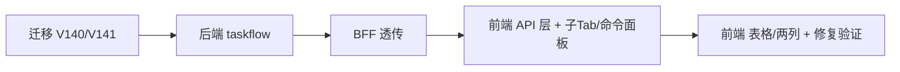

# 门户「待办事项·全部」聚合 + 事项搜索增强 + 首页板块表格化 + 业务分类修复 —— 任务分解

> 上游设计：`docs/design/portal-matters-aggregation-design.md`（本文件为其有序任务列表）
> 依赖顺序 = 实现顺序；`→` 表示「先决任务」。

## 依赖图

> 说明：迁移（T01）与后端（T02）可**并行开发**，但**端到端联调**必须 T01 完成（否则新端点 403、业务分类按钮仍隐藏）。

---

## T01 · 迁移层（V140 / V141）

- **来源文件**
  - `backend/mis-migrator/src/main/resources/db/migration/V140__grant_biz_category_menu_to_admin.sql`（新增）
  - `backend/mis-migrator/src/main/resources/db/migration/V141__portal_matters_api.sql`（新增）
- **依赖**：无
- **优先级**：P0
- **内容**
  - V140：`INSERT INTO sys_role_permission (id, role_id, perm_type, target_id, created_at)` 授权菜单 `95012` 给 `role_id=1`，固定 id `951012`，`'menu'::sys_perm_type`，三重幂等 + 前置 `EXISTS`（设计 §6.2）。
  - V141：登记 `sys_api 95100`（`GET /api/v1/tasks/matters`，module_id/parent_id=95010，`type='api'`，status=1，code `portal_matters`）+ `sys_menu_api 95100` 绑菜单 `95002`（设计 §6.3）。
- **验收点**
  - [ ] `V140` 后 `SELECT 1 FROM sys_role_permission WHERE role_id=1 AND perm_type='menu' AND target_id=95012` 有且仅一行；重复执行幂等。
  - [ ] `V141` 后 `findRegistryRows()` 能查到 `(GET, /api/v1/tasks/matters, permission=NULL(authOnly), moduleStatus=1)`。
  - [ ] **不改动** V1~V139 任意文件（checksum 不得变）。
  - [ ] 与 V1~V139 无 id 冲突（§6.1 核实方式）。

---

## T02 · 后端 · mis-taskflow

- **来源文件**
  - `backend/mis-taskflow/src/main/java/com/mis/taskflow/dto/PortalMatterVO.java`（新增）
  - `backend/mis-taskflow/src/main/java/com/mis/taskflow/domain/repository/PortalMattersRepository.java`（新增，native 动态 SQL）
  - `backend/mis-taskflow/src/main/java/com/mis/taskflow/service/PortalMattersService.java`（新增）
  - `backend/mis-taskflow/src/main/java/com/mis/taskflow/controller/TaskController.java`（改：`/matters` + `/my`、`/handled` 加两参）
  - `backend/mis-taskflow/src/main/java/com/mis/taskflow/controller/WfProcessController.java`（改：`/instances/my` 加两参）
  - `backend/mis-taskflow/src/main/java/com/mis/taskflow/service/TaskService.java`（改：`myTasks`/`handledTasks` 透传两参）
  - `backend/mis-taskflow/src/main/java/com/mis/taskflow/service/ProcessService.java`（改：`myInitiated` 透传两参）
  - `backend/mis-taskflow/src/main/java/com/mis/taskflow/domain/repository/SysTaskRepository.java`（改：my/handled 各 scope 变体加两 clause）
  - `backend/mis-taskflow/src/main/java/com/mis/taskflow/domain/repository/WfInstanceRepository.java`（改：3 变体加两 clause）
- **依赖**：T01（联调）
- **优先级**：P0
- **内容**
  - 新端点：`GET /internal/v1/tasks/matters` → `PortalMattersService` → `PortalMattersRepository`（`UNION ALL` 两支 + 外层过滤 + `ORDER BY created_at DESC,kind,id DESC` + `LIMIT/OFFSET` + 独立 COUNT，设计 §3）。
  - 既有端点加 `initiatorName`/`participantName`（缺省零回归，设计 §4）。
  - `PortalMatterVO` 字段严格对齐设计 §2.3。
- **验收点**
  - [ ] 不传新参数时，`/tasks/my`、`/tasks/handled`、`/workflow/instances/my` 的 SQL 与结果**逐字等价**（JPQL 缺省 clause 恒真）。
  - [ ] `/matters` 分页正确：`total` 与逐页一致性；`wf_task.sys_task_id` 多行不导致膨胀（构造同实例多 wf_task 用例）。
  - [ ] `scope=ALL/APP/PLATFORM` 三态正确；无单条 SQL 可空参数写法。
  - [ ] 集成测试：三源各造 1 行 + 交集 1 行，「全部」返回行数与顺序符合预期。

---

## T03 · BFF 透传

- **来源文件**
  - `backend/mis-admin-bff/src/main/java/com/mis/adminbff/client/model/PortalMatterVO.java`（新增，镜像）
  - `backend/mis-admin-bff/src/main/java/com/mis/adminbff/client/TaskflowWebClient.java`（改：`matters(...)` + `myTasks`/`handledTasks`/`myProcesses` 加两尾参 + 新 `ParameterizedTypeReference`）
  - `backend/mis-admin-bff/src/main/java/com/mis/adminbff/controller/TaskController.java`（改：`GET /matters` + `/my`、`/handled` 加两参）
  - `backend/mis-admin-bff/src/main/java/com/mis/adminbff/controller/WorkflowController.java`（改：`/instances/my` 加两参）
- **依赖**：T02
- **优先级**：P0
- **内容**
  - 出站经 `uriOf()`；空白参不追加（设计 §5.1）。
  - `/matters` 对外路径与 `sys_api 95100` 完全一致。
- **验收点**
  - [ ] `GET /api/v1/tasks/matters`（登录态）返回 `Result<PageResult<PortalMatterVO>>`，非 403。
  - [ ] 未登记前调用返回 403「接口未授权映射」（反向验证登记必要性）。
  - [ ] `/my`、`/handled`、`/instances/my` 传出 query 不含空参。

---

## T04 · 前端 · API 层 + 子 Tab / 命令面板

- **来源文件**
  - `frontend/mis-admin-web/src/stores/portal-todo-tab-store.ts`（改：`TodoTabKey` 加 `'all'`；`DEFAULT_TODO_TAB_KEY='all'`）
  - `frontend/mis-admin-web/src/features/portal/lib/todo-tabs.ts`（改：`TODO_TABS` 首项加 `{key:'all',label:'全部',source:'matters'}`）
  - `frontend/mis-admin-web/src/features/portal/types.ts`（改：`PortalTodoSource` 加 `'matters'`）
  - `frontend/mis-admin-web/src/lib/api/tasks.ts`（改：`TaskQuery`/`buildQuery` 加 `initiatorName`/`participantName`；新增 `PortalMatterItem` 类型与 `fetchPortalMatters(...)`）
  - `frontend/mis-admin-web/src/lib/api/workflow.ts`（改：`fetchMyProcesses` 加两尾参）
  - `frontend/mis-admin-web/src/features/portal/lib/todo-adapters.ts`（改：新增 `fromPortalMatter`）
  - `frontend/mis-admin-web/src/features/portal/tabs/portal-todo-tab.tsx`（改：`source==='matters'` 分支 + 两个搜索框「发起人/参与人」）
  - `frontend/mis-admin-web/src/components/layout/command-palette.tsx`（改：`go()` 中 `portalTab==='todo'` 时 `setActiveKey('all')`）
- **依赖**：T03
- **优先级**：P0
- **内容**
  - 子 Tab 条由 `TODO_TABS` 自动多出「全部」且**默认选中**；`DEFAULT_TODO_TAB_KEY` 与 `TODO_TABS[0].key` 同源。
  - 「发起人/参与人」输入框语义同 keyword（draft/applied，显式搜索，回车触发）。
  - 适配器：`key = \`${kind.toLowerCase()}-${id}\``；`category` 取 VO。
- **验收点**
  - [ ] 进入「待办事项」默认选中「全部」；命令面板点「待办事项」落「全部」。
  - [ ] 「全部」调 `/tasks/matters`（非本地合并）；切「全部」/分页/搜索各触发一次请求。
  - [ ] 既有 6 子 Tab 传 `initiatorName/participantName`；清空后 URL 无该参。
  - [ ] 单测：`todo-tabs.test.tsx`「默认键对齐」更新为 `'all'`；`beforeEach` 复位 `activeKey:'all'`。

---

## T05 · 前端 · 首页三板块表格化 + 修复验证

- **来源文件**
  - `frontend/mis-admin-web/src/features/portal/components/task-board.tsx`（改：`ul` → `table`，加「平台/关联应用」「业务类型」列）
  - `frontend/mis-admin-web/src/features/portal/components/message-board.tsx`（改：同上，复用 `usePortalLookups`）
  - `frontend/mis-admin-web/src/features/portal/components/process-board.tsx`（改：同上）
  - （按需）`frontend/mis-admin-web/src/features/portal/components/workbench-overview.tsx`（校对入口口径）
- **依赖**：T04
- **优先级**：P1
- **内容**
  - 三板块复用一个 `usePortalLookups(tenantId)`；`appCode==null→「平台」`、`bizType==null→「—」`、命中取 name、回退 code（设计 §7 / F7）。
  - 保持单层滚动与既有列信息（优先级/未读/状态徽标）。
- **验收点**
  - [ ] 三板块均渲染「平台/关联应用」「业务类型」两列且取值符合三态规则。
  - [ ] 端到端：`admin` 登录后「系统管理 → 业务分类」出现「新增根分类/新增子分类/编辑/删除」按钮（V140 生效）。
  - [ ] 门户待办「全部」行点开抽屉、有实例行可转办；无回归。
