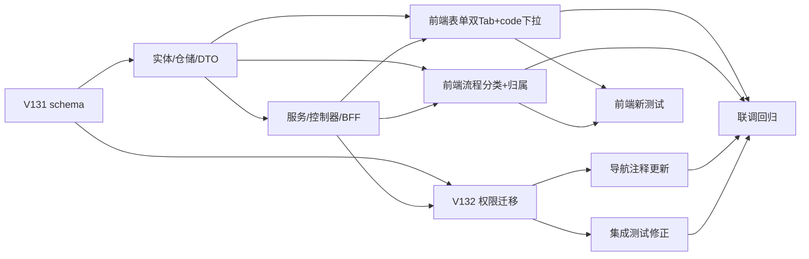

# mis-platform 增量架构设计 + 任务分解（表单/流程分类 + 组件绑定 + 权限合并）

> 作者：software-architect（高见远）｜协作方：team-lead（齐活林）、software-product-manager（Alice）
> 依据：增量 PRD + 已核实代码事实（V120–V130 迁移、FormDefinition/WfDefinition 实体、BFF 透传链、FormDefinitionMigrationIntegrationTest、前端 system-nav/keep-alive-outlet）
> 性质：**仅设计，不写实现代码**。

---

## 1. 实现方案 + 框架选型

### 1.1 技术难点与对应框架

| 难点 | 选型 / 处理 | 理由 |
|---|---|---|
| 表单分类与表单定义共用一张表，又要区分「文件夹」与「真实表单」 | 复用 `form_definition` 表 + 新增 `kind` 列（`CATEGORY`/`FORM`） | 与既有「单表自引用邻接树」范式一致（`sys_menu`/`kb_category`），避免新表与跨表 join |
| 流程分类需要独立的、可管理的树（决策 B：与表单分类**独立**管理） | 新建 `wf_category` 邻接树表（结构对齐 `form_definition`） | 决策明确要求两者独立；复用既有树组装逻辑 |
| 流程定义归属分类，同时兼容历史字符串 `category` | `wf_definition` 加 `category_id`（可空 FK 软引用）+ 旧 `category` 列**保留废弃** | 主理人裁定：不删列，新代码只用 `category_id`；已发起实例的 `definition_id` 不变，不跟随 |
| 表单定义与前端组件真正关联（决策 A） | 前端 code 改为「从 `listFormLoaderCodes()` 下拉选择」；后端不新增组件库，仅保留既有 `code` 唯一性与格式校验 | 组件绑定键=code 不变；前端加载表是唯一真相源 |
| 端点权限（BFF `deny-unmapped:true`） | 每个新端点必须在 `sys_api` 登记并绑定到用户已授权菜单 | 既有坑位（V128/V130 已验证）：漏登记/错绑即 403 |
| 权限模型收敛（决策 C） | 删菜单 95007，把 `workflow:definition:edit` 合并进 95006，原 95007 的 `sys_menu_api` 全部改挂 95006 | 消除 view/edit 双菜单割裂 |

### 1.2 框架选型结论

- **后端**：沿用既有栈（Spring Boot + JPA + Flyway + `mis-common-core` 的 `Result`/`BusinessException`）。**不引入任何新依赖**。
- **前端**：沿用 Vite + React + 既有 shadcn 组件（`Button/Dialog/Input/Select/Table/Badge/sonner`）。**不引入新依赖**（主理人硬约束）。
- **BFF 透传模式**：复用 `TaskflowWebClient`（Feign/WebClient）→ mis-taskflow `/internal/v1/...`，BFF 仅做身份注入（`TaskflowIdentity.tenantId/operatorId`）与路径透传，**不落业务逻辑**。
- **测试**：后端沿用 `@SpringBootTest` + JDBC 读系统表（既有 `FormDefinitionMigrationIntegrationTest` 范式）；前端沿用 `vitest`（**务必用 OOM 规避命令**，见 §7）。

---

## 2. 文件列表（相对路径，标注 新增 / 修改）

### 2.1 后端 `backend/mis-taskflow`

| 状态 | 路径 | 说明 |
|---|---|---|
| 修改 | `src/main/java/com/mis/taskflow/domain/entity/FormDefinition.java` | 新增 `kind` 字段（`String`，`CATEGORY`/`FORM`）+ getter/setter |
| 修改 | `src/main/java/com/mis/taskflow/domain/entity/WfDefinition.java` | 新增 `categoryId`（`Long`，可空）+ getter/setter；`category` 旧字段保留不动 |
| 新增 | `src/main/java/com/mis/taskflow/domain/entity/WfCategory.java` | 邻接树实体（对齐 `FormDefinition`，无 `kind`） |
| 修改 | `src/main/java/com/mis/taskflow/domain/repository/FormDefinitionRepository.java` | 新增 `findByTenantIdAndKindAndDeleted`、`countByTenantIdAndKindAndParentIdAndDeleted` |
| 修改 | `src/main/java/com/mis/taskflow/domain/repository/WfDefinitionRepository.java` | 新增 `findByTenantIdAndCategoryIdAndDeleted`（按分类筛选/回填校验） |
| 新增 | `src/main/java/com/mis/taskflow/domain/repository/WfCategoryRepository.java` | `findByIdAndTenantIdAndDeleted`、`findByTenantIdAndDeleted…`、`countByTenantIdAndParentIdAndDeleted`、`countByTenantIdAndCategoryIdAndDeleted` |
| 修改 | `src/main/java/com/mis/taskflow/dto/FormDefinitionVO.java` | 新增 `kind` 字段 |
| 修改 | `src/main/java/com/mis/taskflow/dto/UpsertFormDefinitionRequest.java` | 新增 `kind` 字段（必填，`@NotBlank`） |
| 新增 | `src/main/java/com/mis/taskflow/dto/WfCategoryVO.java` | 树/列表 VO（`children` 可选） |
| 新增 | `src/main/java/com/mis/taskflow/dto/UpsertWfCategoryRequest.java` | `parentId/code/name/description/sortOrder/config` |
| 修改 | `src/main/java/com/mis/taskflow/dto/WfDefinitionDTO.java` | 新增 `categoryId` 字段（旧 `category` 保留） |
| 修改 | `src/main/java/com/mis/taskflow/dto/CreateDefinitionRequest.java` | 新增 `categoryId` 字段 |
| 修改 | `src/main/java/com/mis/taskflow/service/FormDefinitionService.java` | `tree/list` 支持可选 `kind` 过滤；`create/update` 校验 `kind`；`validateKindAndCode`：FORM 的 code 由前端保证取自组件清单，后端仅做格式+唯一；删除时按 `kind` 区分引用校验 |
| 新增 | `src/main/java/com/mis/taskflow/service/WfCategoryService.java` | `tree/list/get/create/update/delete`（删除前校验子节点 + 已关联 `wf_definition`） |
| 修改 | `src/main/java/com/mis/taskflow/service/WfDefinitionService.java` | `create/update` 接收并写入 `categoryId`；`toDto` 输出 `categoryId`；`list` 支持可选 `categoryId` 过滤 |
| 新增 | `src/main/java/com/mis/taskflow/controller/WfCategoryController.java` | `@RequestMapping("/internal/v1/workflow/categories")`：`GET /tree`、`GET`、`GET /{id}`、`POST`、`PUT /{id}`、`DELETE /{id}` |
| 修改 | `src/main/java/com/mis/taskflow/controller/FormDefinitionController.java` | `/tree`、`GET` 增加可选 `kind` 入参透传给 service |
| 修改 | `src/main/java/com/mis/taskflow/controller/WfDefinitionController.java` | `CreateDefinitionRequest` 已含 `categoryId`，无需改方法签名（仅确认透传） |

### 2.2 后端 `backend/mis-migrator`（**Flyway 只追加，绝不改 V120–V130**）

| 状态 | 路径 | 说明 |
|---|---|---|
| 新增 | `src/main/resources/db/migration/V131__form_wf_category_schema.sql` | `form_definition` 加 `kind` 列（默认 `'FORM'`）+ 旧行回填 `'FORM'`；建 `wf_category` 表；`wf_definition` 加 `category_id` 列（可空） |
| 新增 | `src/main/resources/db/migration/V132__perm_merge_and_backfill.sql` | 权限合并（删 95007 + 95006 改 perm + `sys_menu_api` 重绑）+ wf_category 端点 `sys_api` 登记绑 95006 + `wf_definition.category_id` 数据回填 |

### 2.3 后端 `backend/mis-admin-bff`

| 状态 | 路径 | 说明 |
|---|---|---|
| 修改 | `src/main/java/com/mis/adminbff/client/TaskflowWebClient.java` | 新增 `wfCategoryTree/wfCategories/getWfCategory/createWfCategory/updateWfCategory/deleteWfCategory` 方法（指向 `/internal/v1/workflow/categories`） |
| 新增 | `src/main/java/com/mis/adminbff/client/model/WfCategoryVO.java` | 透传 `WfCategoryVO`（对齐 mis-taskflow） |
| 新增 | `src/main/java/com/mis/adminbff/controller/WfCategoryController.java` | `@RequestMapping("/api/v1/workflow/categories")` 透传（路径与 V132 登记的 `sys_api` 逐字一致） |
| 修改 | `src/main/java/com/mis/adminbff/controller/FormDefinitionController.java` | `tree`/`list` 透传可选 `kind` 参数 |

### 2.4 前端 `frontend/mis-admin-web`

| 状态 | 路径 | 说明 |
|---|---|---|
| 修改 | `src/lib/api/form-definition.ts` | `FormDefinitionItem` 加 `kind`；`UpsertFormDefinitionRequest` 加 `kind`；`fetchFormDefinitions`/`fetchFormDefinitionTree` 支持 `kind` 参数 |
| 新增 | `src/lib/api/wf-category.ts` | `WfCategoryItem` + `fetchWfCategoryTree`/`fetchWfCategories`/`createWfCategory`/`updateWfCategory`/`deleteWfCategory` |
| 修改 | `src/features/biz/forms/form-definition-manage-page.tsx` | **双 Tab 重构**：Tab①「表单注册」（树+表，FORM 节点；列表对 `hasFormLoader(code)` 为 false 的行标红）；Tab②「分类管理」（CATEGORY 树 CRUD，参考 `menu-manage-page`） |
| 修改 | `src/features/biz/forms/form-definition-dialog.tsx` | code 由自由输入改为 `<Select>`（数据源 `listFormLoaderCodes()`）；新增 `kind` 选择（FORM/CATEGORY）；编辑历史「未注册组件」code 时渲染红色保留项 |
| 新增 | `src/features/biz/forms/form-category-tree.tsx` | 分类管理 Tab 的树组件（增/改/删/移动，参考 `menu-manage-page.tsx`） |
| 修改 | `src/features/biz/forms/form-definition-tree.tsx` | 支持 `kind` 过滤 / 无组件节点标红（可选微调） |
| 新增 | `src/features/system/workflow-designer/wf-category-tree.tsx` | 流程分类树组件（CRUD，复用 `menu-manage-page` 范式） |
| 修改 | `src/features/system/workflow-designer/definitions-page.tsx` | 新增「流程分类」Tab（容纳 `wf-category-tree`）；流程定义列表加「分类」列 + 按 `categoryId` 筛选 |
| 修改 | `src/features/system/workflow-designer/definition-dialog.tsx` | 新增 `categoryId` 下拉（选项来自 `fetchWfCategoryTree`） |
| 修改 | `src/lib/nav/system-nav.ts` | 更新 95007 注释（说明已并入 95006、路由保留） |
| 修改 | `src/components/layout/keep-alive-outlet.tsx` | 更新 95007 注释（菜单已删，路由 `/system/workflow/designer` 保留） |
| 修改 | `src/features/system/workflow-designer/designer-page.tsx` | 更新 95007 注释（仅路由壳，redirect 回 definitions） |
| 修改 | `src/features/biz/forms/form-definition-manage-page.test.tsx` | 覆盖双 Tab、code 下拉、无组件标红 |
| 新增 | `src/features/biz/forms/form-category-tree.test.tsx` | 分类 CRUD 单测 |
| 新增 | `src/features/system/workflow-designer/wf-category-tree.test.tsx` | 流程分类 CRUD 单测 |
| 修改 | `src/features/system/workflow-designer/definitions-page.test.tsx` | 覆盖分类 Tab、列表分类列/筛选、对话框 `categoryId` |

### 2.5 后端测试 `backend/mis-taskflow`

| 状态 | 路径 | 说明 |
|---|---|---|
| 修改 | `src/test/java/com/mis/taskflow/service/FormDefinitionMigrationIntegrationTest.java` | **第 101–103 行断言「95050/95056 挂 95007」改为「挂 95006」**，否则 V132 后测试失败 |
| 新增 | `src/test/java/com/mis/taskflow/service/WfCategoryMigrationIntegrationTest.java` | 验收 `wf_category` 表 + V132 中 wf_category 端点绑定 95006（对齐既有 T1.1 JDBC 范式） |

---

## 3. 数据结构和接口（类图）

完整 Mermaid 见 `docs/class-diagram.mermaid`。关键结构变更摘要：

### 3.1 `form_definition`（加 `kind`）
```
id, tenant_id, parent_id(0=根), code, name, description,
status(ENABLED/DISABLED), sort_order, config(JSONB), deleted,
created_by, created_at, updated_at,
kind VARCHAR(16) NOT NULL DEFAULT 'FORM'   -- 新增：CATEGORY / FORM
```
- 旧行回填 `kind='FORM'`（默认）。`uk_form_def_tenant_code(tenant_id, code)` 不变。
- `kind='CATEGORY'`：纯文件夹，code 为文件夹 key；`kind='FORM'`：真实表单，code 必须 ∈ 前端已注册组件（决策 A）。

### 3.2 `wf_category`（新增邻接树表）
```
id BIGINT PK, tenant_id, parent_id(0=根), code, name, description,
sort_order, config(JSONB), deleted, created_by, created_at, updated_at
```
- 与 `form_definition` 同形（无 `kind`、`status`）。`uk_wf_category_tenant_code(tenant_id, code)`。

### 3.3 `wf_definition`（加 `category_id`）
```
... 既有字段 ..., category VARCHAR(32) DEFAULT 'APPROVAL'  -- 旧字段，保留废弃
category_id BIGINT NULL                                  -- 新增：指向 wf_category.id
```
- 旧 `category` 列**不删**；新代码只用 `category_id`。FK 用软引用（不强制外键约束，删除分类时由 service 计数校验）。

### 3.4 关键 DTO / VO 变更
- `FormDefinitionVO` / `UpsertFormDefinitionRequest`：+`kind`。
- `WfCategoryVO` / `UpsertWfCategoryRequest`：新增（树形 `children` 仅 tree 接口填充）。
- `WfDefinitionDTO` / `CreateDefinitionRequest`：+`categoryId`。

### 3.5 API 端点清单（BFF 代理路径，须与 `sys_api` 逐字一致）

| 端点 | BFF 路径 | 内部路径 | 说明 | 权限(菜单) |
|---|---|---|---|---|
| 表单树 | `GET /api/v1/form-definitions/tree?tenantId&kind` | `/internal/v1/form-definitions/tree` | 支持 kind 过滤 | 95011 |
| 表单列表 | `GET /api/v1/form-definitions?tenantId&status&kind` | 同上 `/` | 支持 kind 过滤 | 95011 |
| 表单 CRUD | `POST/PUT/DELETE /api/v1/form-definitions[/id]` | 同上 | `kind` 入参 | 95011 |
| 流程分类树 | `GET /api/v1/workflow/categories/tree?tenantId` | `/internal/v1/workflow/categories/tree` | 新增 | **95006** |
| 流程分类列表 | `GET /api/v1/workflow/categories?tenantId` | `/internal/v1/workflow/categories` | 新增 | 95006 |
| 流程分类 CRUD | `POST/PUT/DELETE /api/v1/workflow/categories[/id]` | 同上 | 新增 | 95006 |
| 流程定义 CRUD | 既有 `/api/v1/workflow/definitions[/id]` | 既有 | `categoryId` 入参 | 95006（合并后） |

---

## 4. 程序调用流程（时序图）

完整 Mermaid 见 `docs/sequence-diagram.mermaid`，含 5 个流程：
1. **表单分类 CRUD**（kind=CATEGORY，复用 form_definition）
2. **表单定义选择组件下拉**（决策 A：`listFormLoaderCodes()` → code Select）
3. **流程分类 CRUD**（新增 wf_category）
4. **删除 95007 的权限迁移执行顺序**（V131 先 DDL → V132 权限合并 + 数据回填）
5. **流程定义归属分类**（新建/编辑选 `categoryId`；跨分类移动仅改 `category_id`，实例不跟随）

---

## 5. 任务列表（有序、含依赖、优先级）

> 依赖关系以「实现顺序 + 数据契约」为准。V131/V132 为 Flyway 顺序迁移，必须按 V131→V132 落地。

| Task | 名称 | 源文件（节 2） | 依赖 | 优先级 |
|---|---|---|---|---|
| **T01** | **V131 数据库 schema 迁移**：form_definition.kind 列（默认 FORM + 旧行回填）、wf_category 表、wf_definition.category_id 列 | `V131__form_wf_category_schema.sql` | — | **P0** |
| **T02** | **后端实体/仓储/DTO**：FormDefinition+kind、WfDefinition+categoryId、新增 WfCategory 实体/仓储/WfCategoryVO/UpsertWfCategoryRequest、FormDefinitionVO/UpsertFormDefinitionRequest+kind、WfDefinitionDTO/CreateDefinitionRequest+categoryId、Repository 新增查询 | 节 2.1 实体/仓储/DTO | T01 | **P0** |
| **T03** | **后端服务/控制器 + BFF 透传**：FormDefinitionService(kind 校验+kind 过滤)、新增 WfCategoryService、WfDefinitionService(categoyId 读写+list 过滤)、WfCategoryController(内部)、FormDefinitionController(+kind)、WfDefinitionController；BFF TaskflowWebClient+WfCategoryController+WfCategoryVO+FormDefinitionController(+kind) | 节 2.1/2.3 服务/控制器/BFF | T02 | **P0** |
| **T04** | **V132 权限迁移 + 数据回填**：删 95007、95006.permission→`workflow:definition:edit`、95007 的 sys_menu_api(95032/95033/95050/95056/95057/95058/95059) 改挂 95006、95052 在 95006 补绑一份、sys_role_permission(95007→95006) 迁移、wf_category 端点 sys_api 95060–95065 登记绑 95006、wf_definition.category_id 数据回填（建默认「未分类」节点并指向） | `V132__perm_merge_and_backfill.sql` | T01, T03 | **P0** |
| **T05** | **前端表单管理双 Tab 重构 + code 下拉**：form-definition-manage-page 双 Tab、form-definition-dialog（code Select 取 listFormLoaderCodes、kind 选择、未注册组件标红保留）、form-category-tree 新增、form-definition-tree 微调、form-definition.ts(+kind)；列表对无组件定义标红（引入 hasFormLoader） | 节 2.4 表单相关 | T02, T03 | **P0** |
| **T06** | **前端流程分类管理 UI + 流程定义归属分类**：wf-category.ts 客户端、wf-category-tree 新增、definitions-page 加「流程分类」Tab + 列表分类列/筛选、definition-dialog 加 categoryId 下拉 | 节 2.4 流程相关 | T02, T03 | **P0** |
| **T07** | **导航/路由注释更新 + 不可删项保护**：system-nav.ts、keep-alive-outlet.tsx、designer-page.tsx 的 95007 注释更新（说明并入 95006、路由 `/system/workflow/designer` 保留）；确认 `/system/workflow/designer` 路由与 designer-page redirect 不被删除 | 节 2.4 注释项 | T04 | **P1** |
| **T08** | **后端集成测试修正 + 新增**：FormDefinitionMigrationIntegrationTest 第 101–103 行断言改挂 95006；新增 WfCategoryMigrationIntegrationTest 验收 wf_category 表 + V132 绑定 | 节 2.5 测试 | T04 | **P0** |
| **T09** | **前端新测试**：form-definition-manage-page.test.tsx（双 Tab/下拉/标红）、form-category-tree.test.tsx、wf-category-tree.test.tsx、definitions-page.test.tsx（分类 Tab/列/筛选/对话框 categoryId）；遵守 OOM 命令 | 节 2.4 测试 | T05, T06 | **P1** |
| **T10** | **联调与回归**：本地起 mis-taskflow+BFF+前端，验证 deny-unmapped 下各端点 200/403、双 Tab、code 下拉、分类 CRUD、流程定义归属分类、权限合并后编排/编辑全链路 | 全量 | T05–T09 | **P1** |

**依赖图（Mermaid）**：


### 5.1 V131 迁移细节（要点）
- `ALTER TABLE form_definition ADD COLUMN kind VARCHAR(16) NOT NULL DEFAULT 'FORM';` 后 `UPDATE form_definition SET kind='FORM' WHERE kind IS NULL;`（DDL 已带默认，旧行自动 FORM）。加 `CHECK (kind IN ('CATEGORY','FORM'))`。
- `CREATE TABLE wf_category (...)`（结构同 `form_definition` 去掉 `status`，加 `uk_wf_category_tenant_code(tenant_id, code)`、`idx_wf_category_tree(tenant_id,parent_id,sort_order)`）。
- `ALTER TABLE wf_definition ADD COLUMN category_id BIGINT NULL;`（**不加**外键约束；旧 `category` 列不改）。

### 5.2 V132 迁移细节（要点）
- **wf_category 端点登记**：`sys_api` 95060(tree)/95061(list)/95062(get)/95063(create POST)/95064(update PUT)/95065(delete DELETE)，`module_id=95010`（任务流模块，沿用 V128 段位）；全部 `INSERT ... WHERE NOT EXISTS` 幂等；再 `INSERT sys_menu_api` 绑 **95006**（编排/定义统一菜单）。
- **权限合并**（基于已核实 V123/V128/V130 实占，务必避免重复绑定）：
  - `UPDATE sys_menu SET permission='workflow:definition:edit' WHERE id=95006;`
  - `DELETE FROM sys_menu_api WHERE menu_id=95007;`（删掉 95007 上的 7 行：api_id 95032/95033/95050/95056/95030/95031/95052）
  - `INSERT sys_menu_api` 把**尚未在 95006 上**的 api_id 改挂 95006，用新行 id（段位 95070–95076 空闲）：`95032`(POST def)、`95033`(activate)、`95050`(deactivate)、`95056`(PUT def)、`95052`(表单清单，**补绑一份**，原仅 95011)。**`95030`/`95031` 已在 95006（V123 行 id 95030/95031），不可再绑，否则违反 `uk_menu_api_pair(menu_id, api_id)`。**
  - `DELETE FROM sys_role_permission WHERE perm_type='menu' AND target_id=95007;`（95006 已由 V123 含 role-1 授权，访问不丢）
  - `DELETE FROM sys_menu WHERE id=95007;`
  - 幂等写法：`INSERT ... WHERE NOT EXISTS(同 id) AND NOT EXISTS(menu_id=95006 AND api_id=X) AND EXISTS(菜单启用) AND EXISTS(端点存在)`。
- **数据回填**：建默认 `wf_category` 节点（固定高位 ID 如 `990001`，`tenant_id=1`，`code='UNCATEGORIZED'`，`name='未分类'`，`parent_id=0`），`UPDATE wf_definition SET category_id=990001 WHERE category_id IS NULL;`（旧 `category` 保留不动）。回填用固定 ID 避免与 IdGenerator(snowflake) 冲突。
- **不可改 V120–V130**：V130 注释里仍会出现 95007，那是历史描述，允许保留（Flyway checksum 只校验自身文件）。

---

## 6. 依赖包列表

**空（不引入任何新依赖）。** 后端沿用 Spring Boot/JPA/Flyway/`mis-common-core`；前端沿用 Vite/React/既有 shadcn 组件。**这是主理人硬约束**，设计已据此规避（无新库、无 barrel 改造、组件绑定键复用既有 `code`）。

---

## 7. 共享知识（跨文件约定，工程师必须遵守）

- **`kind` 取值约定**：`form_definition.kind ∈ {'CATEGORY','FORM'}`；CATEGORY=纯文件夹（code 为文件夹 key），FORM=真实表单（code 必须 ∈ 前端 `listFormLoaderCodes()`）。旧行默认 `'FORM'`。
- **`category_id` 与旧 `category` 并存约定**：`wf_definition.category_id` 为新权威字段；旧 `category`（VARCHAR，默认 `'APPROVAL'`）**保留但废弃，不删列、新代码不再赋予业务含义**。已发起实例的 `definition_id` 外键不变，跨分类移动仅改 `category_id`、实例不跟随。
- **权限码统一**：合并后唯一权限码 = `workflow:definition:edit`（挂在菜单 95006）；原 `workflow:definition:view` 不再使用。表单注册页仍用 `biz:form:list`（95011）。
- **组件绑定键 = code**：前端已注册组件清单由 `form-loaders.ts` 的 `listFormLoaderCodes()`/`hasFormLoader()` 提供，**这是唯一真相源**；新增表单的 code 只能从中选择；列表/树对 `hasFormLoader(code)=false` 的定义标红。
- **BFF `deny-unmapped:true`**：每个新端点必须在 `sys_api` 登记且绑定到用户已授权菜单，否则 403。V132 后 95006 必须覆盖编排/编辑全部端点（95030/95031/95032/95033/95050/95056/95052 + wf_category 95060–95065）。
- **OOM 测试命令（前端必须照用）**：
  - 单测：`NODE_OPTIONS="--max-old-space-size=700" npx vitest run --pool=threads --poolOptions.threads.singleThread=true`
  - 类型检查：`node --max-old-space-size=1400 ./node_modules/typescript/bin/tsc --noEmit`
- **不可删项**：`/system/workflow/designer` 路由（keep-alive-outlet 与 designer-page redirect，前端测试依赖）；除 `FormDefinitionMigrationIntegrationTest` 外的既有契约测试。
- **前端 UI 规范（沿用既有）**：表格吸顶 `min-h-0 flex-1 overflow-auto` 单层滚动；页面内层不加 padding；主色 `#4f46e5`；表头/标签 `13px`；表单管理页 `tenantId='1'`、`operatorId='1'` 本地固定（BFF 单租户原型），参考 `definitions-page.tsx` 的取数与状态过滤；树+表+Sheet/Dialog 参考 `menu-manage-page.tsx`。

---

## 8. 待明确事项（仍需用户/主理人拍板）

1. **form_definition 旧行 kind 回填语义**：默认全填 `'FORM'`。若存量含「纯文件夹（仅作父节点、无对应组件）」的行，是否需要在迁移里识别并标为 `'CATEGORY'`？还是交给管理员在「分类管理」Tab 手动改？**建议**：默认 `'FORM'`，文档说明管理员可改；无需迁移识别。
2. **wf_category 数据回填策略**：V132 用单一「未分类」节点回填所有旧 `wf_definition.category_id`（推荐，低风险），还是按旧 `category` 字符串（如 `'APPROVAL'`）逐值建分类节点？**建议**：单一「未分类」节点，语义保留在旧 `category` 列。
3. **wf_category 是否要进侧栏新菜单**：本设计将其作为「流程定义」页（95006）内的 Tab，不新增菜单/路由。**若主理人希望独立页面**，则需新增菜单 95012（permission=`workflow:definition:edit`）与新路由 `/system/workflow/categories`，并在 V132 绑定。请在开工 T06 前确认。
4. **表单「分类管理」Tab 是否必要**：本设计用双 Tab 显式分离「表单注册」与「分类管理」。若主理人认为现有树+表已够用、仅需在表单对话框增加 kind 选择即可，可简化为单视图 + kind 列。**建议保留双 Tab**（与 PRD「表单分类」诉求一致）。
5. **CATEGORY 节点的 code 约束**：FORM 的 code 取自组件清单；CATEGORY 的 code 拟沿用 `FORM_CODE_PATTERN`（`^[A-Z][A-Z0-9_]{1,63}$`）作为文件夹 key。**是否允许 CATEGORY code 与 FORM code 重名**（不同 kind）？**建议**：`uk_form_def_tenant_code` 不区分 kind，故同租户内 CATEGORY 与 FORM 的 code 不可重复（与既有唯一约束一致，无需改）。

---

## 附：产出文件
- `docs/system_design.md`（本文件）
- `docs/class-diagram.mermaid`（类图）
- `docs/sequence-diagram.mermaid`（5 个时序图）
